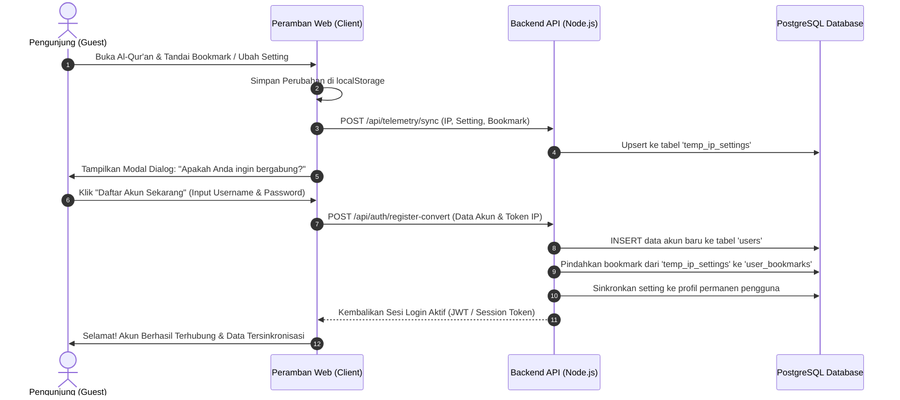

# Functional Specification Document (FSD): Aplikasi QuranWeb
## Dokumen Spesifikasi Kebutuhan Fungsional Lengkap & Standar Rekayasa Perangkat Lunak

---

### Lembar Informasi Dokumen (Document Control)

| Parameter | Keterangan |
| :--- | :--- |
| **Nama Proyek** | QuranWeb: Platform Tilawah Al-Qur'an Digital Modern Ramah Lansia |
| **Kode Dokumen** | QW-DOC-FSD-001 |
| **Versi Dokumen** | 2.2.0 (Comprehensive Release) |
| **Status Dokumen** | Disetujui & Tervalidasi Produksi (Production Ready) |
| **Tanggal Pembaruan** | 19 November 2026 |
| **Target Lingkungan** | Web Browser Modern (Desktop & Mobile), PWA Offline, Docker Container Port 3382 |
| **Basis Dokumen Rujukan** | [FSD.md](file:///c:/TEMP/VSCODE/QuranWeb/QuranWeb/Document/FSD.md), [TSD.md](file:///c:/TEMP/VSCODE/QuranWeb/QuranWeb/Document/TSD.md), [USER_MANUAL.md](file:///c:/TEMP/VSCODE/QuranWeb/QuranWeb/Document/USER_MANUAL.md), [MasterPlan.md](file:///c:/TEMP/VSCODE/QuranWeb/QuranWeb/Initial/MasterPlan.md), [MasterPlan-2.md](file:///c:/TEMP/VSCODE/QuranWeb/QuranWeb/Initial/MasterPlan-2.md), [DEV_STEP.md](file:///c:/TEMP/VSCODE/QuranWeb/QuranWeb/Initial/DEV_STEP.md), [DEV_STEP_2.md](file:///c:/TEMP/VSCODE/QuranWeb/QuranWeb/Initial/DEV_STEP_2.md), [QualityAssurance.md](file:///c:/TEMP/VSCODE/QuranWeb/QuranWeb/Initial/QualityAssurance.md) |

---

## DAFTAR ISI

- [BAB 1: PENDAHULUAN](#bab-1-pendahuluan)
  - [1.1 Latar Belakang & Rasional Proyek](#11-latar-belakang--rasional-proyek)
  - [1.2 Tujuan Dokumen FSD](#12-tujuan-dokumen-fsd)
  - [1.3 Ruang Lingkup Sistem (System Scope)](#13-ruang-lingkup-sistem-system-scope)
  - [1.4 Prinsip Desain & Filosofi Produk](#14-prinsip-desain--filosofi-produk)
  - [1.5 Definisi, Singkatan, dan Istilah (Glosarium)](#15-definisi-singkatan-dan-istilah-glosarium)
  - [1.6 Dokumen Acuan & Keterkaitan](#16-dokumen-acuan--keterkaitan)
- [BAB 2: DESKRIPSI UMUM SISTEM](#bab-2-deskripsi-umum-sistem)
  - [2.1 Perspektif Produk & Konteks Operasional](#21-perspektif-produk--konteks-operasional)
  - [2.2 Arsitektur Alur Fungsional Tingkat Tinggi](#22-arsitektur-alur-fungsional-tingkat-tinggi)
  - [2.3 Model Penyimpanan Data & Tingkatan Data Hibrida](#23-model-penyimpanan-data--tingkatan-data-hibrida)
  - [2.4 Alur Interaksi Pengguna & Konsep Guest-First ke Registered Member](#24-alur-interaksi-pengguna--konsep-guest-first-ke-registered-member)
- [BAB 3: PERAN PENGGUNA & HAK AKSES (USER ROLES & RBAC)](#bab-3-peran-pengguna--hak-akses-user-roles--rbac)
  - [3.1 Identifikasi Aktor & Persona Pengguna](#31-identifikasi-aktor--persona-pengguna)
  - [3.2 Matriks Hak Akses Peran (Role-Based Access Control)](#32-matriks-hak-akses-peran-role-based-access-control)
  - [3.3 Mekanisme Proteksi Rute & Session Guard](#33-mekanisme-proteksi-rute--session-guard)
  - [3.4 Mekanisme Quick Logout & Sesi Bersih](#34-mekanisme-quick-logout--sesi-bersih)
- [BAB 4: SPESIFIKASI KEBUTUHAN FUNGSIONAL RINCI (FR-01 s.d. FR-24)](#bab-4-spesifikasi-kebutuhan-fungsional-rinci-fr-01-sd-fr-24)
  - [4.1 Modul Navigasi & Indeks Tiga Dimensi (Surat, Juz, 'Ain) [FR-01]](#41-modul-navigasi--indeks-tiga-dimensi-surat-juz-ain-fr-01)
  - [4.2 Modul Lembar Tilawah & Pembaca Al-Qur'an (Quran Reader RTL) [FR-02]](#42-modul-lembar-tilawah--pembaca-al-quran-quran-reader-rtl-fr-02)
  - [4.3 Modul Tata Letak Adaptif, Layar Penuh Desktop & Mobile View [FR-03]](#43-modul-tata-letak-adaptif-layar-penuh-desktop--mobile-view-fr-03)
  - [4.4 Modul Last Read & Bookmark Sisi Klien (Local-First) [FR-04]](#44-modul-last-read--bookmark-sisi-klien-local-first-fr-04)
  - [4.5 Modul Preferensi Pembaca & Aksesibilitas Ramah Lansia [FR-05]](#45-modul-preferensi-pembaca--aksesibilitas-ramah-lansia-fr-05)
  - [4.6 Modul Pencarian Cepat & Filter Indeks [FR-06]](#46-modul-pencarian-cepat--filter-indeks-fr-06)
  - [4.7 Modul Jam Aktual & Jadwal Shalat Offline (Adhan.js) [FR-07]](#47-modul-jam-aktual--jadwal-shalat-offline-adhanjs-fr-07)
  - [4.8 Modul Tajwid Berwarna, Makharijul Huruf & Tanda Waqaf [FR-08]](#48-modul-tajwid-berwarna-makharijul-huruf--tanda-waqaf-fr-08)
  - [4.9 Modul Audio Recitation Murottal 5 Qari & Ayah-Sync [FR-09]](#49-modul-audio-recitation-murottal-5-qari--ayah-sync-fr-09)
  - [4.10 Modul Telemetri IP, Activity Log & Database Staging [FR-10]](#410-modul-telemetri-ip-activity-log--database-staging-fr-10)
  - [4.11 Modul Portal Administrator & Dashboard Audit Trail (/admin) [FR-11]](#411-modul-portal-administrator--dashboard-audit-trail-admin-fr-11)
  - [4.12 Modul Portal Pengguna & Dashboard Pribadi (/user) [FR-12]](#412-modul-portal-pengguna--dashboard-pribadi-user-fr-12)
  - [4.13 Modul Standarisasi Akun (RBAC) & Logout Dialog [FR-13]](#413-modul-standarisasi-akun-rbac--logout-dialog-fr-13)
  - [4.14 Modul Qashashul Anbiya' (Kisah 25 Rasulullah & Quran Linking) [FR-14]](#414-modul-qashashul-anbiya-kisah-25-rasulullah--quran-linking-fr-14)
  - [4.15 Modul Jurnal Literasi & Blog Tadabbur Qur'ani (5 Pilar Konten) [FR-15]](#415-modul-jurnal-literasi--blog-tadabbur-qurani-5-pilar-konten-fr-15)
  - [4.16 Modul Rencana Khatam Ramah Lansia (Khatam Sakinah 'Ain) [FR-16]](#416-modul-rencana-khatam-ramah-lansia-khatam-sakinah-ain-fr-16)
  - [4.17 Modul 40 Doa Rabbana, Dzikir Harian & Tasbih Haptic [FR-17]](#417-modul-40-doa-rabbana-dzikir-harian--tasbih-haptic-fr-17)
  - [4.18 Modul Kompas Arah Kiblat Adaptif (Offline Great Circle) [FR-18]](#418-modul-kompas-arah-kiblat-adaptif-offline-great-circle-fr-18)
  - [4.19 Modul Peta Masjid Terdekat (Leaflet.js + OSM + Lansia Routing) [FR-19]](#419-modul-peta-masjid-terdekat-leafletjs--osm--lansia-routing-fr-19)
  - [4.20 Modul Khazanah Ulumul Qur'an (Asbabun Nuzul, Gharib & Audio Capsule) [FR-20]](#420-modul-khazanah-ulumul-quran-asbabun-nuzul-gharib--audio-capsule-fr-20)
  - [4.21 Modul Pendaftaran Akun Jamaah Baru & Dropdown Menu Strip 3 [FR-21]](#421-modul-pendaftaran-akun-jamaah-baru--dropdown-menu-strip-3-fr-21)
  - [4.22 Modul Splash Screen Pembuka & Brand Experience [FR-22]](#422-modul-splash-screen-pembuka--brand-experience-fr-22)
  - [4.23 Modul Asmaul Husna (99 Nama Agung & Tadabbur Dalil) [FR-23]](#423-modul-asmaul-husna-99-nama-agung--tadabbur-dalil-fr-23)
  - [4.24 Modul Tasbih Digital Interaktif Card (Hitung Naik & Mundur) [FR-24]](#424-modul-tasbih-digital-interaktif-card-hitung-naik--mundur-fr-24)
- [BAB 5: SPESIFIKASI KEBUTUHAN NON-FUNGSIONAL (NON-FUNCTIONAL REQUIREMENTS)](#bab-5-spesifikasi-kebutuhan-non-fungsional-non-functional-requirements)
  - [5.1 Kinerja & Waktu Muat (Performance & Latency) [NFR-01]](#51-kinerja--waktu-muat-performance--latency-nfr-01)
  - [5.2 Ketahanan & Operasional Tanpa Jaringan (Offline-First & PWA) [NFR-02]](#52-ketahanan--operasional-tanpa-jaringan-offline-first--pwa-nfr-02)
  - [5.3 Tipografi, Skalabilitas & Standar Teks Arab (RTL & Harakat Rendering) [NFR-03]](#53-tipografi-skalabilitas--standar-teks-arab-rtl--harakat-rendering-nfr-03)
  - [5.4 Aksesibilitas Universal & Kepatuhan Lansia (WCAG 2.1 AA) [NFR-04]](#54-aksesibilitas-universal--kepatuhan-lansia-wcag-21-aa-nfr-04)
  - [5.5 Privasi, Keamanan Data & Etika Pengguna [NFR-05]](#55-privasi-keamanan-data--etika-pengguna-nfr-05)
  - [5.6 Portabilitas, Kontainerisasi & Infrastruktur [NFR-06]](#56-portabilitas-kontainerisasi--infrastruktur-nfr-06)
- [BAB 6: SKEMA ARSITEKTUR DATA & INTEGRASI LOGIKAL](#bab-6-skema-arsitektur-data--integrasi-logikal)
  - [6.1 Pemodelan Entitas Database Relasional PostgreSQL](#61-pemodelan-entitas-database-relasional-postgresql)
  - [6.2 Struktur Penyimpanan Sisi Klien (localStorage & Cache API)](#62-struktur-penyimpanan-sisi-klien-localstorage--cache-api)
  - [6.3 Alur Migrasi Data Staging IP ke Akun Permanen](#63-alur-migrasi-data-staging-ip-ke-akun-permanen)
- [BAB 7: BATASAN, ASUMSI, DAN KETERGANTUNGAN SISTEM](#bab-7-batasan-asumsi-dan-ketergantungan-sistem)
  - [7.1 Batasan Sistem (System Constraints)](#71-batasan-sistem-system-constraints)
  - [7.2 Asumsi Desain (Assumptions)](#72-asumsi-desain-assumptions)
  - [7.3 Ketergantungan Eksternal (External Dependencies)](#73-ketergantungan-eksternal-external-dependencies)
- [BAB 8: MATRIKS KETERLACAKAN KEBUTUHAN & PENGUJIAN](#bab-8-matriks-keterlacakan-kebutuhan--pengujian)
  - [8.1 Pemetaan FR ke Tahapan Eksekusi DEV_STEP & DEV_STEP_2](#81-pemetaan-fr-ke-tahapan-eksekusi-dev_step--dev_step_2)
  - [8.2 Pemetaan FR ke Skenario Pengujian Mutu (QA Test Cases)](#82-pemetaan-fr-ke-skenario-pengujian-mutu-qa-test-cases)
- [BAB 9: REFERENSI BERSUMBER LENGKAP & TAUTAN DOKUMEN PROYEK](#bab-9-referensi-bersumber-lengkap--tautan-dokumen-proyek)

---

## BAB 1: PENDAHULUAN

### 1.1 Latar Belakang & Rasional Proyek
Kebutuhan umat Islam terhadap Al-Qur'an digital di era web modern kian meningkat. Namun, sebagian besar aplikasi yang beredar saat ini memiliki kendala krusial:
1. Memaksa proses registrasi/login yang rumit di awal sebelum pengguna dapat membaca ayat.
2. Dipenuhi iklan pop-up komersial yang mengaburkan konsentrasi tilawah.
3. Tipografi teks Arab berukuran kaku, harakat bertumpuk (*overlapping diacritics*), dan jarak baris yang sempit sehingga menyulitkan pembaca lanjut usia (lansia) atau pembaca pemula.
4. Terbatas hanya pada indeks Surat dan Juz, tanpa menyertakan navigasi tematik berbasis **'Ain (Ruku')** yang merepresentasikan satu kesatuan makna bahasan dalam Al-Qur'an.
5. Bergantung 100% pada sambungan internet stabil sehingga gagal berfungsi di wilayah minim sinyal.

**QuranWeb** hadir sebagai platform web Al-Qur'an modern yang mengusung prinsip kesederhanaan, kecepatan, keterbacaan tinggi, dan ketahanan *offline* penuh.

### 1.2 Tujuan Dokumen FSD
Dokumen Spesifikasi Kebutuhan Fungsional (*Functional Specification Document* - FSD) ini bertujuan untuk:
- Mendefinisikan secara formal seluruh kapabilitas, perilaku fungsional, aturan bisnis, dan antarmuka sistem yang telah dirancang dan diimplementasikan.
- Berperan sebagai tolok ukur acuan verifikasi mutu antara tim pengembang, penguji mutu (*Quality Assurance*), dan pemangku kepentingan.
- Menjadi panduan operasional integrasi sistem dari lapisan antarmuka pengguna (*frontend*), lapisan *state storage* lokal, hingga basis data PostgreSQL di sisi server.

### 1.3 Ruang Lingkup Sistem (System Scope)
Ruang lingkup aplikasi QuranWeb meliputi:
- **Modul Tilawah Inti:** Pembaca Al-Qur'an 30 Juz, 114 Surat, dan 556 'Ain lengkap dengan terjemahan standar Kemenag RI, tajwid berwarna, audio murottal 5 qari ternama, bookmark lokal, dan riwayat bacaan terakhir (*last read*).
- **Aksesibilitas Universal Ramah Lansia:** Fitur 1-klik *Elder Mode*, pembesaran font Arab proporsional (hingga 52px), *line-height* ekstra longgar, 4 tema warna kontras (Light, Dark/Inverse, High-Contrast OLED, Sepia Mushaf), dan *Zen Mode* layar penuh desktop.
- **Modul Waktu Shalat & Kompas Kiblat:** Jam aktual dan kalkulasi jadwal shalat offline menggunakan *Adhan.js*, kompas arah kiblat speris *Great Circle* luring dengan akselerometer pada ponsel pintar dan azimuth pada desktop.
- **Modul Edukasi & Khazanah Qur'ani:** Katalog Kisah 25 Nabi (*Qashashul Anbiya'*) bertaut silang dua arah ke ayat mushaf, 40 Doa Rabbana, Dzikir Harian, Tasbih Getar Layar Penuh (*Haptic Tasbih*), Jurnal Literasi 5 Pilar, Asbabun Nuzul (*Lubabun Nuqul* & *Al-Wahidi*), Glosarium Mufradat Sukar (*Gharibul Qur'an*), dan Audio Capsule Tadabbur 3 Menit.
- **Modul Peta Masjid Terdekat:** Pencarian lokasi masjid dengan peta interaktif Leaflet.js & OpenStreetMap (OSM) tanpa API berbayar, filter fasilitas khusus lansia, dan estimasi waktu jalan kaki santai.
- **Arsitektur Hibrida & Backend:** Dukungan PWA offline mandiri (*Service Worker Cache API*), pencatatan telemetri IP (*visitor_logs*, *activity_logs*), staging konfigurasi per IP (*temp_ip_settings*), serta portal RBAC multi-peran (`/admin` dan `/user`).

### 1.4 Prinsip Desain & Filosofi Produk
1. **Guest-First & Zero Friction:** Pengunjung publik dapat langsung membaca Al-Qur'an detik pertama membuka aplikasi tanpa wajib login atau mengisi data pribadi apa pun.
2. **Elder-Friendly by Default:** Ukuran elemen interaksi (tombol/chip) memiliki target sentuh minimal 44x44 piksel, teks berharakat terbaca tajam, dan antarmuka bebas efek animasi berlebih yang memusingkan.
3. **Offline-First Resilience:** Seluruh teks ayat, indeks meta, terjemahan, dan logika perhitungan shalat/kiblat berjalan 100% mandiri di peramban tanpa internet.
4. **Zen Mode / Zero Distraction:** Menghilangkan seluruh bilah navigasi dan ornamen non-esensial saat pengguna ingin khusyuk membaca.

### 1.5 Definisi, Singkatan, dan Istilah (Glosarium)
| Istilah | Definisi |
| :--- | :--- |
| **'Ain (Ruku')** | Tanda perhentian tematik dalam mushaf Al-Qur'an (disimbolkan huruf **ع**) yang menandai satu pokok bahasan utuh (berjumlah 556 'Ain). |
| **Kemenag RI** | Kementerian Agama Republik Indonesia, penyedia standar terjemahan resmi Bahasa Indonesia. |
| **PWA** | *Progressive Web App*, teknologi peramban yang memungkinkan aplikasi web diinstal ke perangkat dan berjalan saat luring. |
| **RBAC** | *Role-Based Access Control*, pembagian wewenang sistem berdasarkan hierarki peran pengguna. |
| **RTL** | *Right-To-Left*, arah penulisan teks dari kanan ke kiri untuk aksara Arab. |
| **Tajwid** | Kaidah hukum pelafalan dan pemanjangan huruf dalam membaca Al-Qur'an. |
| **Zen Mode** | Mode membaca layar penuh murni tanpa header, sidebar, atau kontrol yang mengganggu. |
| **Haptic Feedback** | Umpan balik getaran fisik pada perangkat bergerak melalui peramban Web API (`navigator.vibrate`). |

### 1.6 Dokumen Acuan & Keterkaitan
Dokumen FSD ini bersumber dan memiliki keterkaitan erat dengan berkas dokumentasi proyek berikut:
- [FSD.md](file:///c:/TEMP/VSCODE/QuranWeb/QuranWeb/Document/FSD.md) - Dokumen Fungsional Ringkas.
- [TSD.md](file:///c:/TEMP/VSCODE/QuranWeb/QuranWeb/Document/TSD.md) - Dokumen Spesifikasi Teknis, Skema DDL Database, dan Struktur Kode.
- [USER_MANUAL.md](file:///c:/TEMP/VSCODE/QuranWeb/QuranWeb/Document/USER_MANUAL.md) - Panduan Operasional Pengguna Lengkap.
- [MasterPlan.md](file:///c:/TEMP/VSCODE/QuranWeb/QuranWeb/Initial/MasterPlan.md) - Cetak Biru Arsitektur Fase 1 (Step 1 s.d. Step 8).
- [MasterPlan-2.md](file:///c:/TEMP/VSCODE/QuranWeb/QuranWeb/Initial/MasterPlan-2.md) - Perluasan Ekosistem & Brainstorming Fitur Fase 2 (Step 9 s.d. Step 16).
- [DEV_STEP.md](file:///c:/TEMP/VSCODE/QuranWeb/QuranWeb/Initial/DEV_STEP.md) - Rencana & Realisasi Langkah Implementasi Teknis Fase 1.
- [DEV_STEP_2.md](file:///c:/TEMP/VSCODE/QuranWeb/QuranWeb/Initial/DEV_STEP_2.md) - Rencana & Realisasi Langkah Implementasi Teknis Fase 2.
- [QualityAssurance.md](file:///c:/TEMP/VSCODE/QuranWeb/QuranWeb/Initial/QualityAssurance.md) - Laporan Matriks Uji Mutu & Verifikasi Kode.
- [Dockerfile](file:///c:/TEMP/VSCODE/QuranWeb/QuranWeb/Dockerfile) & [docker-compose.yml](file:///c:/TEMP/VSCODE/QuranWeb/QuranWeb/docker-compose.yml) - Konfigurasi Kontainerisasi Multi-Service Nginx & PostgreSQL.

---

## BAB 2: DESKRIPSI UMUM SISTEM

### 2.1 Perspektif Produk & Konteks Operasional
QuranWeb dirancang sebagai aplikasi peramban web modern (*Single Page Application*) yang menggabungkan keunggulan komputasi sisi klien (*Client-Side Compute*) dengan ketahanan penyimpanan lokal (*Offline Storage*) dan pencatatan telemetri server PostgreSQL. 

Aplikasi beroperasi secara terisolasi di dalam kontainer Docker pada port `3382`. Seluruh data mushaf di-*bundle* sebagai aset statis JSON lokal yang diakses seketika tanpa jeda API jaringan.

### 2.2 Arsitektur Alur Fungsional Tingkat Tinggi

```text
+-----------------------------------------------------------------------------------+
|                            LAPISAN PENGGUNA (BROWSER)                             |
|                                                                                   |
|  +--------------------+   +-----------------------+   +------------------------+  |
|  |  Mode Tamu (Guest) |   | Anggota (/user)       |   | Administrator (/admin) |  |
|  |  - Baca Al-Qur'an  |   | - Sinkronisasi Cloud  |   | - Audit Trail Chart.js |  |
|  |  - 4 Tema & Lansia |   | - Card Bookmark       |   | - Telemetri Kunjungan  |  |
|  |  - Audio Murottal  |   | - Arsip Pencarian     |   | - Identitas Situs CMS  |  |
|  |  - Shalat & Kiblat |   | - Khatam Planner 'Ain |   | - CMS Blog & Buletin   |  |
|  +---------+----------+   +-----------+-----------+   +-----------+------------+  |
|            |                          |                           |               |
|            +--------------------------+---------------------------+               |
|                                       |                                           |
|                     +-----------------v-----------------+                         |
|                     |     State Manager & Controller    |                         |
|                     | - localStorage (Pengaturan Klien) |                         |
|                     | - Service Worker (Cache API PWA)  |                         |
|                     +-----------------+-----------------+                         |
+---------------------------------------|-------------------------------------------+
                                        | HTTP / JSON API
                                        | (Endpoints: /api/telemetry, /api/auth)
+---------------------------------------v-------------------------------------------+
|                          BACKEND & DATABASE SERVER                                |
|                                                                                   |
|  +-----------------------------------------------------------------------------+  |
|  | Server API Node.js (Express Service, Port 4000)                              |  |
|  | - Parser IP & User-Agent, Session Guard Token, Sanitizer Payload            |  |
|  +-------------------------------------+---------------------------------------+  |
|                                        | Pool Koneksi 'pg'                        |
|  +-------------------------------------v---------------------------------------+  |
|  | Database PostgreSQL 16 (Port 5432 / Host 5572)                              |  |
|  | - visitor_logs (Catatan Kunjungan IP & Waktu)                               |  |
|  | - activity_logs (Catatan Interaksi & Pengubahan Konfigurasi)                |  |
|  | - temp_ip_settings (Staging Isolasi Preferensi Tamu Bebas Benturan)          |  |
|  | - users (Kredensial Multi-Peran: admin, asatidz, editor, user)              |  |
|  | - app_configurations (Dinamis: Nama Situs, Logo, Copyright, Pengumuman)     |  |
|  | - user_saved_searches & user_bookmarks (Sinkronisasi Data Anggota)          |  |
|  | - blog_articles & nearby_mosques_cache (Data Khazanah & Geografis)          |  |
|  +-----------------------------------------------------------------------------+  |
+-----------------------------------------------------------------------------------+
```

### 2.3 Model Penyimpanan Data & Tingkatan Data Hibrida
Aplikasi menerapkan paradigma penyimpanan hibrida bertingkat:
1. **Tingkat 1 - Klien Lokal Instan (`localStorage`):**
   Digunakan untuk menyimpan preferensi pembaca (tema, ukuran font, jenis font, mode lansia, status terjemahan, penanda tajwid), riwayat ayat terakhir dibaca (*Last Read*), dan daftar bookmark lokal. Membaca dan menulis ke penyimpanan ini bebas dari latensi jaringan (0 ms).
2. **Tingkat 2 - Cache Aset Offline (`IndexedDB` / Cache API Service Worker):**
   Digunakan untuk menyimpan berkas statis `meta.json`, 114 berkas `surahs/{id}.json`, font Arab `.woff2`, serta data statis nabi, doa, blog, dan khazanah ulumul Qur'an.
3. **Tingkat 3 - Database Server Relasional (PostgreSQL):**
   Digunakan untuk menyimpan data telemetri, audit trail interaktif, tabel staging preferensi sementara per IP (`temp_ip_settings`), otentikasi akun pengguna (`users`), dan konfigurasi dinamis aplikasi (`app_configurations`).

### 2.4 Alur Interaksi Pengguna & Konsep Guest-First ke Registered Member
- Pengguna umum membuka alamat web aplikasi dan langsung disajikan antarmuka pembaca Al-Qur'an tanpa penghalang (*zero barrier*).
- Secara otomatis di latar belakang, peramban mengirimkan sinyal telemetri ringan ke server untuk mencatat IP dan menginisialisasi baris data di `temp_ip_settings`.
- Apabila pengguna melakukan tindakan penyimpanan (misalnya: menandai bookmark baru atau mengubah pengaturan tampilan), sistem menyimpan perubahan tersebut ke `localStorage` dan mengirimkan sinkronisasi ke tabel staging `temp_ip_settings`.
- Pada saat bersamaan, sistem menampilkan modal dialog ramah:
  > *"Apakah Anda ingin bergabung dengan kami? Bergabunglah bersama komunitas jamaah QuranWeb untuk menyinkronkan bacaan antar perangkat."*
- Pengguna berhak menolak dialog tersebut dengan menekan *"Lanjut sebagai Tamu"* tanpa kehilangan preferensi bacaannya, atau menekan *"Daftar Sekarang"* untuk mengonversi data staging lokal menjadi akun permanen di tabel `users`.

---

## BAB 3: PERAN PENGGUNA & HAK AKSES (USER ROLES & RBAC)

### 3.1 Identifikasi Aktor & Persona Pengguna
Sistem mengakomodasi 5 kategori aktor pengguna:

1. **Pengunjung Publik (Guest User):**
   Masyarakat umum, pembaca pemula, atau lansia yang ingin membaca Al-Qur'an secara instan di perangkat mereka tanpa proses login.
2. **Jamaah Terdaftar (Registered Member - `/user`):**
   Pengguna terdaftar (Kredensial Demo: `fulan` / `user123`) yang memanfaatkan fitur sinkronisasi cloud, kartu bookmark personal, arsip kata kunci pencarian, rencana khatam tematik 'Ain, 40 Doa Rabbana, dan peta masjid terdekat.
3. **Editor Redaksi (Content Editor):**
   Petugas redaksi (Kredensial Demo: `editor` / `editor123`) yang mengelola artikel literasi, kajian tadabbur, dan draf tulisan di portal CMS blog.
4. **Dewan Asatidz (Religious Scholar / Validator):**
   Dewan asatidz (Kredensial Demo: `asatidz` / `asatidz123`) yang berwenang memvalidasi naskah artikel, memeriksa kesahihan riwayat Asbabun Nuzul, serta meninjau rujukan doa dan tafsir.
5. **Super Administrator (`/admin`):**
   Pengelola teknis tertinggi sistem (Kredensial Demo: `admin` / `admin123`) yang memiliki kontrol penuh terhadap dashboard metrik statistik, visualisasi grafik audit trail, konfigurasi global identitas situs, manajemen buletin email, dan pemeliharaan basis data.

### 3.2 Matriks Hak Akses Peran (Role-Based Access Control)

| Modul / Fitur Sistem | Guest User | Registered User (`/user`) | Editor Redaksi | Dewan Asatidz | Super Admin (`/admin`) |
| :--- | :---: | :---: | :---: | :---: | :---: |
| Membaca Al-Qur'an (Surat/Juz/'Ain) | **Ya** | **Ya** | **Ya** | **Ya** | **Ya** |
| Pengaturan Tampilan & Mode Lansia | **Ya (Lokal)** | **Ya (Cloud)** | **Ya (Cloud)** | **Ya (Cloud)** | **Ya (Cloud)** |
| Pemutar Audio Murottal 5 Qari | **Ya** | **Ya** | **Ya** | **Ya** | **Ya** |
| Tajwid Berwarna & Makhraj Huruf | **Ya** | **Ya** | **Ya** | **Ya** | **Ya** |
| Waktu Shalat & Kompas Kiblat | **Ya** | **Ya** | **Ya** | **Ya** | **Ya** |
| Katalog Kisah 25 Nabi (`/kisah`) | **Ya** | **Ya** | **Ya** | **Ya** | **Ya** |
| Membaca Jurnal Blog (`/blog`) | **Ya** | **Ya** | **Ya** | **Ya** | **Ya** |
| Rencana Khatam Sakinah 'Ain | Tidak (Dicegat) | **Ya** | **Ya** | **Ya** | **Ya** |
| 40 Doa Rabbana & Tasbih Haptic | Tidak (Dicegat) | **Ya** | **Ya** | **Ya** | **Ya** |
| Peta Navigasi Masjid (`/masjid`) | Tidak (Dicegat) | **Ya** | **Ya** | **Ya** | **Ya** |
| Dashboard Pengguna Pribadi (`/user`) | Tidak | **Ya** | **Ya** | **Ya** | **Ya** |
| Manajemen Draf Artikel CMS Blog | Tidak | Tidak | **Ya** | **Ya** | **Ya** |
| Validasi Konten & Rujukan Tafsir | Tidak | Tidak | Tidak | **Ya** | **Ya** |
| Dashboard Audit Trail & Chart.js | Tidak | Tidak | Tidak | Tidak | **Ya** |
| Pengaturan Identitas & Logo Situs | Tidak | Tidak | Tidak | Tidak | **Ya** |
| Pengaturan SMTP & Pengiriman Email | Tidak | Tidak | Tidak | Tidak | **Ya** |

### 3.3 Mekanisme Proteksi Rute & Session Guard
Sistem menerapkan pengamanan sesi (*Session Guard*) pada sisi routing aplikasi:
- **Rute Publik Terbuka:** `/`, `/kisah`, `/blog`. Bebas diakses oleh siapa saja.
- **Rute Terproteksi Khusus Akun:** `/user`, `/doa`, `/masjid`, dan modul Rencana Khatam Sakinah. Apabila aktor *Guest User* mencoba mengakses rute atau mengklik menu ini, sistem mencegat perpindahan rute dan memunculkan modal ajakan pendaftaran `JoinPromptModal.tsx`.
- **Rute Terproteksi Khusus Manajemen:** `/admin`. Wajib melalui form autentikasi kredensial password terenkripsi.

### 3.4 Mekanisme Quick Logout & Sesi Bersih
- Pada saat pengguna memiliki sesi aktif (login), tombol keluar akun (*Quick Logout*) berbentuk ikon berwarna merah disematkan pada sudut kanan atas Header navigasi tilawah.
- Mengklik tombol tersebut memicu munculnya modal konfirmasi santun (`LogoutConfirmModal.tsx`) yang menyapa nama pengguna dan menyertakan doa perpisahan.
- Mengonfirmasi logout akan membersihkan sesi akun dari `localStorage` secara instan tanpa melakukan *full-reload* halaman, sehingga posisi ayat yang sedang dibaca pengguna tetap utuh tanpa berpindah.

---

## BAB 4: SPESIFIKASI KEBUTUHAN FUNGSIONAL RINCI (FR-01 s.d. FR-24)

### 4.1 Modul Navigasi & Indeks Tiga Dimensi (Surat, Juz, 'Ain) [FR-01]
- **Tujuan Modul:** Memfasilitasi pengguna dalam menemukan dan membuka ayat Al-Qur'an berdasarkan tiga perspektif klasifikasi Islam: Surat, Juz, dan 'Ain (Ruku' tematik).
- **Rincian Spesifikasi:**
  - **FR-01.1:** Sistem menyediakan bilah tab navigasi 3 opsi: **Surat (114)**, **Juz (30)**, dan **'Ain (556)**.
  - **FR-01.2 (Tab Surat):** Menampilkan daftar 114 surat berisi: nomor urut surat, nama Arab (khat kaligrafi), nama Latin resmi, arti nama dalam Bahasa Indonesia, jumlah ayat, serta klasifikasi turunnya wahyu (Makkiyah / Madaniyah).
  - **FR-01.3 (Tab Juz):** Menampilkan daftar 30 juz lengkap dengan nomor juz, nama awal potongan ayat juz, serta rentang surat dan ayat awal hingga surat dan ayat akhir pada juz tersebut.
  - **FR-01.4 (Tab 'Ain / Ruku'):** Menampilkan daftar 556 kelompok 'Ain tematik berurutan, lengkap dengan nomor urut 'Ain global (1–556), nomor urut 'Ain internal di dalam surat, nama surat, serta rentang ayat yang tercakup dalam tema bahasan tersebut.
  - **FR-01.5 (Aksi Pemilihan):** Mengklik salah satu entitas indeks (Surat, Juz, atau 'Ain) memicu sistem untuk langsung memuat data terkait dan menggulirkan (*scrolling*) layar lembar baca ke posisi ayat pertama bagian tersebut secara halus (*smooth scroll*).
- **Spesifikasi I/O & Aturan Bisnis:**
  - *Input:* Klik mouse atau ketukan jari pada salah satu item daftar indeks.
  - *Process:* Query dataset memori `meta.json`, identifikasi `surahId` dan `ayahNumber`, muat berkas `surahs/{surahId}.json` jika belum ada di memori, emit event perpindahan posisi baca.
  - *Output:* Tampilan lembar tilawah berpindah ke posisi ayat target dengan indikator aktif yang jelas.

### 4.2 Modul Lembar Tilawah & Pembaca Al-Qur'an (Quran Reader RTL) [FR-02]
- **Tujuan Modul:** Menyajikan teks kalam Ilahi secara agung, presisi, berharakat sempurna, serta nyaman dibaca dalam berbagai kondisi pencahayaan dan perangkat.
- **Rincian Spesifikasi:**
  - **FR-02.1 (Tata Arah RTL & Tipografi):** Teks Arab disajikan dengan arah penulisan kanan-ke-kiri (`direction: rtl`) menggunakan font pilihan berstandar Mushaf Standar Indonesia atau Utsmani (Amiri Quran, Amiri, Scheherazade New, atau LPMQ) dengan harakat yang tidak saling menindih (*no diacritical collision*).
  - **FR-02.2 (Penanda Ayat):** Setiap ujung ayat dilengkapi ornamen lingkaran medali nomor ayat khas mushaf berangka Latin atau Arab timur yang terbaca tajam.
  - **FR-02.3 (Pemisah Visual Batas Juz & 'Ain):**
    - Pada awal pergantian Juz, sistem menyisipkan spanduk pemisah megah (*JuzDivider*) bertuliskan nomor Juz dan basmalah.
    - Pada akhir suatu kelompok 'Ain, sistem menyisipkan lencana pembatas tematik (*AinDivider*) dengan simbol huruf **ع** emas, nomor 'Ain global, dan nomor ruku' internal surat.
  - **FR-02.4 (Dua Mode Tampilan: Terjemahan vs Mushaf Murni):**
    - *Mode Terjemahan (Default):* Menampilkan teks ayat Arab berukuran proporsional, diikuti teks terjemahan resmi Kemenag RI di bawahnya.
    - *Mode Mushaf / Fokus:* Menyembunyikan seluruh baris terjemahan, hanya menampilkan teks Arab murni berformat renggang untuk kenyamanan tadarus dan hafalan (*tahfidz*).
  - **FR-02.5 (Navigasi Berkelanjutan Antar-Bagian):** Di bagian bawah lembar tilawah disediakan tombol *"Bagian Sebelumnya"* dan *"Bagian Berikutnya"* untuk berpindah ke Surat, Juz, atau 'Ain berikutnya tanpa perlu kembali ke menu utama.

### 4.3 Modul Tata Letak Adaptif, Layar Penuh Desktop & Mobile View [FR-03]
- **Tujuan Modul:** Menyediakan pengalaman antarmuka yang optimal bagi layar monitor komputer meja (Desktop) maupun perangkat genggam pintar (Mobile).
- **Rincian Spesifikasi:**
  - **FR-03.1 (Tata Letak Desktop Layar Lebar):**
    - Sistem menerapkan tata letak panel ganda (*split-screen view*): bilah panel navigasi di sebelah kiri (lebar ~320px–380px) dan area tilawah di sebelah kanan.
    - Tersedia tombol **Layar Penuh (*Fullscreen Zen Mode*)** yang mengaktifkan *HTML5 Fullscreen API*, menyembunyikan panel samping, header aplikasi, dan widget jam/shalat sehingga 100% bidang layar hanya memuat lembar tilawah.
    - Pengguna dapat keluar dari mode layar penuh kapan saja menggunakan tombol keluar atau menekan tombol keyboard `Esc`.
  - **FR-03.2 (Tata Letak Mobile Device):**
    - Pada resolusi layar di bawah 768px, sistem otomatis beralih ke tata letak satu kolom responsif yang proporsional (*zero horizontal scrolling*).
    - Tipografi menyesuaikan lebar layar secara dinamis (*fluid scaling*).
    - Navigasi utama diakses melalui bilah bawah (*Bottom Navigation Bar*) yang ergonomis untuk pengoperasian satu tangan.

### 4.4 Modul Last Read & Bookmark Sisi Klien (Local-First) [FR-04]
- **Tujuan Modul:** Memastikan pembaca dapat langsung melanjutkan bacaan terakhirnya kapan saja tanpa risiko kehilangan jejak tilawah.
- **Rincian Spesifikasi:**
  - **FR-04.1 (Simpan Otomatis & Manual Terakhir Dibaca):** Sistem secara otomatis memperbarui penanda posisi ayat yang sedang dibaca ke `localStorage` (mencakup nomor surat, ayat, juz, 'Ain, dan stempel waktu) saat pengguna menggulir layar, atau saat pengguna mengklik ikon *"Tandai Terakhir Dibaca"*.
  - **FR-04.2 (Pintasan Lanjutkan Bacaan):** Di halaman beranda dan bilah navigasi, sistem menyajikan kartu pintasan dinamis: *"Lanjutkan Membaca: [Nama Surat] Ayat [X]"* yang bila diklik akan membuka dan men-scroll langsung ke ayat tersebut.
  - **FR-04.3 (Pengelolaan Bookmark Ayat):** Pengguna dapat menandai ayat-ayat pilihan dengan mengklik ikon bintang/markah pada kartu ayat, menyertakan catatan tadabbur pribadi, serta melihat daftar bookmark tersimpan pada panel laci.
  - **FR-04.4 (Tautan Berbagi / Share Link):** Pengguna dapat menyalin tautan langsung (*deep-link URL*) spesifik menuju nomor surat dan ayat tertentu untuk dibagikan melalui aplikasi perpesanan.

### 4.5 Modul Preferensi Pembaca & Aksesibilitas Ramah Lansia [FR-05]
- **Tujuan Modul:** Menjamin keterbacaan tingkat tinggi bagi seluruh kalangan usia, khususnya pembaca lansia dan pengguna dengan keterbatasan visual.
- **Rincian Spesifikasi:**
  - **FR-05.1 (1-Klik Mode Lansia / Elder Mode):** Sistem menyediakan saklar instan *Mode Lansia* yang dengan sekali klik langsung mengonfigurasi ukuran font Arab menjadi ekstra besar (38px–44px), memperbesar font terjemahan (20px), mengatur jarak baris (*line-height*) longgar (2.4x), mengaktifkan kontras tinggi, dan memperbesar seluruh kontrol tombol navigasi hingga ≥48px.
  - **FR-05.2 (Pilihan 4 Tema Visual):**
    - *Light:* Latar putih bersih dengan teks arang gelap untuk penggunaan siang hari.
    - *Dark (Inverse):* Latar abu-abu gelap dengan teks putih lembut untuk mengurangi kelelahan mata di malam hari.
    - *High-Contrast (OLED):* Latar hitam pekat `#000000` dengan teks kuning keemasan kontras tinggi berstandar WCAG AAA.
    - *Sepia Mushaf:* Latar krem hangat bernuansa kertas mushaf klasik yang menenangkan mata.
  - **FR-05.3 (Kustomisasi Tipografi & Jarak Baris):** Penggeser mandiri untuk ukuran huruf Arab (20px s.d. 52px), ukuran terjemahan (14px s.d. 26px), serta jarak antar-baris (2.0x s.d. 2.8x) tanpa merusak kerapian tata letak.
  - **FR-05.4 (Fitur Ayat Spotlight & Auto-Scroll):**
    - *Ayat Spotlight:* Menyorot kartu ayat yang aktif dibaca dengan bingkai menyala lembut dan meredupkan ayat di sekelilingnya agar mata lansia tidak melompat baris.
    - *Auto-Scroll:* Fitur pengguliran layar otomatis secara perlahan dengan opsi kecepatan yang dapat diatur untuk membaca santai tanpa perlu menyentuh layar.
  - **FR-05.5 (Pintasan Tombol Papan Ketik Desktop):** Dukungan tombol `F` (Fullscreen), `+`/`-` (Ubah ukuran font), dan tombol panah kiri/kanan (Pindah surat/ayat).

### 4.6 Modul Pencarian Cepat & Filter Indeks [FR-06]
- **Tujuan Modul:** Menemukan surat, juz, 'Ain, atau ayat tertentu dalam hitungan milidetik.
- **Rincian Spesifikasi:**
  - **FR-06.1:** Kotak pencarian cerdas di bilah atas yang menyaring daftar 114 surat secara *real-time* berdasarkan pengetikan nama Latin (misal: "Kahf", "Baqarah"), nomor surat, atau nama Arab.
  - **FR-06.2:** Pencarian langsung nomor Juz (ketik angka "1" s.d. "30") atau nomor 'Ain (ketik angka "1" s.d. "556").
  - **FR-06.3:** Fitur penelusuran kata kunci terjemahan Bahasa Indonesia untuk menemukan ayat bertema khusus (misal: "sabar", "ibu bapak", "kiamat").

### 4.7 Modul Jam Aktual & Jadwal Shalat Offline (Adhan.js) [FR-07]
- **Tujuan Modul:** Menyajikan informasi waktu ibadah shalat wajib yang akurat tanpa bergantung pada koneksi internet.
- **Rincian Spesifikasi:**
  - **FR-07.1:** Menampilkan jam digital aktual (*real-time clock*) beserta kalender hari dan tanggal Masehi/Hijriyah pada bilah navigasi atas.
  - **FR-07.2:** Menampilkan widget jadwal 5 waktu shalat fardhu (Subuh, Dzuhur, Ashar, Maghrib, Isya) plus waktu Terbit (*Syuruq*) dan hitung mundur (*countdown*) menuju waktu shalat berikutnya.
  - **FR-07.3:** Perhitungan jadwal shalat berjalan 100% luring menggunakan algoritma astronomis pustaka `Adhan.js` dengan standar hisab resmi **Kementerian Agama Republik Indonesia (Kemenag RI)**.
  - **FR-07.4:** Lokasi koordinat lintang/bujur pengguna dapat diperoleh melalui izin GPS peramban secara sukarela atau memilih daftar kota besar di Indonesia secara manual tanpa popup izin yang mengganggu.
  - **FR-07.5:** Widget jam dan jadwal shalat otomatis disembunyikan saat *Zen Mode* aktif demi konsentrasi tilawah.

### 4.8 Modul Tajwid Berwarna, Makharijul Huruf & Tanda Waqaf [FR-08]
- **Tujuan Modul:** Memberikan panduan praktis hukum bacaan tajwid bagi pemula dan lansia langsung pada teks Al-Qur'an.
- **Rincian Spesifikasi:**
  - **FR-08.1 (Saklar Cepat Tajwid Berwarna):** Tombol saklar di bilah baca untuk mengaktifkan atau menonaktifkan kode warna hukum tajwid pada teks ayat seketika.
  - **FR-08.2 (Otomatisasi Nonaktif pada Mode Kontras Tinggi):** Apabila pengguna mengaktifkan mode *High-Contrast* atau *Mode Lansia*, sistem secara cerdas menonaktifkan pewarnaan tajwid agar warna-warni tidak mengaburkan keterbacaan huruf.
  - **FR-08.3 (Modal Legenda Tajwid 11 Kaidah):** Dialog interaktif 3 tab yang menjelaskan 11 hukum tajwid utama (Ghunnah, Ikhfa Haqiqi, Idgham Bighunnah, Idgham Bilaghunnah, Iqlab, Qalqalah, Mad Wajib/Jaiz, Mad Thabi'i, Alif Lam Syamsiyyah/Qamariyyah) lengkap dengan kode warna, jumlah harakat, cara membaca, dan contoh ayatnya.
  - **FR-08.4 (Panduan Makhraj Huruf & Tanda Waqaf):**
    - Tab panduan 5 daerah keluarnya huruf hijaiyah (*Al-Jauf, Al-Halq, Al-Lisan, Asy-Syafatan, Al-Khaisyum*).
    - Tab penjelasan 7 tanda waqaf mushaf (*Waqaf Lazim م, Ja'iz ج, Waqaf Aula قلى, Washal Aula صلى, Laa Wakfa Fiih لا, Mu'anaqah ∴, dan Saktah سا*).

### 4.9 Modul Audio Recitation Murottal 5 Qari & Ayah-Sync [FR-09]
- **Tujuan Modul:** Memfasilitasi pengguna untuk mendengarkan pelafalan Al-Qur'an yang fasih dan tartil dari para ulama qari terkemuka.
- **Rincian Spesifikasi:**
  - **FR-09.1 (Pilihan 5 Qari Mu'tabar):** Pengguna dapat memilih audio murottal dari 5 qari bertaraf internasional:
    1. Syaikh Mishary Rashid Alafasy
    2. Syaikh Mahmoud Khalil Al-Husary (Tartil Murattal Guru)
    3. Syaikh Muhammad Siddiq Al-Minshawi
    4. Syaikh Abdurrahman As-Sudais (Imam Masjidil Haram)
    5. Syaikh Abu Bakr Asy-Syathiri
  - **FR-09.2 (Ayah-Sync Highlight & Auto-Scroll):** Selama lantunan audio ayat diputar, sistem otomatis memberikan efek highlight latar belakang pada kartu ayat yang sedang berbunyi dan menggulirkan posisi layar secara presisi mengikuti bacaan.
  - **FR-09.3 (Pengatur Kecepatan Putar Ramah Belajar):** Opsi tempo audio: `0.75x` (lambat untuk lansia/pemula menyimak makhraj), `1.0x` (normal), `1.25x`, dan `1.5x` (cepat untuk tadarus mandiri).
  - **FR-09.4 (Mini Player Mengambang):** Pemutar audio ringkas di bagian bawah layar yang dilengkapi indikator judul surat/ayat, penggeser linimasa waktu (*scrubber* `mm:ss`), kontrol volume, dan tombol jeda/putar.
  - **FR-09.5 (Pemutaran Berkelanjutan Surat / 'Ain):** Tombol pada header lembar baca untuk memutar seluruh ayat dalam surat atau 'Ain yang sedang dibuka secara bersambung tanpa henti.
  - **FR-09.6 (Mode Pengulangan Audio / Repeat):** Pilihan mode putar: *Putar 1 Kali*, *Ulang Ayat Aktif* (sangat berguna untuk tahfidz Al-Qur'an), dan *Lanjut Berurutan*.

### 4.10 Modul Telemetri IP, Activity Log & Database Staging [FR-10]
- **Tujuan Modul:** Melakukan observabilitas operasional aplikasi, pencatatan statistik penggunaan anonim, dan penyediaan ruang simpan sementara (*staging*) preferensi per IP.
- **Rincian Spesifikasi:**
  - **FR-10.1 (Pencatatan Kunjungan IP):** Setiap peramban yang memuat aplikasi dicatat alamat IP-nya, identitas peramban (*User-Agent*), URL referer, dan stempel waktu ke tabel `visitor_logs`.
  - **FR-10.2 (Pencatatan Log Aktivitas):** Aksi-aksi interaksi fungsional utama (seperti: membuka pengaturan, mengaktifkan mode lansia, mengubah tema warna, memilih qari audio) dicatat secara terstruktur ke tabel `activity_logs` dengan format JSON payload.
  - **FR-10.3 (Tabel Staging Sementara per IP Bebas Benturan):** Tabel `temp_ip_settings` menyimpan preferensi pembaca dan bookmark sementara berdasarkan alamat IP pengunjung. Hal ini memastikan seorang pengunjung yang belum mendaftar tetap mendapati pengaturannya tersimpan saat membuka kembali aplikasi dari perangkat yang sama tanpa bertabrakan dengan pengguna lain.
  - **FR-10.4 (Popup Ramah Call-to-Action / Join Prompt):** Ketika pengunjung publik melakukan aksi simpan bookmark atau konfigurasi, sistem memunculkan popup ajakan bersahabat:
    > *"Apakah Anda ingin bergabung dengan kami? Daftarkan akun Anda secara gratis untuk menyimpan tilawah Anda di awan secara permanen."*

### 4.11 Modul Portal Administrator & Dashboard Audit Trail (`/admin`) [FR-11]
- **Tujuan Modul:** Menyediakan antarmuka terpusat bagi administrator untuk memantau performa platform, mengaudit jejak aktivitas, dan mengonfigurasi identitas situs.
- **Rincian Spesifikasi:**
  - **FR-11.1 (Autentikasi Aman Portal Admin):** Akses rute `/admin` dilindungi sistem login berbasis username dan password dengan validasi peran (*Role Guard*).
  - **FR-11.2 (Dashboard Statistik & Metrik Kunjungan):** Kartu ringkasan metrik real-time: Total Pembaca Unik, Rata-rata Durasi Sesi, Total Aktivitas Interaktif, dan Total Jamaah Terdaftar.
  - **FR-11.3 (Visualisasi Grafik Modern Chart.js):**
    - Grafik garis ganda (*dual-series line chart*) berbasis pustaka Chart.js yang membedakan aktivitas penulisan/modifikasi (*CRUD Operations* - warna Amber) dan peninjauan (*View Operations* - warna Emerald).
    - Dilengkapi kurva halus (*tension: 0.35*), filter rentang waktu interaktif (7 hari, 30 hari, seluruhnya), serta tombol ekspor data log audit ke berkas JSON.
  - **FR-11.4 (Modul Konfigurasi Identitas Situs & Pengumuman):** Formulir pengaturan dinamis untuk mengubah: Nama Aplikasi Web, Simbol Kaligrafi / Logo, Teks Hak Cipta (*Copyright*), Informasi Lisensi, dan Teks Banner Pengumuman Siaran (*Broadcast Announcement*) yang langsung tampil di bilah atas seluruh pengguna.
  - **FR-11.5 (CMS Manajemen Konten Blog & Jurnal):** Antarmuka pengelolaan artikel jurnal tadabbur: pembuatan naskah baru, pengeditan naskah, kategorisasi 5 pilar konten, status publikasi (*Diterbitkan, Draf, Diarsipkan*), dan penghapusan artikel.
  - **FR-11.6 (Modul Email Buletin, Pengingat Tilawah & Warta Jamaah):**
    - Penyusunan dan pengiriman pesan siaran email kepada jamaah terdaftar dengan 3 template siap pakai: Buletin Tadabbur Mingguan, Pengingat Rutin Tilawah, dan Warta Pembaruan Sistem.
    - Dilengkapi opsi pemilihan target (Semua Jamaah, Leads Pendaftar CTA, atau Masukan Email Manual), pratinjau langsung naskah HTML (*live preview*), tombol kirim uji coba ke admin (*Test Send*), dan tabel log pengiriman (*Outbox Log*).
  - **FR-11.7 (Pengaturan Server SMTP Gateway):** Pengaturan koneksi server surat keluar yang mencakup Host SMTP, Port, Jenis Enkripsi Keamanan (STARTTLS/TLS, SSL, None), Kredensial Pengirim, serta tombol uji verifikasi koneksi (*SMTP Ping*).

### 4.12 Modul Portal Pengguna & Dashboard Pribadi (`/user`) [FR-12]
- **Tujuan Modul:** Menyajikan ruang personal bagi jamaah terdaftar untuk memantau pencapaian tilawah dan mengelola aset bacaan mereka.
- **Rincian Spesifikasi:**
  - **FR-12.1 (Autentikasi & Registrasi Anggota):** Formulir masuk dan pendaftaran anggota baru pada rute `/user` (Akun Demo: `fulan` / `user123`).
  - **FR-12.2 (Dashboard Card Bookmark Pribadi):** Tampilan kartu-kartu ayat favorit yang ditandai oleh pengguna lengkap dengan kutipan teks Arab, nomor ayat, catatan tadabbur pribadi, serta tombol 1-klik untuk langsung membuka ayat tersebut di lembar mushaf.
  - **FR-12.3 (Arsip Kata Kunci Pencarian Cloud):** Fitur penyimpanan riwayat kata kunci pencarian tematik (misal: "hukum waris", "surga", "istighfar") lengkap dengan jumlah temuan ayat dan tombol buka instan.
  - **FR-12.4 (Sinkronisasi Data Lintas Perangkat):** Sinkronisasi otomatis posisi bacaan terakhir (*Last Read*) dan preferensi tampilan ke database cloud sehingga pengguna dapat melanjutkan tilawah di komputer maupun ponsel pintar secara mulus.

### 4.13 Modul Standarisasi Akun (RBAC) & Logout Dialog [FR-13]
- **Tujuan Modul:** Menstandarkan pengelolaan hak akses pengguna dan menyediakan tata cara keluar akun yang santun serta aman.
- **Rincian Spesifikasi:**
  - **FR-13.1:** Penegakan struktur hak akses 5 hierarki peran: `admin`, `asatidz`, `editor`, `user`, dan `guest`.
  - **FR-13.2:** Tombol keluar akun (*Quick Logout*) selalu hadir secara elegan di header navigasi saat pengguna terautentikasi.
  - **FR-13.3:** Modal dialog konfirmasi keluar akun menyajikan ucapan terima kasih dan doa penutup tilawah, serta menghapus token autentikasi tanpa mereset posisi ayat yang sedang dibaca.

### 4.14 Modul Qashashul Anbiya' (Kisah 25 Rasulullah & Quran Linking) [FR-14]
- **Tujuan Modul:** Menghadirkan khazanah sejarah perjuangan 25 nabi dan rasul Allah yang terintegrasi langsung dengan dalil ayat Al-Qur'an.
- **Rincian Spesifikasi:**
  - **FR-14.1 (Halaman Khusus `/kisah`):** Katalog visual 25 nabi dan rasul dari Nabi Adam AS hingga Nabi Muhammad SAW yang dilengkapi fitur pencarian cepat, filter 3 era zaman (Era Permulaan, Era Kebangkitan Tauhid / Bani Israil, Era Risalah Penutup), serta tombol filter khusus 5 Rasul *Ulul Azmi*.
  - **FR-14.2 (Narasi Mendalam & Babak Linimasa):** Setiap nabi memiliki lembar baca komprehensif yang menguraikan profil peradaban kaum, 3–4 babak linimasa kehidupan berbobot (1.400–2.300 karakter per babak), mukjizat yang dianugerahkan, dan ujian keimanan.
  - **FR-14.3 (Taut Silang Dua Arah / Bi-Directional Quran Linking):**
    - Dari lembar kisah nabi, pengguna dapat mengklik rujukan ayat untuk langsung melompat ke posisi ayat tersebut di mushaf dan mendengarkan audionya.
    - Pada lembar baca mushaf Al-Qur'an, surat-surat yang berkaitan erat dengan sejarah kenabian menampilkan spanduk lentera kisah (*Prophet Lantern Banner*) untuk membuka latar belakang nabi bersangkutan.
  - **FR-14.4 (Kompilasi Doa Nabawi & Pelajaran Hikmah):** Tab khusus doa-doa yang dipanjatkan para nabi yang diabadikan dalam Al-Qur'an lengkap dengan teks Arab, transliterasi Latin, arti, tombol salin teks, dan intisari hikmah pelajaran hidup.

### 4.15 Modul Jurnal Literasi & Blog Tadabbur Qur'ani (5 Pilar Konten) [FR-15]
- **Tujuan Modul:** Menyediakan sarana pengayaan wawasan literasi Al-Qur'an dan tadabbur tematik yang menyejukkan hati.
- **Rincian Spesifikasi:**
  - **FR-15.1 (Katalog Jurnal `/blog` Berbasis 5 Pilar):** Artikel diklasifikasikan ke dalam 5 pilar konten utama:
    1. *Tafsir Tematik (Maudhu'i)*
    2. *Inspirasi Lansia & Sakinah (Elder Care)*
    3. *Ulumul Qur'an & Sejarah Mushaf*
    4. *Tazkiyatun Nufus & Penyejuk Hati*
    5. *Warta & Kabar Ekosistem QuranWeb*
  - **FR-15.2 (Widget Kutipan Ayat Interaktif di Artikel):** Naskah artikel dapat menyematkan widget ayat Al-Qur'an interaktif yang menampilkan teks Arab Utsmani, terjemahan, tombol salin, dan pemutar audio murottal mini yang dapat diputar langsung di dalam badan tulisan.
  - **FR-15.3 (Siklus Konten CMS):** Pengelolaan artikel di portal admin mencakup pembuatan tulisan, penentuan estimasi waktu baca, pemilihan pilar, dan status draf/publikasi.

### 4.16 Modul Rencana Khatam Ramah Lansia (Khatam Sakinah 'Ain) [FR-16]
- **Tujuan Modul:** Membimbing pembaca, khususnya jamaah lanjut usia, untuk menuntaskan khatam Al-Qur'an secara tenang tanpa tekanan kompetitif yang membebani fisik.
- **Rincian Spesifikasi:**
  - **FR-16.1 (Metode Ritme Sakinah 'Ain):** Perencanaan khatam berbasis 'Ain (Ruku' tematik). Standar utama: membaca 1 'Ain tematik setiap selesai shalat fardhu (5 'Ain per hari), sehingga seluruh 556 'Ain khatam dalam tempo ±111 hari dengan pemahaman makna yang utuh. Tersedia pula opsi Ritme Istiqamah (10 'Ain/hari ~ 56 hari) dan Ritme 30 Hari.
  - **FR-16.2 (Visualisasi Cincin Sakinah & Selebrasi Santun):**
    - Progres khatam ditampilkan dalam bentuk cincin persentase melingkar (*Gentle Progress Ring*) yang menenangkan dengan perpaduan warna zamrud dan emas sepia.
    - Saat seluruh target tuntas, sistem memunculkan efek konfeti lembut (*canvas-confetti*) dan doa khatam Al-Qur'an.
  - **FR-16.3 (Proteksi Sesi Akun):** Modul rencana khatam hanya diaktifkan bagi jamaah yang telah memiliki akun terdaftar untuk memastikan pencatatan progres tilawah harian tidak terhapus saat pembersihan cache peramban.

### 4.17 Modul 40 Doa Rabbana, Dzikir Harian & Tasbih Haptic [FR-17]
- **Tujuan Modul:** Menyediakan kumpulan doa mustajab Al-Qur'an dan sarana wirid harian yang mudah digunakan tanpa perlu memandang layar secara terus-menerus.
- **Rincian Spesifikasi:**
  - **FR-17.1 (Rute Khusus `/doa` & Session Guard):** Halaman komprehensif doa dan dzikir yang dilindungi penjaga sesi khusus pengguna terdaftar (tamu publik diarahkan ke modal pendaftaran santun).
  - **FR-17.2 (Kompilasi 40 Doa Rabbana):** Menampilkan daftar lengkap 40 doa agung berawalan kata *Rabbana* dari Al-Qur'an, dilengkapi teks Arab berharakat besar, transliterasi Latin, arti, pemutar audio pelafalan, dan tautan langsung ke surat/ayat asalnya.
  - **FR-17.3 (Wirid Dzikir Pagi, Petang & Ba'da Shalat):** Rangkaian bacaan dzikir ma'tsur dengan tipografi besar yang nyaman dibaca selepas shalat fardhu.
  - **FR-17.4 (Tasbih Layar Penuh dengan Umpan Balik Getar / Haptic Tasbih):**
    - Seluruh permukaan layar peramban dapat disentuh di mana saja untuk menambah hitungan dzikir (*screen-wide touch*).
    - Memanfaatkan getaran fisik peramban (*Web Haptic API*): bergetar halus 1 kali pada setiap hitungan, bergetar ganda (2 kali) saat mencapai hitungan ke-33, dan getaran ritmis panjang saat mencapai hitungan ke-100, memungkinkan lansia berdzikir dengan mata terpejam secara khusyuk.

### 4.18 Modul Kompas Arah Kiblat Adaptif (Offline Great Circle) [FR-18]
- **Tujuan Modul:** Menentukan arah kiblat menuju Ka'bah di Masjidil Haram secara presisi dan 100% luring di mana pun pengguna berada.
- **Rincian Spesifikasi:**
  - **FR-18.1 (Algoritma Trigonometri Speris Great Circle):** Menghitung sudut arah kiblat dari koordinat geografis pengguna menuju koordinat absolut Ka'bah (Lintang: 21.4225° N, Bujur: 39.8262° E) menggunakan rumus trigonometri bola (*Great Circle Distance & Bearing*) tanpa memerlukan koneksi ke server pihak ketiga.
  - **FR-18.2 (Perilaku pada Smartphone):**
    - Pada ponsel pintar yang memiliki sensor kompas magnetik (*DeviceOrientationEvent*), piringan kompas berputar secara dinamis mengikuti arah fisik perangkat.
    - Ketika ponsel tepat menghadap garis lurus arah Ka'bah (toleransi presisi ±1.5°), piringan kompas berubah warna menjadi hijau zamrud menyala dan perangkat bergetar lembut menandakan arah telah sempurna.
  - **FR-18.3 (Perilaku pada Komputer Desktop / Laptop):**
    - Pada perangkat komputer meja atau laptop yang tidak memiliki sensor orientasi fisik, sistem menampilkan jarum sudut azimuth statis yang jelas (misal: 295.14° Barat Laut dari arah Utara).
    - Menyajikan kode QR dinamis yang dapat dipindai dengan kamera ponsel untuk langsung membuka kompas berputar di ponsel pengguna.
    - Menyertakan panduan kalibrasi bayangan matahari saat peristiwa *Istiwa A'zham* (*Rasydul Qiblah*).

### 4.19 Modul Peta Masjid Terdekat (Leaflet.js + OSM + Lansia Routing) [FR-19]
- **Tujuan Modul:** Membantu jamaah, terutama lansia, menemukan lokasi masjid terdekat yang memiliki fasilitas ramah usia lanjut.
- **Rincian Spesifikasi:**
  - **FR-19.1 (Rute Khusus `/masjid` & Proteksi Akses):** Menu peta masjid dilindungi sistem penjaga sesi akun terdaftar.
  - **FR-19.2 (Peta Interaktif Leaflet.js & Tile OpenStreetMap):** Menampilkan peta interaktif yang ringan (~42 KB) tanpa biaya API berbayar dan tanpa script pelacak komersial, dengan 4 tema peta adaptif yang serasi dengan tema aplikasi (Light, Dark OLED, Sepia, High Contrast).
  - **FR-19.3 (Estimasi Waktu Jalan Santai Lansia):** Sistem menghitung perkiraan durasi jalan kaki berdasarkan ritme jalan santai lansia (kecepatan rata-rata ±3 km/jam atau setara ~50 meter per menit), bukan ritme orang dewasa normal, sehingga lansia dapat mengukur waktu berangkat menuju masjid sebelum azan berkumandang.
  - **FR-19.4 (Filter Fasilitas Ramah Lansia & Navigasi Suara 1-Klik):**
    - Tombol filter cepat untuk menyaring masjid yang menyediakan: *Tempat Wudhu Lantai Dasar (Tanpa Tangga), Kursi Shalat, Tanjakan Kursi Roda (Ramp), Pendingin Ruangan (AC), Parkir Luas, dan Toilet Duduk*.
    - Tombol 1-klik untuk membuka navigasi suara belokan demi belokan (*turn-by-turn navigation*) ke aplikasi Google Maps, Waze, atau Apple Maps.

### 4.20 Modul Khazanah Ulumul Qur'an (Asbabun Nuzul, Gharib & Audio Capsule) [FR-20]
- **Tujuan Modul:** Memperkaya pemahaman tafsir dan konteks historis ayat bagi para penuntut ilmu Al-Qur'an.
- **Rincian Spesifikasi:**
  - **FR-20.1 (Lencana Asbabun Nuzul & Dialog Konteks Sejarah):** Kartu ayat yang memiliki latar belakang sejarah turunnya ayat menampilkan lencana amber *"Asbabun Nuzul"*. Mengklik lencana tersebut membuka modal riwayat shahih bersumber dari kitab induk *Lubabun Nuqul fi Asbabin Nuzul* (Imam As-Suyuthi) dan *Asbabun Nuzul* (Imam Al-Wahidi), lengkap dengan nama perawi, latar belakang peristiwa, dan intisari tadabbur.
  - **FR-20.2 (Glosarium Mufradat Sukar / Gharibul Qur'an):** Kartu ayat yang memuat kata sastra tinggi menampilkan lencana zamrud *"Gharibul Qur'an"*. Mengklik lencana membuka penjelasan kata sukar, akar kata bahasa Arab (*jadzr*), transliterasi, arti harfiah dasar, serta rahasia balaghah keindahan sastranya.
  - **FR-20.3 (Audio Capsule Tadabbur 3 Menit):**
    - Pemutar rekaman tuturan audio bertema tadabbur ringkas 3 menit dengan narasi suara yang hangat dan tenang di bilah header dan laci menu.
    - Dilengkapi *Dual-Engine Audio*: engine Web Speech API bahasa Indonesia (100% offline tanpa kuota) dan engine audio streaming qari CDN berkualitas jernih.
    - Dilengkapi fitur *Sleep Timer* (otomatis mati setelah 15, 30, atau 45 menit) dengan hitung mundur visual dan jendela transkrip teks berhuruf besar untuk menemani istirahat malam para lansia.

### 4.21 Modul Pendaftaran Akun Jamaah Baru & Dropdown Menu Strip 3 [FR-21]
- **Tujuan Modul:** Mempermudah pendaftaran anggota jamaah baru dengan formulir bersih dan ramah lansia, serta merapikan bilah navigasi (navbar) agar terhindar dari tumpukan menu melalui konsolidasi dropdown 3-garis (strip 3).
- **Rincian Spesifikasi:**
  - **FR-21.1 (Formulir Registrasi Mandiri `/daftar`):** Formulir pendaftaran akun memuat kolom Nama Lengkap, Alamat Email, Username (otomatis disanitasi menjadi huruf kecil tanpa spasi), Password, dan Konfirmasi Password.
  - **FR-21.2 (Fitur Aksesibilitas Sandi):** Tombol interaktif untuk menampilkan atau menyembunyikan karakter kata sandi (toggle *eye icon*) guna mencegah kesalahan pengetikan bagi lansia.
  - **FR-21.3 (Validasi Sisi Klien & Backend Endpoint):** Validasi lengkap pencegahan spasi pada username, verifikasi format email, kecocokan konfirmasi sandi, dan penanganan HTTP 409 jika username/email telah terdaftar via endpoint `POST /api/auth/register` dengan hashing bcrypt serta fallback luring ke `localStorage`.
  - **FR-21.4 (Konsolidasi Menu Strip 3 / Dropdown Drawer):**
    - Seluruh item navigasi header dikonsolidasikan ke dalam tombol dropdown 3-garis (strip 3) berlabel "Menu".
    - Menu beradaptasi secara cerdas berdasarkan status autentikasi:
      - **Tamu (Belum Login):** Menampilkan opsi cepat *"Login / Masuk Akun"* dan *"Daftar Akun Baru"*.
      - **Pengguna Login:** Menampilkan kartu identitas profil jamaah (Avatar, Nama Lengkap, Email, Badge Peran) dan tombol *"Logout / Keluar Sesi"* dengan dialog konfirmasi santun.

### 4.22 Modul Splash Screen Pembuka & Brand Experience [FR-22]
- **Tujuan Modul:** Menghadirkan kesan pertama yang menenangkan, syahdu, dan bermartabat melalui layar pembuka (*splash screen*) berornamen islami sebelum pengguna memasuki lembar mushaf tilawah.
- **Rincian Spesifikasi:**
  - **FR-22.1 (Tampilan Visual Syahdu):** Menampilkan ornamen kubah masjid bercahaya, bulan sabit & bintang emas dengan animasi kilau mengambang (*floating glow*), kaligrafi basmalah bercahaya, judul elegan "QURAN WEB", serta kutipan pengantar tadabbur.
  - **FR-22.2 (Indikator Pemuatan & Aksi Cepat):** Dilengkapi bilah progres animasi pemuatan halus 3 detik dengan transisi fade-out otomatis menuju mushaf, serta tombol *"Masuk Sekarang →"* bagi pengguna yang ingin langsung membaca tanpa menunggu.
  - **FR-22.3 (Preferensi Langsung ke Mushaf):** Opsi centang *"Jangan tampilkan lagi"* yang menyimpan preferensi di `localStorage` (`quranweb_skip_splash`) agar kunjungan berikutnya langsung menuju mushaf tanpa jeda splash screen.
  - **FR-22.4 (Perlindungan Rute Langsung):** Splash screen hanya aktif pada kunjungan ke rute utama (`/` atau `/index.html`), dan secara otomatis dilewati jika pengguna membuka tautan langsung ke rute spesifik (seperti `/admin`, `/daftar`, `/doa`, `/kisah`).

### 4.23 Modul Asmaul Husna (99 Nama Agung & Tadabbur Dalil) [FR-23]
- **Tujuan Modul:** Membimbing jamaah dalam mengenal, menghafal, dan meneladani 99 sifat keagungan Allah Subhanahu wa Ta'ala secara interaktif dan terhubung langsung dengan dalil Al-Qur'an.
- **Rincian Spesifikasi:**
  - **FR-23.1 (Rute Khusus `/asmaul-husna` & Session Guard):** Halaman Asmaul Husna dilindungi *session guard* khusus jamaah terdaftar; pengunjung tamu otomatis disajikan modal pendaftaran/masuk dan dialihkan kembali ke mushaf.
  - **FR-23.2 (Koleksi Lengkap 99 Nama Allah):** Memuat 99 nama agung lengkap dengan nomor urut (1–99), kaligrafi Arab besar (`font-arabic-amiri`), transliterasi Latin standar Kemenag RI, terjemahan ringkas, tafsir makna teologis hakiki, dan faidah refleksi kehidupan.
  - **FR-23.3 (Tautan 1-Klik Rujukan Ayat Al-Qur'an):** Setiap nama yang memiliki rujukan dalil dilengkapi tombol langsung yang melompat ke surah dan ayat terkait di lembar tilawah mushaf (misal: *Ar-Rahman* ke QS. Al-Fatihah: 1, *Al-Quddus* ke QS. Al-Hasyr: 23).
  - **FR-23.4 (Pelafalan Audio Makhraj Web Speech API):** Tombol audio sintetis untuk mendengarkan pelafalan bahasa Arab standar yang bekerja 100% luring tanpa kuota internet.
  - **FR-23.5 (Pencarian Cepat, Favorit & Skalabilitas Huruf):** Fitur pencarian multi-kriteria (nomor, lafadz Arab, ejaan Latin, arti), penyimpanan nama favorit ke `localStorage`, pengatur ukuran huruf 3 tingkat (A, A+, A++), dan opsi tata letak Grid atau List.
  - **FR-23.6 (PWA Offline Precache v8):** Dataset `/data/asmaul_husna.json` tersimpan dalam Service Worker cache v8 untuk akses penuh tanpa koneksi internet.

### 4.24 Modul Tasbih Digital Interaktif Card (Hitung Naik & Mundur) [FR-24]
- **Tujuan Modul:** Menyediakan sarana bertasbih dan berdzikir modern berbasis kartu interaktif (*card-based interface*) yang fleksibel dengan pilihan mode hitung naik (*count up*) dan hitung mundur (*count down*).
- **Rincian Spesifikasi:**
  - **FR-24.1 (Rute Khusus `/tasbih` & Session Guard):** Halaman tasbih digital khusus untuk pengguna yang telah terdaftar, dapat diakses dari menu dropdown 3-garis pada seksi Fitur & Layanan Islami.
  - **FR-24.2 (Kartu Tasbih Sentuh Bebas / Tap-Anywhere):** Seluruh area kartu berukuran besar dapat disentuh di layar sentuh, diklik mouse, atau ditekan tombol keyboard (Spasi / Enter) dengan animasi ripple dan umpan balik getar.
  - **FR-24.3 (Dua Mode Hitungan Fleksibel):**
    - **Mode Hitung Naik (Count Up):** Hitungan bertambah `+1` dari 0 menuju target yang ditentukan (33x, 99x, 100x, 1000x, atau Bebas $\infty$). Bar kemajuan terisi dari 0% hingga 100%.
    - **Mode Hitung Mundur (Count Down):** Hitungan berkurang `-1` dari target yang ditentukan (misal 33 atau 100) menuju angka 0. Saat mencapai 0, sistem menampilkan perayaan tuntas putaran dan bersiap otomatis untuk putaran berikutnya.
  - **FR-24.4 (Umpan Balik Sensori Haptic & Melodic Chime):**
    - *Getaran Haptic Smartphone:* Getaran halus 18ms pada tiap ketukan dan getaran ritmis panjang saat mencapai target/putaran.
    - *Suara Sintesis Web Audio API:* Suara klik lembut pada tiap ketukan dan melodi harmoni kristal 3-nada (*C5-E5-G5 chime*) saat tuntas satu putaran target.
  - **FR-24.5 (Koleksi 8 Dzikir Ma'tsur & Fadhilah):** Pilihan cepat dzikir (*Subhanallah, Alhamdulillah, Allahu Akbar, Tahlil, Istighfar, Shalawat, Hauqalah, Subhanallahi wa bihamdihi*) dengan fadhilah dan rujukan hadits shahih Bukhari/Muslim.
  - **FR-24.6 (Statistik Harian & Konsistensi Widget `/doa`):** Pencatatan otomatis total dzikir harian dan putaran tuntas di `localStorage`, serta sinkronisasi kemampuan hitung naik/mundur pada widget tasbih di modul Doa Qur'ani (`/doa`).

---

## BAB 5: SPESIFIKASI KEBUTUHAN NON-FUNGSIONAL (NON-FUNCTIONAL REQUIREMENTS)

### 5.1 Kinerja & Waktu Muat (Performance & Latency) [NFR-01]
- **Waktu Muat Awal (*Initial Load*):** Halaman awal tilawah wajib tampil dan interaktif dalam waktu < 2.0 detik pada jaringan 4G standar atau koneksi internet rata-rata Indonesia (10 Mbps).
- **Latensi Navigasi Lokal:** Perpindahan antar Surat, antar Juz, atau antar 'Ain wajib berlangsung instan (< 100 ms) karena dataset telah terindeks di memori klien.
- **Ukuran Bundle Klien:** Ukuran berkas JavaScript utama aplikasi hasil kompresi Gzip/Brotli tidak boleh melebihi 250 KB demi menghemat kuota pengguna.

### 5.2 Ketahanan & Operasional Tanpa Jaringan (Offline-First & PWA) [NFR-02]
- **Instalabilitas PWA:** Aplikasi memenuhi standar PWA Manifest V3 (*Progressive Web App*) sehingga dapat diinstal sebagai aplikasi mandiri di sistem operasi Windows, macOS, Android, dan iOS.
- **Dukungan Tilawah Penuh Tanpa Sinyal:** Seluruh 6.236 ayat Al-Qur'an, data 30 juz, 556 'Ain, terjemahan Kemenag RI, serta algoritma shalat dan kiblat dapat dijalankan tanpa terhubung ke jaringan internet setelah kunjungan pertama (*pre-cached*).

### 5.3 Tipografi, Skalabilitas & Standar Teks Arab (RTL & Harakat Rendering) [NFR-03]
- **Kemandirian Font Arab (Self-Hosted):** Menggunakan berkas font mandiri berformat `.woff2` (*Amiri Quran, Amiri, Scheherazade New*) yang disimpan lokal di direktori `public/fonts/`, menghindari ketergantungan pada Google Fonts eksternal.
- **Bebas Tumpukan Harakat:** Properti CSS `line-height` ditetapkan minimal `2.0` hingga `2.8` pada teks Arab untuk menjamin harakat dhommah, fathah, kasrah, dan tanwin tidak saling bertumpuk di berbagai ukuran layar dan resolusi piksel.

### 5.4 Aksesibilitas Universal & Kepatuhan Lansia (WCAG 2.1 AA) [NFR-04]
- **Kontras Rasio Warna:** Seluruh kombinasi warna latar belakang dan teks wajib memenuhi ambang batas kontras rasio minimal `4.5:1` untuk teks normal dan `3:1` untuk teks besar (WCAG 2.1 Level AA), serta mencapai rasio `7:1` pada mode *High-Contrast* (Level AAA).
- **Target Sentuh Minimum:** Seluruh tombol navigasi, chip filter, dan kontrol audio memiliki area ketukan minimal `44 x 44` piksel sesuai standar ergonomi sentuh perangkat bergerak.
- **Kompatibilitas Pembaca Layar:** Seluruh elemen interaktif wajib menyertakan atribut semantik `aria-label`, `role`, dan teks alternatif yang jelas bagi penyandang disabilitas netra.

### 5.5 Privasi, Keamanan Data & Etika Pengguna [NFR-05]
- **Nir-Pelacak Komersial (Zero Commercial Tracking):** Aplikasi bebas 100% dari skrip analitik komersial pihak ketiga (Google Analytics, Facebook Pixel, dll.) dan tidak menampilkan iklan komersial apa pun.
- **Isolasi Data Staging IP:** Alamat IP pengunjung yang disimpan di tabel telemetri server hanya digunakan untuk keperluan teknis pencegahan tabrakan preferensi dan agregasi statistik internal tanpa korelasi data pribadi.
- **Enkripsi Kredensial:** Seluruh kata sandi pengguna akun terdaftar disimpan dalam bentuk *hash* satu arah yang aman di database PostgreSQL.

### 5.6 Portabilitas, Kontainerisasi & Infrastruktur [NFR-06]
- **Standardisasi Unified Dockerfile:** Seluruh komponen aplikasi frontend Nginx (`target: web`) dan backend Node.js (`target: api`) terkonsolidasi dalam satu berkas `Dockerfile` multi-stage & multi-target terpadu tanpa redundansi berkas terpisah.
- **Orkestrasi Docker Compose Mandiri:** Nginx Web Server, Node.js API Service, dan PostgreSQL Database terorkestrasi via `docker-compose.yml` dengan healthcheck database otomatis (`pg_isready`) dan restart-resilient policy.
- **Skrip Deployment Multi-Platform 1-Klik:** Disediakan skrip `docker_deploy.sh` (Linux/macOS) dan `docker_deploy.bat` (Windows) serta berkas panduan deployment resmi `DOCKER_DEPLOY.md` dan `.env.example`.
- **Alokasi Port Mandiri:** Server web Nginx mengekspos port kustom **3382** secara default, database PostgreSQL pada port **5572**, dan API internal pada port **4000** untuk mencegah benturan port dengan layanan web server lain di host.

---

## BAB 6: SKEMA ARSITEKTUR DATA & INTEGRASI LOGIKAL

### 6.1 Pemodelan Entitas Database Relasional PostgreSQL

```sql
-- 1. Tabel Pencatatan Kunjungan IP Pengunjung
CREATE TABLE IF NOT EXISTS visitor_logs (
  id BIGSERIAL PRIMARY KEY,
  ip_address VARCHAR(45) NOT NULL,
  user_agent TEXT,
  referer TEXT,
  created_at TIMESTAMP WITH TIME ZONE DEFAULT CURRENT_TIMESTAMP
);
CREATE INDEX IF NOT EXISTS idx_visitor_ip ON visitor_logs(ip_address);

-- 2. Tabel Pencatatan Log Aktivitas Pengguna
CREATE TABLE IF NOT EXISTS activity_logs (
  id BIGSERIAL PRIMARY KEY,
  ip_address VARCHAR(45) NOT NULL,
  activity_type VARCHAR(50) NOT NULL,
  payload JSONB,
  created_at TIMESTAMP WITH TIME ZONE DEFAULT CURRENT_TIMESTAMP
);
CREATE INDEX IF NOT EXISTS idx_activity_ip ON activity_logs(ip_address);

-- 3. Tabel Staging Pengaturan Sementara per IP Address
CREATE TABLE IF NOT EXISTS temp_ip_settings (
  ip_address VARCHAR(45) PRIMARY KEY,
  theme VARCHAR(20) DEFAULT 'light',
  elder_mode BOOLEAN DEFAULT FALSE,
  arabic_font_size INT DEFAULT 30,
  translation_font_size INT DEFAULT 16,
  line_height NUMERIC(3, 1) DEFAULT 2.2,
  arabic_font VARCHAR(20) DEFAULT 'amiri',
  show_translation BOOLEAN DEFAULT TRUE,
  tajweed_enabled BOOLEAN DEFAULT FALSE,
  spotlight_enabled BOOLEAN DEFAULT FALSE,
  auto_scroll_speed INT DEFAULT 0,
  bookmarks JSONB DEFAULT '[]'::jsonb,
  last_read JSONB DEFAULT NULL,
  updated_at TIMESTAMP WITH TIME ZONE DEFAULT CURRENT_TIMESTAMP
);

-- 4. Tabel Manajemen Akun Pengguna & Admin (RBAC)
CREATE TABLE IF NOT EXISTS users (
  id BIGSERIAL PRIMARY KEY,
  username VARCHAR(100) UNIQUE NOT NULL,
  email VARCHAR(255) UNIQUE NOT NULL,
  password VARCHAR(255) NOT NULL,
  role VARCHAR(20) DEFAULT 'user', -- 'admin' | 'asatidz' | 'editor' | 'user'
  full_name VARCHAR(150),
  created_at TIMESTAMP WITH TIME ZONE DEFAULT CURRENT_TIMESTAMP
);

-- 5. Tabel Konfigurasi Dinamis Identitas Situs
CREATE TABLE IF NOT EXISTS app_configurations (
  key VARCHAR(100) PRIMARY KEY,
  value TEXT NOT NULL,
  updated_at TIMESTAMP WITH TIME ZONE DEFAULT CURRENT_TIMESTAMP
);

-- 6. Tabel Arsip Pencarian Tersimpan Jamaah
CREATE TABLE IF NOT EXISTS user_saved_searches (
  id BIGSERIAL PRIMARY KEY,
  username VARCHAR(100) NOT NULL,
  query VARCHAR(255) NOT NULL,
  results_count INT DEFAULT 0,
  notes TEXT,
  created_at TIMESTAMP WITH TIME ZONE DEFAULT CURRENT_TIMESTAMP
);

-- 7. Tabel Bookmark Cloud Pengguna
CREATE TABLE IF NOT EXISTS user_bookmarks (
  id BIGSERIAL PRIMARY KEY,
  username VARCHAR(100) NOT NULL,
  surah_id INT NOT NULL,
  ayah_number INT NOT NULL,
  ain_number INT DEFAULT 1,
  note TEXT,
  created_at TIMESTAMP WITH TIME ZONE DEFAULT CURRENT_TIMESTAMP
);

-- 8. Tabel Manajemen Artikel Jurnal & Blog CMS
CREATE TABLE IF NOT EXISTS blog_articles (
  id VARCHAR(100) PRIMARY KEY,
  slug VARCHAR(255) UNIQUE NOT NULL,
  title VARCHAR(255) NOT NULL,
  pillar VARCHAR(50) NOT NULL,
  author VARCHAR(100) NOT NULL,
  status VARCHAR(20) DEFAULT 'published',
  content TEXT NOT NULL,
  created_at TIMESTAMP WITH TIME ZONE DEFAULT CURRENT_TIMESTAMP
);

-- 9. Tabel Cache Data POI Masjid Terdekat
CREATE TABLE IF NOT EXISTS nearby_mosques_cache (
  id VARCHAR(100) PRIMARY KEY,
  name VARCHAR(255) NOT NULL,
  lat DOUBLE PRECISION NOT NULL,
  lng DOUBLE PRECISION NOT NULL,
  address TEXT NOT NULL,
  city VARCHAR(100) NOT NULL,
  facilities JSONB DEFAULT '[]'::jsonb,
  elder_rating INT DEFAULT 5,
  is_verified BOOLEAN DEFAULT TRUE,
  created_at TIMESTAMP WITH TIME ZONE DEFAULT CURRENT_TIMESTAMP
);
CREATE INDEX IF NOT EXISTS idx_mosques_coords ON nearby_mosques_cache(lat, lng);

-- 10. Tabel Konfigurasi Gateway SMTP & Email
CREATE TABLE IF NOT EXISTS email_configurations (
  key VARCHAR(100) PRIMARY KEY,
  value TEXT NOT NULL,
  updated_at TIMESTAMP WITH TIME ZONE DEFAULT CURRENT_TIMESTAMP
);

-- 11. Tabel Riwayat Pengiriman Email Buletin & Reminder (Outbox)
CREATE TABLE IF NOT EXISTS email_campaign_logs (
  id BIGSERIAL PRIMARY KEY,
  title VARCHAR(255) NOT NULL,
  campaign_type VARCHAR(50) NOT NULL,
  target_audience VARCHAR(50) NOT NULL,
  manual_recipients TEXT,
  subject VARCHAR(255) NOT NULL,
  content_html TEXT NOT NULL,
  status VARCHAR(30) DEFAULT 'sent',
  recipient_count INT DEFAULT 1,
  sent_by VARCHAR(100) DEFAULT 'admin',
  created_at TIMESTAMP WITH TIME ZONE DEFAULT CURRENT_TIMESTAMP
);
```

### 6.2 Struktur Penyimpanan Sisi Klien (localStorage & Cache API)
1. **Kunci-Kunci `localStorage`:**
   - `quranweb_settings`: Menyimpan JSON objek `ReaderSettings` (tema, ukuran font, status tajwid, dll.).
   - `quranweb_last_read`: Menyimpan JSON objek posisi bacaan aktif (`surahId`, `ayahNumber`, `juzNumber`, `ainNumber`).
   - `quranweb_bookmarks`: Menyimpan array data bookmark lokal pengguna beserta catatan tadabbur.
   - `quranweb_khatam_progress`: Menyimpan array 'Ain yang telah diselesaikan pada rencana khatam sakinah.
   - `quranweb_auth_session`: Menyimpan token sesi masuk dan identitas ringkas pengguna terdaftar.
   - `quranweb_email_config`: Menyimpan konfigurasi parameter server SMTP lokal.
   - `quranweb_email_campaigns`: Menyimpan riwayat siaran email dan outbox lokal.
2. **Koleksi Cache Service Worker (`Cache API`):**
   - `quranweb-core-v7`: Berisi HTML app-shell, CSS, bundel JavaScript, dan font Arab `.woff2`.
   - `quranweb-data-v7`: Berisi berkas JSON metadata Al-Qur'an (`meta.json`), 114 data surat (`surahs/*.json`), data 25 nabi, artikel blog, doa rabbana, asbabun nuzul, gharib, audio capsule, dan bibit data masjid.

### 6.3 Alur Migrasi Data Staging IP ke Akun Permanen


---

## BAB 7: BATASAN, ASUMSI, DAN KETERGANTUNGAN SISTEM

### 7.1 Batasan Sistem (System Constraints)
1. **Dataset Teks Arab Statis:** Teks Al-Qur'an merujuk pada standar Rasm Utsmani resmi Kemenag RI dan tidak menerima modifikasi teks dari pengguna demi menjaga kesucian dan keaslian kalam Ilahi.
2. **Streaming Audio Eksternal:** Audio murottal ayat dialirkan dari jaringan CDN EveryAyah yang stabil; file MP3 tidak di-cache secara permanen dalam jumlah gigabyte ke perangkat klien guna mencegah kehabisan kapasitas memori perangkat lokal pengguna.
3. **Penyimpanan Lokal Tamu:** Jika pengunjung publik membersihkan data peramban (*Clear Browsing Data / Cache*) secara manual, maka riwayat bacaan lokal yang belum dikonversi ke akun permanen akan terhapus dari peramban tersebut.

### 7.2 Asumsi Desain (Assumptions)
1. Peramban pengguna mendukung teknologi web standar terkini: ES6+, CSS Grid, Flexbox, Web Storage API, dan Canvas API.
2. Fitur getar tasbih haptic memerlukan perangkat yang memiliki motor getar fisik (ponsel pintar Android/iOS) dan mendukung antarmuka `navigator.vibrate`.
3. Kompas orientasi dinamis membutuhkan perangkat yang memiliki sensor giroskop / magnetometer (*hardware compass*). Pada perangkat desktop, kompas otomatis beralih menyajikan jarum azimuth statis dan panduan manual.

### 7.3 Ketergantungan Eksternal (External Dependencies)
1. **Adhan.js:** Pustaka kalkulasi astronomi hisab jadwal shalat luring.
2. **Leaflet.js & Tile OpenStreetMap:** Penyedia peta interaktif bebas royalti tanpa token komersial.
3. **Pustaka Chart.js:** Generator grafik canvas modern untuk visualisasi audit trail.
4. **Server CDN EveryAyah:** Sumber streaming audio murottal 5 qari dunia.

---

## BAB 8: MATRIKS KETERLACAKAN KEBUTUHAN & PENGUJIAN

### 8.1 Pemetaan FR ke Tahapan Eksekusi DEV_STEP & DEV_STEP_2

| Kode Kebutuhan | Nama Modul Fungsional | Tahap Pengembangan | Status Pelaksanaan |
| :--- | :--- | :--- | :---: |
| **FR-01** | Navigasi & Indeks 3D (Surat, Juz, 'Ain) | [DEV_STEP.md](file:///c:/TEMP/VSCODE/QuranWeb/QuranWeb/Initial/DEV_STEP.md) - Step 1 & 3 | **Selesai (100%)** |
| **FR-02** | Lembar Tilawah & Reader RTL | [DEV_STEP.md](file:///c:/TEMP/VSCODE/QuranWeb/QuranWeb/Initial/DEV_STEP.md) - Step 2 | **Selesai (100%)** |
| **FR-03** | Tata Letak Adaptif & Fullscreen Zen Mode | [DEV_STEP.md](file:///c:/TEMP/VSCODE/QuranWeb/QuranWeb/Initial/DEV_STEP.md) - Step 3 | **Selesai (100%)** |
| **FR-04** | Last Read & Bookmark Sisi Klien | [DEV_STEP.md](file:///c:/TEMP/VSCODE/QuranWeb/QuranWeb/Initial/DEV_STEP.md) - Step 4 | **Selesai (100%)** |
| **FR-05** | Preferensi Pembaca & Mode Lansia | [DEV_STEP.md](file:///c:/TEMP/VSCODE/QuranWeb/QuranWeb/Initial/DEV_STEP.md) - Step 5 | **Selesai (100%)** |
| **FR-06** | Pencarian Cepat & Filter Indeks | [DEV_STEP.md](file:///c:/TEMP/VSCODE/QuranWeb/QuranWeb/Initial/DEV_STEP.md) - Step 4 | **Selesai (100%)** |
| **FR-07** | Jam Aktual & Jadwal Shalat Kemenag RI | [DEV_STEP.md](file:///c:/TEMP/VSCODE/QuranWeb/QuranWeb/Initial/DEV_STEP.md) - Step 6 | **Selesai (100%)** |
| **FR-08** | Tajwid Berwarna, Makhraj & Waqaf | [DEV_STEP.md](file:///c:/TEMP/VSCODE/QuranWeb/QuranWeb/Initial/DEV_STEP.md) - Step 7 | **Selesai (100%)** |
| **FR-09** | Audio Recitation Murottal 5 Qari | [DEV_STEP.md](file:///c:/TEMP/VSCODE/QuranWeb/QuranWeb/Initial/DEV_STEP.md) - Step 7 | **Selesai (100%)** |
| **FR-10** | Telemetri IP, Activity Log & Database Staging | [DEV_STEP.md](file:///c:/TEMP/VSCODE/QuranWeb/QuranWeb/Initial/DEV_STEP.md) - Step 5 | **Selesai (100%)** |
| **FR-11** | Portal Administrator & Dashboard Audit Trail | [DEV_STEP.md](file:///c:/TEMP/VSCODE/QuranWeb/QuranWeb/Initial/DEV_STEP.md) - Step 8 & [DEV_STEP_2.md](file:///c:/TEMP/VSCODE/QuranWeb/QuranWeb/Initial/DEV_STEP_2.md) - Step 14 | **Selesai (100%)** |
| **FR-12** | Portal Pengguna & Dashboard Pribadi (`/user`) | [DEV_STEP.md](file:///c:/TEMP/VSCODE/QuranWeb/QuranWeb/Initial/DEV_STEP.md) - Step 8 | **Selesai (100%)** |
| **FR-13** | Standarisasi Akun (RBAC) & Quick Logout | [DEV_STEP_2.md](file:///c:/TEMP/VSCODE/QuranWeb/QuranWeb/Initial/DEV_STEP_2.md) - Step 9 | **Selesai (100%)** |
| **FR-14** | Qashashul Anbiya' (Kisah 25 Nabi & Quran Linking) | [DEV_STEP_2.md](file:///c:/TEMP/VSCODE/QuranWeb/QuranWeb/Initial/DEV_STEP_2.md) - Step 10 & 16 | **Selesai (100%)** |
| **FR-15** | Jurnal Literasi & Blog Tadabbur (5 Pilar) | [DEV_STEP_2.md](file:///c:/TEMP/VSCODE/QuranWeb/QuranWeb/Initial/DEV_STEP_2.md) - Step 11 & 14 | **Selesai (100%)** |
| **FR-16** | Rencana Khatam Ramah Lansia (Sakinah 'Ain) | [DEV_STEP_2.md](file:///c:/TEMP/VSCODE/QuranWeb/QuranWeb/Initial/DEV_STEP_2.md) - Step 12 & 13 | **Selesai (100%)** |
| **FR-17** | 40 Doa Rabbana, Dzikir & Tasbih Haptic | [DEV_STEP_2.md](file:///c:/TEMP/VSCODE/QuranWeb/QuranWeb/Initial/DEV_STEP_2.md) - Step 13 & 14 | **Selesai (100%)** |
| **FR-18** | Kompas Arah Kiblat Adaptif (Offline) | [DEV_STEP_2.md](file:///c:/TEMP/VSCODE/QuranWeb/QuranWeb/Initial/DEV_STEP_2.md) - Step 14 | **Selesai (100%)** |
| **FR-19** | Peta Masjid Terdekat (Leaflet.js + OSM) | [DEV_STEP_2.md](file:///c:/TEMP/VSCODE/QuranWeb/QuranWeb/Initial/DEV_STEP_2.md) - Step 15 & 16 | **Selesai (100%)** |
| **FR-20** | Asbabun Nuzul, Gharib & Audio Capsule 3 Mnt | [DEV_STEP_2.md](file:///c:/TEMP/VSCODE/QuranWeb/QuranWeb/Initial/DEV_STEP_2.md) - Step 16 | **Selesai (100%)** |
| **FR-21** | Pendaftaran Akun Jamaah Baru & Dropdown Strip 3 | [DEV_STEP_2.md](file:///c:/TEMP/VSCODE/QuranWeb/QuranWeb/Initial/DEV_STEP_2.md) - Step 18 | **Selesai (100%)** |
| **FR-22** | Splash Screen Pembuka & Brand Experience | [DEV_STEP_2.md](file:///c:/TEMP/VSCODE/QuranWeb/QuranWeb/Initial/DEV_STEP_2.md) - Step 19 | **Selesai (100%)** |
| **FR-23** | Asmaul Husna (99 Nama Allah & Dalil Mushaf) | [DEV_STEP_2.md](file:///c:/TEMP/VSCODE/QuranWeb/QuranWeb/Initial/DEV_STEP_2.md) - Step 20 | **Selesai (100%)** |
| **FR-24** | Tasbih Digital Card (Hitung Naik & Mundur) | [DEV_STEP_2.md](file:///c:/TEMP/VSCODE/QuranWeb/QuranWeb/Initial/DEV_STEP_2.md) - Step 21 | **Selesai (100%)** |

### 8.2 Pemetaan FR ke Skenario Pengujian Mutu (QA Test Cases)

| Kode Kebutuhan | Rangkaian Kasus Uji Mutu Terverifikasi | Hasil Evaluasi QA | Status |
| :--- | :--- | :--- | :---: |
| **FR-01 s.d. FR-03** | TC-ST01-001 s.d. TC-ST01-005, TC-ST02-001 s.d. TC-ST02-006, TC-ST03-001 s.d. TC-ST03-006 | Indeks termuat cepat, layout adaptif, fullscreen mulus. | **PASS (100%)** |
| **FR-04 s.d. FR-06** | TC-ST04-001 s.d. TC-ST04-006, TC-ST05-001 s.d. TC-ST05-005 | Riwayat tersimpan persisten, font lansia besar tajam. | **PASS (100%)** |
| **FR-07 s.d. FR-09** | TC-ST06-001 s.d. TC-ST06-005, TC-ST07-001 s.d. TC-ST07-008 | Jadwal shalat akurat, audio sinkron otomatis dengan teks. | **PASS (100%)** |
| **FR-10 s.d. FR-12** | TC-ST05-006 s.d. TC-ST05-009, TC-ST08-001 s.d. TC-ST08-009 | Telemetri tercatat, staging IP bebas benturan, login aman. | **PASS (100%)** |
| **FR-13** | TC-ST09-01 s.d. TC-ST09-05 (Standarisasi Akun RBAC & Logout) | Role terisolasi, dialog logout santun, sesi bersih instan. | **PASS (100%)** |
| **FR-14** | TC-ST10-01 s.d. TC-ST10-08 (Kisah 25 Nabi & Quran Linking) | 25 nabi lengkap, rujukan ayat presisi, lentera kisah aktif. | **PASS (100%)** |
| **FR-15** | TC-ST11-01 s.d. TC-ST11-09 (Jurnal Blog & Widget Audio Ayat) | 5 pilar aktif, shortcode ayat ber-audio, CMS lancar. | **PASS (100%)** |
| **FR-16** | TC-ST12-01 s.d. TC-ST12-05 (Rencana Khatam Sakinah 'Ain) | Perhitungan 556 'Ain akurat, cincin progres tenang. | **PASS (100%)** |
| **FR-17** | TC-ST13-01 s.d. TC-ST13-05 (40 Doa Rabbana & Tasbih Haptic) | Doa lengkap dengan audio, tasbih bergetar akurat 33/100. | **PASS (100%)** |
| **FR-18** | TC-ST14-01 s.d. TC-ST14-07 (Kompas Kiblat & Visualisasi Audit) | Kompas akurat Great Circle Ka'bah, Chart.js dinamis. | **PASS (100%)** |
| **FR-19** | TC-ST15-01 s.d. TC-ST15-06 (Peta Masjid Leaflet.js OSM) | Peta offline ringan, rute jalan santai lansia teruji. | **PASS (100%)** |
| **FR-20** | TC-ST16-01 s.d. TC-ST16-07 (Asbabun Nuzul, Gharib & Audio 3 Mnt) | Riwayat Asbabun Nuzul shahih, glosarium balaghah jelas. | **PASS (100%)** |
| **FR-21** | TC-ST17-08 (Formulir Pendaftaran & Dropdown Menu Strip 3) | Validasi bersih, sanitasi spasi, toggle sandi, drawer responsif. | **PASS (100%)** |
| **FR-22** | TC-ST17-04 (Splash Screen Pembuka & Brand Experience) | Animasi kilau halus, tombol lewati, skip preference tersimpan. | **PASS (100%)** |
| **FR-23** | TC-ST17-09 (Modul Asmaul Husna 99 Nama & Session Guard) | 99 nama lengkap, dalil ayat presisi, audio makhraj offline. | **PASS (100%)** |
| **FR-24** | TC-ST17-10 (Tasbih Digital Card Hitung Naik & Mundur) | Tap-anywhere card, mode naik/mundur presisi, getar & chime. | **PASS (100%)** |

---

## BAB 9: REFERENSI BERSUMBER LENGKAP & TAUTAN DOKUMEN PROYEK

Seluruh bab dan sub-bab dalam dokumen FSD ini disusun mengacu secara komprehensif pada ekosistem dokumentasi teknis dan rencana implementasi proyek QuranWeb:

1. **Dokumen Spesifikasi Fungsional Sumber Asli:**
   - [FSD.md](file:///c:/TEMP/VSCODE/QuranWeb/QuranWeb/Document/FSD.md) - Berkas master kebutuhan fungsional aplikasi.
2. **Dokumen Spesifikasi Teknis & Arsitektur Kode:**
   - [TSD.md](file:///c:/TEMP/VSCODE/QuranWeb/QuranWeb/Document/TSD.md) - Rincian arsitektur perangkat lunak, skema antarmuka TypeScript, skema DDL PostgreSQL, dan struktur direktori.
3. **Buku Panduan Pengguna Lengkap:**
   - [USER_MANUAL.md](file:///c:/TEMP/VSCODE/QuranWeb/QuranWeb/Document/USER_MANUAL.md) - Petunjuk operasional interaktif untuk seluruh modul tilawah, kisah nabi, doa, kiblat, peta masjid, dan portal admin.
4. **Dokumen Perencanaan Fondasi & Cetak Biru Fitur:**
   - [MasterPlan.md](file:///c:/TEMP/VSCODE/QuranWeb/QuranWeb/Initial/MasterPlan.md) - Dokumen perancangan awal arsitektur fase 1.
   - [MasterPlan-2.md](file:///c:/TEMP/VSCODE/QuranWeb/QuranWeb/Initial/MasterPlan-2.md) - Dokumen perluasan ekosistem inovatif fase 2.
5. **Urutan Tahapan Eksekusi Teknis:**
   - [DEV_STEP.md](file:///c:/TEMP/VSCODE/QuranWeb/QuranWeb/Initial/DEV_STEP.md) - Laporan realisasi implementasi Step 1 s.d. Step 8.
   - [DEV_STEP_2.md](file:///c:/TEMP/VSCODE/QuranWeb/QuranWeb/Initial/DEV_STEP_2.md) - Laporan realisasi implementasi Step 9 s.d. Step 16.
6. **Laporan Penjaminan & Pengujian Mutu Sistem:**
   - [QualityAssurance.md](file:///c:/TEMP/VSCODE/QuranWeb/QuranWeb/Initial/QualityAssurance.md) - Matriks uji mutu 54 kasus uji Fase 1 dan seluruh rangkaian uji modul Fase 2 dengan status *100% Passed*.
7. **Infrastruktur & Berkas Kontainerisasi:**
   - [Dockerfile](file:///c:/TEMP/VSCODE/QuranWeb/QuranWeb/Dockerfile) - Konfigurasi kontainer Nginx Alpine.
   - [docker-compose.yml](file:///c:/TEMP/VSCODE/QuranWeb/QuranWeb/docker-compose.yml) - Orkestrasi multi-service web client, node server, dan database PostgreSQL pada port `3382`.

---
*Dokumen ini merupakan spesifikasi fungsional resmi QuranWeb dan menjadi acuan utama pengembangan serta audit mutu berkelanjutan.*
