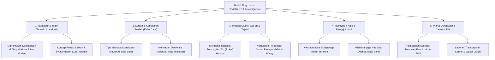

# Master Plan 2 & Brainstorming: Modul Kisah Para Rasulullah & Jurnal Literasi Blog
## Konsep Integrasi Modul Qashashul Anbiya' (Kisah 25 Nabi & Rasul) dan Modul Blog / Jurnal Tadabbur Qur'ani pada QuranWeb

* **Nama Dokumen:** MasterPlan-2.md
* **Fokus Dokumen:** Brainstorming Konseptual & Perencanaan Strategis (No Code — Pure Ideation Only)
* **Kategori:** Modul Edukasi, Tadabbur, Sejarah Nabawi & Literasi Qur'ani
* **Target Pengguna:** Umat Muslim Seluruh Usia, Terkhusus Lansia, Keluarga, Guru Tilawah, dan Penuntut Ilmu

---

# BAGIAN I: KONSEP KUMPULAN CERITA PARA RASULULLAH (QASHASHUL ANBIYA')

## 1. Latar Belakang & Filosofi Fitur Kisah Rasul

### 1.1. Mengapa Kisah Para Rasul di Dalam QuranWeb?
Al-Qur'anul Karim bukan sekadar kumpulan hukum dan perintah ibadah, melainkan kitab hikmah yang **lebih dari sepertiganya berisi qashash (kisah-kisah teladan masa lampau)**. Allah SWT berfirman:

> *"Kami menceritakan kepadamu (Muhammad) kisah yang paling baik dengan mewahyukan Al-Qur'an ini kepadamu..."*  
> — **QS. Yusuf [12]: 3**

Bagi banyak umat Islam—terutama kaum lanjut usia yang memiliki banyak waktu luang untuk tadabbur, maupun pembaca pemula—membaca mushaf ayat demi ayat terkadang membutuhkan jembatan pemahaman konteks:
- Mengapa ayat ini diturunkan?
- Siapa kaum Tsamud, 'Ad, atau Ashabur Rass yang sering disebut dalam ayat?
- Bagaimana ketabahan Nabi Ayub saat diuji sakit bertahun-tahun, atau keteguhan Nabi Nuh saat mendakwahi kaumnya selama 950 tahun?

Menghadirkan **Modul Kumpulan Cerita Para Rasulullah** di dalam QuranWeb bertujuan mengubah pengalaman membaca Al-Qur'an dari sekadar mengeja lafadz menjadi **perjalanan batin yang menghidupkan sirah dan menancapkan keimanan**.

### 1.2. DNA & Prinsip QuranWeb yang Harus Tetap Dijaga
1. **Bersih & Tenang:** Tidak boleh mengubah QuranWeb menjadi portal berita yang ramai distraksi. Suasana tetap syahdu, khusyuk, dan berwibawa.
2. **Keterbacaan Lansia:** Bahasa narasi harus santun, mengalir, tidak berbelit-belit, dan disajikan dengan tipografi berjarak baris lega.
3. **Taut Silang Organik dengan Ayat Al-Qur'an:** Kisah bukan sekadar dongeng fiksi, melainkan selalu berjangkar pada ayat-ayat Al-Qur'an yang otentik.

---

## 2. Nilai Unik & Diferensiasi Utama Kisah Rasul

Berbeda dengan aplikasi kisah nabi umum yang biasanya berdiri sendiri sebagai kumpulan artikel lepas, modul kisah pada QuranWeb memiliki keunikan strategis:

### A. Taut Silang Dua Arah (*Bi-Directional Quran Linking*)
* **Dari Kisah ke Mushaf:** Saat membaca episode pengorbanan Nabi Ibrahim AS, pembaca dapat mengklik tombol ayat untuk langsung membuka Surat Ash-Shaffat ayat 102 di lembar baca Al-Qur'an lengkap dengan audio murottal.
* **Dari Mushaf ke Kisah:** Saat pengguna sedang membaca surat tertentu (misalnya Surat Maryam, Thaha, atau Al-Qashash), muncul penanda lembut (ikon lentera kisah) yang memungkinkan pembaca membuka latar belakang kisah nabi yang bersangkutan hanya dalam satu sentuhan.

### B. Harmonisasi dengan Navigasi 'Ain (Ruku')
Tradisi pembagian 'Ain dalam mushaf pada hakikatnya membagi ayat berdasarkan kesatuan tema cerita. Sebagian besar batas 'Ain bertepatan persis dengan pembuka dan penutup fragmen kisah rasul. Modul ini akan memperkaya pemahaman pembaca tentang alasan mengapa para ulama terdahulu memotong bacaan shalat pada tanda 'Ain tersebut.

### C. Kurasi Doa-Doa Mustajab Para Nabi (*Du'a Al-Anbiya'*)
Setiap kisah rasul dirangkum dengan tab khusus yang menyoroti doa-doa yang diabadikan di dalam Al-Qur'an, misalnya:
- Doa Nabi Yunus saat di dalam kegelapan perut ikan (*Laa ilaaha illaa Anta subhaanaka inni kuntu minazh-zhaalimiin*).
- Doa Nabi Zakariya saat memohon keturunan di usia senja.
- Doa Nabi Ayyub saat memohon kesembuhan penyakit.
- Doa Nabi Musa saat menghadapi Fir'aun (*Rabbi-syrahlii shadrii wa yassirlii amrii*).

---

## 3. Cakupan Konten: 25 Nabi & Rasul Utama

Konten dirancang mencakup **25 Nabi dan Rasul** yang wajib diimani, dengan pembagian hierarki:
- **Era Permulaan:** Nabi Adam AS, Idris AS, Nuh AS (Ulul Azmi), Hud AS (Kaum 'Ad), Shalih AS (Kaum Tsamud).
- **Era Kebangkitan Tauhid & Bani Israil:** Nabi Ibrahim AS (Ulul Azmi), Luth AS, Ismail AS, Ishaq AS, Ya'qub AS, Yusuf AS, Ayyub AS, Syu'aib AS, Musa AS (Ulul Azmi), Harun AS, Dzulkifli AS, Daud AS, Sulaiman AS, Ilyas AS, Ilyasa AS, Yunus AS, Zakariya AS, Yahya AS, Isa AS (Ulul Azmi).
- **Era Penutup Kenabian (*Khatamul Anbiya'*):** Baginda Nabi Muhammad SAW (Sayyidul Mursalin - Ulul Azmi).

---

## 4. Struktur Anatomi Setiap Halaman Kisah Nabi
1. **Kartu Identitas & Ikhtisar Singkat:** Nama, julukan, wilayah dakwah, kaum, jumlah sebutan dalam Al-Qur'an.
2. **Linimasa Babak Kehidupan (3–5 Menit Baca):** Kelahiran, seruan tauhid, puncak ujian & mukjizat, kemenangan kebenaran.
3. **Mutiara Hikmah & Refleksi Kehidupan:** Pelajaran akhlak untuk kehidupan masa kini.
4. **Kompilasi Doa Nabawi:** Teks Arab, transliterasi, terjemahan, dan rujukan ayat.
5. **Indeks Ayat Terkait di Mushaf:** Daftar tautan langsung ke surat dan ayat bersangkutan.

---

## 5. Mode Eksplorasi Kisah Rasul
- **Mode Garis Waktu Kronologis:** Menelusuri silsilah kenabian dari Adam AS hingga Muhammad SAW.
- **Mode Tematik Solusi Batin:** Berdasarkan masalah hidup (Ujian Sakit -> Nabi Ayyub, Doa Usia Senja -> Nabi Zakariya, Terjebak Masalah Berat -> Nabi Yunus, Fitnah -> Nabi Yusuf).
- **Mode Peta Jejak Para Nabi:** Visualisasi titik-titik wilayah dakwah nabi di Timur Tengah & Afrika Utara.
- **Mode Membaca Bersama Cucu (*Family Storytelling*):** Gaya bahasa bertutur hangat untuk kakek/nenek membacakan hikmah kepada anak dan cucu.

---
---

# BAGIAN II: BRAINSTORMING MODUL BLOG & JURNAL TADABBUR QUR'ANI

## 6. Latar Belakang & Urgensi Modul Blog pada QuranWeb

### 6.1. Mengapa QuranWeb Memerlukan Modul Blog?
Selama ini aplikasi Al-Qur'an sering kali hanya berperan sebagai "alat baca teks" (*reader tool*). Begitu pengguna selesai tilawah satu atau dua halaman, aplikasi ditutup. 

Keberadaan **Modul Blog (Jurnal Literasi & Tadabbur Qur'ani)** memberikan dimensi baru:
1. **Membangun Ekosistem Pemahaman:** Menghubungkan teks firman Allah dengan dinamika kehidupan nyata sehari-hari umat Islam.
2. **Media Edukasi Mendalam Tanpa Rasa Menggurui:** Menyajikan artikel-artikel bernas tentang tafsir, adab tilawah, kesehatan spiritual lansia, dan sejarah Islam dengan bahasa yang sejuk, santun, dan mudah dicerna.
3. **Kanal Komunikasi Tim Pengembang & Komunitas:** Media resmi mengabarkan perkembangan fitur QuranWeb, panduan penggunaan PWA offline, dan seruan kebaikan wakaf digital.

### 6.2. Nilai Filosofi: Bukan Blog Komersial Biasa
* ❌ **BUKAN portal gosip / clickbait:** Menolak judul sensasional, berita politik polaritatif, atau konten kontroversial yang memecah belah umat.
* ❌ **BUKAN media beriklan bising:** Bebas dari banner iklan pihak ketiga, popup jebakan, atau video autoplay yang mengganggu kenyamanan.
*  **ADALAH Jurnal Tadabbur Bermartabat:** Bernilai ibadah, menenangkan hati (*peace of mind*), mencerahkan wawasan, dan memperkuat cinta kepada Kitab Suci Al-Qur'an.

---

## 7. Pilar-Pilar Kategori Konten Blog (Content Pillars)

Untuk menjaga keberagaman dan relevansi materi, konten blog dikelompokkan ke dalam **5 Pilar Utama**:



### Penjelasan Rinci Setiap Pilar:

#### Pilar 1: Tadabbur & Tafsir Tematik (*Tafsir Maudhu'i*)
Mengkaji ayat-ayat Al-Qur'an dengan pendekatan tematik yang menyentuh realitas kehidupan:
* *"Bagaimana Al-Qur'an Mengajarkan Manajemen Stres dan Berdamai dengan Takdir"*
* *"Keadilan Sosial dan Larangan Eksploitasi: Tadabbur Surat Al-Muthaffifin"*
* *"Pendidikan Karakter Anak: Membedah Wasiat Luqman Al-Hakim"*

#### Pilar 2: Lansia & Kebugaran Ibadah (*Elder Care & Active Aging*)
Konten khusus yang menyapa kebutuhan komunitas pembaca lansia dan keluarganya:
* *"Panduan Mengatur Posisi Ergonomis Duduk Tilawah untuk Mencegah Nyeri Pinggang"*
* *"Menjaga Kualitas Pendengaran dan Manfaat Menyimak Murottal bagi Lansia"*
* *"Pentingnya Pencahayaan Lembut dan Tipografi Ramah Mata Saat Membaca Al-Qur'an"*

#### Pilar 3: Mutiara Ulumul Qur'an, Tajwid & Bahasa Arab
Edukasi literasi Al-Qur'an bagi yang ingin memperdalam ilmu:
* *"Mengapa Mushaf Standar Indonesia Menggunakan Rasm Utsmani Karakteristik Khusus?"*
* *"Memahami 7 Tanda Waqaf Utama: Kapan Harus Berhenti dan Kapan Boleh Lanjut"*
* *"Mengenal Kata-Kata Indah Al-Qur'an: Makna Mendalam di Balik Kata Rahmah, Sakinah, dan Barakah"*

#### Pilar 4: Tazkiyatun Nafs & Penyejuk Jiwa (*Spiritual Solace*)
Esai reflektif pendek (2–3 menit baca) yang menyejukkan hati di saat cemas, lelah, atau berduka:
* *"Ketika Doamu Belum Terjawab: Meneladani Kesabaran Nabi Zakariya"*
* *"Menghidupkan Jiwa yang Gersang dengan Dzikir Pagi dan Petang"*

#### Pilar 5: Warta QuranWeb & Catatan Rilis (*Changelog & Announcement*)
Transparansi pembaruan aplikasi dan panduan teknis bagi pengguna:
* *"Cara Memasang QuranWeb ke Layar Utama Ponsel (PWA) untuk Akses Tanpa Internet"*
* *"Pembaruan Versi: Penambahan 5 Qari Murottal dan Pengaturan Kecepatan Suara"*

---

## 8. Fitur Spesial: Ekosistem Taut Terintegrasi (*Interactive Quran Ecosystem*)

Modul blog pada QuranWeb bukan sekadar artikel teks biasa, melainkan terhubung erat dengan seluruh komponen aplikasi:

### 1. Kartu Kutipan Ayat Interaktif (*Embedded Ayah Widget*)
Setiap kali artikel menyebutkan dalil firman Allah, ayat tersebut disajikan dalam kotak kartu khusus yang memiliki:
- Teks Arab berharakat indah (font LPMQ Misbah).
- Terjemahan bahasa Indonesia resmi Kemenag RI.
- **Tombol Play Murottal Mini:** Pengguna bisa mendengarkan pelafalan ayat tersebut langsung di dalam artikel.
- **Tombol "Buka di Mushaf":** Satu sentuhan langsung membawa pengguna ke lembar tilawah penuh untuk membaca ayat sebelum dan sesudahnya.

### 2. Taut Silang ke Modul Cerita Para Rasul
Jika sebuah artikel membahas tema kepemimpinan Nabi Sulaiman atau kesabaran Nabi Nuh, terdapat lencana tautan cerdas:
> 💡 *Baca selengkapnya riwayat lengkap perjuangan dakwah beliau di: **Kisah Nabi Sulaiman AS**.*

### 3. Taut Silang ke Jadwal Shalat & Doa
Artikel yang membahas keutamaan shalat dhuha atau tahajjud otomatis menampilkan kartu pengingat waktu aktual dan hitung mundur jadwal shalat sesuai lokasi pembaca.

---

## 9. Desain Antarmuka & Standar Aksesibilitas Pembaca (UX & Reader Experience)

Karakteristik ramah lansia yang telah menjadi identitas QuranWeb diterapkan secara konsisten pada modul blog:

### A. Kenyamanan Tipografi Editorial
- **Format Paragraf Lapang:** Lebar baris teks dibatasi (*max-width 680px–720px*) agar mata pembaca tidak lelah melompat dari ujung kiri ke ujung kanan layar.
- **Line-Height & Letter-Spacing:** Spasi antar-baris `1.75x–1.8x` dan jarak antar-paragraf lega, sangat ramah bagi pembaca bermata minus/plus atau lanjut usia.
- **Pilihan Jenis Font Bacaan:** Pengguna dapat memilih antara font sans-serif modern (bersih) atau font serif buku editorial (klasik).

### B. Integrasi 4 Tema Tampilan
- 📜 **Tema Sepia (Kertas Antik):** Sangat disukai pembaca lansia karena memberikan kehangatan seperti membaca majalah cetak di teras rumah.
- 🌙 **Tema Dark Inverse (OLED):** Tulisan putih/abu terang di atas latar hitam pekat untuk membaca sebelum tidur tanpa silau.
- 🔲 **Tema High Contrast:** Memastikan teks hitam legam di atas latar putih bersih dengan garis batas tajam bagi pengguna dengan keterbatasan penglihatan.

### C. Fitur Penunjang Kenyamanan Membaca
1. **Slider Ukuran Font Artikel:** Pengguna dapat mengubah ukuran teks artikel dari `16px` hingga `28px` secara instan.
2. **Indikator Estimasi Waktu Baca:** Label seperti `⏱️ Waktu Baca: ~4 menit` membantu lansia mengatur ritme membaca.
3. **Bilah Kemajuan Membaca (*Reading Progress Bar*):** Garis indikator tipis di bagian atas layar yang menunjukkan persentase panjang artikel yang telah diselesaikan.
4. **Penanda Artikel Tersimpan (*Reading List / Bookmark Artikel*):** Pembaca dapat menyimpan artikel favorit untuk dibaca kembali saat santai.
5. **Mode Narasi Suara (*Text-to-Speech / Audio Article Concept*):** Konsep masa depan di mana artikel dapat diperdengarkan secara audio bagi lansia yang sedang lelah membaca layar.

---

## 10. Pengelolaan Konten melalui Portal Administrator (`/admin`)

Untuk menjaga kualitas tulisan dan kemudahan penerbitan, modul blog dikelola langsung melalui Portal Admin:

### 1. Antarmuka Manajemen Artikel (CMS Sederhana & Cepat)
- **Tabel Daftar Artikel:** Menampilkan judul, kategori/pilar, nama penulis, tanggal terbit, status (*Draft* / *Published*), dan jumlah pembaca.
- **Editor Artikel Berbantuan:**
  - Penulisan format Markdown atau Rich-Text editor yang bersih.
  - *Shortcode* instan untuk menyisipkan ayat Al-Qur'an (misal: `[ayah surah=2 ayah=255]`), otomatis merender teks Arab, terjemahan, dan audio player tanpa perlu copas manual.
- **Pratinjau Langsung (*Live Preview Dual-Pane*):** Administrator dapat melihat tampilan artikel di layar Desktop dan Mobile secara berdampingan sebelum diterbitkan.

### 2. Pengaturan Jadwal Terbit (*Scheduled Publishing*)
Administrator dapat menjadwalkan artikel terbit secara otomatis pada momentum tertentu (misalnya: setiap hari Jumat pagi untuk tema keutamaan Al-Kahfi, atau awal bulan hijriah).

### 3. Analisis Minat & Metrik Pembaca di PostgreSQL
- **Statistik Artikel Populer:** Mengukur artikel mana yang paling sering dibaca dan paling lama diresapi durasi membacanya.
- **Topik Paling Dicari:** Menganalisis kata kunci pencarian pengguna di blog untuk merencanakan artikel lanjutan yang dibutuhkan jamaah.

---

## 11. Integrasi pada Portal Pengguna Terdaftar (`/user`)

Bagi pengguna yang telah mendaftar atau masuk ke akun pribadinya, modul blog menyediakan fitur personalisasi:
1. **Daftar Baca Nanti (*Read Later List*):** Menyimpan artikel menarik yang belum sempat dibaca.
2. **Catatan Tadabbur Pribadi (*Personal Reflection Notes*):** Pengguna dapat menuliskan satu dua paragraf renungan pribadi di bawah artikel yang hanya bisa dibaca oleh dirinya sendiri.
3. **Riwayat Bacaan Selesai:** Catatan artikel yang telah tuntas dibaca sebagai motivasi konsistensi belajar.

---

## 12. Struktur Data Konseptual Blog (Schema Ideation)

Secara konseptual, struktur data blog dirancang ramping, mandiri, dan efisien:

```text
Entitas Artikel Blog (Blog Article):
├── ID Unik (Slug URL SEO-Friendly, misal: /blog/menemukan-ketenangan-surat-ibrahim)
├── Judul Artikel (Title) & Ringkasan Singkat (Excerpt)
├── Kategori Pilar (Tafsir / Elder Care / Ulumul Quran / Refleksi / Berita)
├── Tag Kata Kunci (Keywords)
├── Nama Penulis / Asatidz / Kontributor
├── Estimasi Waktu Baca (Menit)
├── Konten Lengkap (Format Markdown / JSON Blocks dengan Embedded Quran Ayahs)
├── Tautan Terkait (Daftar ID Surat/Ayat Al-Qur'an dan ID Kisah Rasul)
├── Waktu Dibuat & Waktu Terbit
└── Status (Draft / Published / Archived)
```

---

## 13. Matriks Perbandingan: Nilai Tambah QuranWeb Blog

| Aspek | Blog Islami Konvensional | Modul Blog QuranWeb |
| :--- | :--- | :--- |
| **Iklan & Monetisasi** | Penuh banner iklan pop-up & display ads yang membingungkan lansia. | **100% Bersih & Bebas Iklan (Waqaf Digital).** |
| **Integrasi Mushaf** | Kutipan teks Arab berupa gambar statis atau teks mentah tanpa audio. | **Interaktif:** Ada murottal mini & tombol 1-klik buka ayat langsung di lembar tilawah. |
| **Aksesibilitas** | Ukuran font kaku, jarang mendukung tema malam ramah mata. | **4 Tema Warna (Sepia/Dark/High Contrast) + Slider Font hingga 28px.** |
| **Fokus Konten** | Sering mengejar trending topik politik / khilafiyah sensasional. | **Fokus pada Tadabbur ayat, keimanan, keteladanan sirah, dan panduan ibadah lansia.** |
| **Akses Offline** | Membutuhkan koneksi internet aktif setiap membuka halaman. | **Didukung PWA Cache Storage:** Artikel yang disimpan dapat dibaca ulang saat offline. |

---

## 14. Rekomendasi Roadmap Perwujudan Ide

Untuk memastikan penambahan modul blog berjalan terukur dan tidak membebani performa aplikasi utama, disarankan tahapan sebagai berikut:

| Fase | Sasaran Utama | Target Luaran |
| :--- | :--- | :--- |
| **Fase 1: Kurasi Konten Perdana** | Menyiapkan 5–10 artikel percontohan berbobot tinggi yang mewakili 5 pilar utama. | Kumpulan naskah terverifikasi tanpa kekeliruan kutipan ayat. |
| **Fase 2: Arsitektur UI & Layout Desain** | Merancang antarmuka daftar artikel kartu (*blog catalog*) dan lembar baca artikel (*article reader*). | Wireframe & mockup responsif (Desktop & Mobile). |
| **Fase 3: Widget Kutipan Ayat Interaktif** | Merancang integrasi kartu ayat di dalam artikel yang terhubung ke audio murottal dan reader utama. | Prototipe interlinking artikel-ke-mushaf. |
| **Fase 4: Panel Manajemen Admin & Metrik** | Mengintegrasikan editor artikel pada `/admin` dan penyimpanan riwayat baca di `/user`. | Antarmuka CMS yang siap pakai oleh editor konten. |

---

## 15. Kesimpulan Penutup

Penggabungan antara **Kumpulan Cerita Para Rasulullah** (Bagian I) dan **Modul Blog Literasi & Tadabbur Qur'ani** (Bagian II) menjadikan QuranWeb bukan sekadar mushaf digital pasif, melainkan **Pusat Pembelajaran dan Sahabat Kehidupan Spiritual Umat Muslim**.

Kedua modul ini saling menopang secara harmonis:
- **Mushaf Inti:** Menyajikan lafadz wahyu ilahi (Surat, Juz, 'Ain) dengan kenyamanan baca maksimal.
- **Kisah Rasul:** Memberikan teladan nyata perjuangan hidup dan doa-doa para Nabi.
- **Modul Blog:** Menguraikan hikmah, menjawab kegelisahan hidup modern, dan membimbing jamaah lansia merawat ibadah dengan penuh keikhlasan.

---
*Dokumen ini merupakan catatan pemikiran konseptual utuh untuk menjadi landasan perancangan fungsional (FSD) dan arsitektur teknis (TSD) pada pengembangan mendatang.*
