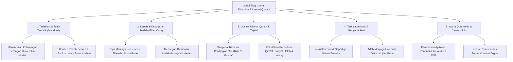
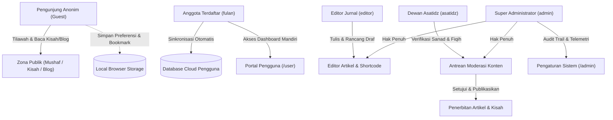
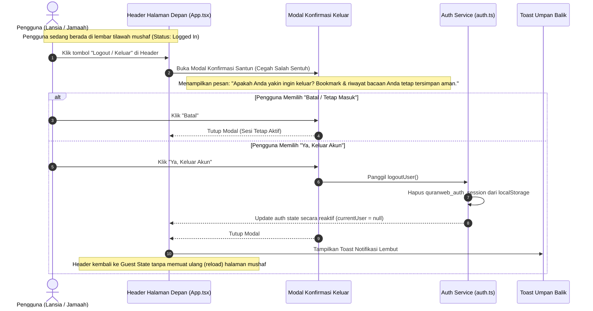
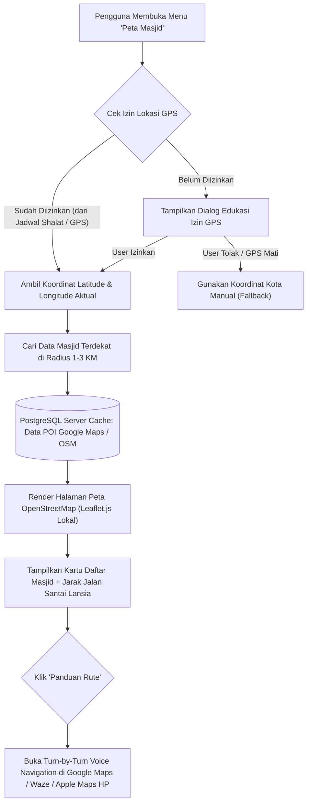

# Master Plan 2 & Brainstorming: Ekosistem Pembelajaran, Ibadah & Aksesibilitas QuranWeb
## Konsep Integrasi Modul Qashashul Anbiya', Jurnal Blog, Standarisasi Akun & Logout, Rencana Khatam 'Ain, Doa-Dzikir, Asbabun Nuzul, Audio Narasi, Kompas Kiblat & Peta Masjid OpenStreetMap

* **Nama Dokumen:** MasterPlan-2.md
* **Fokus Dokumen:** Brainstorming Konseptual & Perencanaan Strategis Tahap 2 (No Code — Pure Ideation Only)
* **Kategori:** Ekosistem Edukasi, Tadabbur, Sejarah Nabawi, Jurnal Literasi, Ibadah Harian, Navigasi Masjid & Aksesibilitas Lansia
* **Target Pengguna:** Umat Muslim Seluruh Usia, Terkhusus Lansia, Keluarga, Guru Tilawah, dan Penuntut Ilmu

---

# BAGIAN I: KONSEP KUMPULAN CERITA PARA RASULULLAH (QASHASHUL ANBIYA')

## 1. Latar Belakang & Filosofi Fitur Kisah Rasul

### 1.1. Mengapa Kisah Para Rasul di Dalam QuranWeb?
Al-Qur'anul Karim bukan sekadar kumpulan hukum dan perintah ibadah, melainkan kitab hikmah yang **lebih dari sepertiganya berisi qashash (kisah-kisah teladan masa lampau)**. Allah SWT berfirman:

> *"Kami menceritakan kepadamu (Muhammad) kisah yang paling baik dengan mewahyukan Al-Qur'an ini kepadamu..."*  
> — **QS. Yusuf [12]: 3**

Bagi banyak umat Islam—terutama kaum lanjut usia yang memiliki banyak waktu luang untuk tadabbur, maupun pembaca pemula—membaca mushaf ayat demi ayat terkadang membutuhkan jembatan pemahaman konteks:
- Mengapa ayat ini diturunkan?
- Siapa kaum Tsamud, 'Ad, atau Ashabur Rass yang sering disebut dalam ayat?
- Bagaimana ketabahan Nabi Ayub saat diuji sakit bertahun-tahun, atau keteguhan Nabi Nuh saat mendakwahi kaumnya selama 950 tahun?

Menghadirkan **Modul Kumpulan Cerita Para Rasulullah** di dalam QuranWeb bertujuan mengubah pengalaman membaca Al-Qur'an dari sekadar mengeja lafadz menjadi **perjalanan batin yang menghidupkan sirah dan menancapkan keimanan**.

### 1.2. DNA & Prinsip QuranWeb yang Harus Tetap Dijaga
1. **Bersih & Tenang:** Tidak boleh mengubah QuranWeb menjadi portal berita yang ramai distraksi. Suasana tetap syahdu, khusyuk, dan berwibawa.
2. **Keterbacaan Lansia:** Bahasa narasi harus santun, mengalir, tidak berbelit-belit, dan disajikan dengan tipografi berjarak baris lega.
3. **Taut Silang Organik dengan Ayat Al-Qur'an:** Kisah bukan sekadar dongeng fiksi, melainkan selalu berjangkar pada ayat-ayat Al-Qur'an yang otentik.

---

## 2. Nilai Unik & Diferensiasi Utama Kisah Rasul

Berbeda dengan aplikasi kisah nabi umum yang biasanya berdiri sendiri sebagai kumpulan artikel lepas, modul kisah pada QuranWeb memiliki keunikan strategis:

### A. Taut Silang Dua Arah (*Bi-Directional Quran Linking*)
* **Dari Kisah ke Mushaf:** Saat membaca episode pengorbanan Nabi Ibrahim AS, pembaca dapat mengklik tombol ayat untuk langsung membuka Surat Ash-Shaffat ayat 102 di lembar baca Al-Qur'an lengkap dengan audio murottal.
* **Dari Mushaf ke Kisah:** Saat pengguna sedang membaca surat tertentu (misalnya Surat Maryam, Thaha, atau Al-Qashash), muncul penanda lembut (ikon lentera kisah) yang memungkinkan pembaca membuka latar belakang kisah nabi yang bersangkutan hanya dalam satu sentuhan.

### B. Harmonisasi dengan Navigasi 'Ain (Ruku')
Tradisi pembagian 'Ain dalam mushaf pada hakikatnya membagi ayat berdasarkan kesatuan tema cerita. Sebagian besar batas 'Ain bertepatan persis dengan pembuka dan penutup fragmen kisah rasul. Modul ini akan memperkaya pemahaman pembaca tentang alasan mengapa para ulama terdahulu memotong bacaan shalat pada tanda 'Ain tersebut.

### C. Kurasi Doa-Doa Mustajab Para Nabi (*Du'a Al-Anbiya'*)
Setiap kisah rasul dirangkum dengan tab khusus yang menyoroti doa-doa yang diabadikan di dalam Al-Qur'an, misalnya:
- Doa Nabi Yunus saat di dalam kegelapan perut ikan (*Laa ilaaha illaa Anta subhaanaka inni kuntu minazh-zhaalimiin*).
- Doa Nabi Zakariya saat memohon keturunan di usia senja.
- Doa Nabi Ayyub saat memohon kesembuhan penyakit.
- Doa Nabi Musa saat menghadapi Fir'aun (*Rabbi-syrahlii shadrii wa yassirlii amrii*).

---

## 3. Cakupan Konten: 25 Nabi & Rasul Utama

Konten dirancang mencakup **25 Nabi dan Rasul** yang wajib diimani, dengan pembagian hierarki:
- **Era Permulaan:** Nabi Adam AS, Idris AS, Nuh AS (Ulul Azmi), Hud AS (Kaum 'Ad), Shalih AS (Kaum Tsamud).
- **Era Kebangkitan Tauhid & Bani Israil:** Nabi Ibrahim AS (Ulul Azmi), Luth AS, Ismail AS, Ishaq AS, Ya'qub AS, Yusuf AS, Ayyub AS, Syu'aib AS, Musa AS (Ulul Azmi), Harun AS, Dzulkifli AS, Daud AS, Sulaiman AS, Ilyas AS, Ilyasa AS, Yunus AS, Zakariya AS, Yahya AS, Isa AS (Ulul Azmi).
- **Era Penutup Kenabian (*Khatamul Anbiya'*):** Baginda Nabi Muhammad SAW (Sayyidul Mursalin - Ulul Azmi).

---

## 4. Struktur Anatomi Setiap Halaman Kisah Nabi
1. **Kartu Identitas & Ikhtisar Singkat:** Nama, julukan, wilayah dakwah, kaum, jumlah sebutan dalam Al-Qur'an.
2. **Linimasa Babak Kehidupan (3–5 Menit Baca):** Kelahiran, seruan tauhid, puncak ujian & mukjizat, kemenangan kebenaran.
3. **Mutiara Hikmah & Refleksi Kehidupan:** Pelajaran akhlak untuk kehidupan masa kini.
4. **Kompilasi Doa Nabawi:** Teks Arab, transliterasi, terjemahan, dan rujukan ayat.
5. **Indeks Ayat Terkait di Mushaf:** Daftar tautan langsung ke surat dan ayat bersangkutan.

---

## 5. Mode Eksplorasi Kisah Rasul
- **Mode Garis Waktu Kronologis:** Menelusuri silsilah kenabian dari Adam AS hingga Muhammad SAW.
- **Mode Tematik Solusi Batin:** Berdasarkan masalah hidup (Ujian Sakit -> Nabi Ayyub, Doa Usia Senja -> Nabi Zakariya, Terjebak Masalah Berat -> Nabi Yunus, Fitnah -> Nabi Yusuf).
- **Mode Peta Jejak Para Nabi:** Visualisasi titik-titik wilayah dakwah nabi di Timur Tengah & Afrika Utara.
- **Mode Membaca Bersama Cucu (*Family Storytelling*):** Gaya bahasa bertutur hangat untuk kakek/nenek membacakan hikmah kepada anak dan cucu.

---
---

# BAGIAN II: BRAINSTORMING MODUL BLOG & JURNAL TADABBUR QUR'ANI

## 6. Latar Belakang & Urgensi Modul Blog pada QuranWeb

### 6.1. Mengapa QuranWeb Memerlukan Modul Blog?
Selama ini aplikasi Al-Qur'an sering kali hanya berperan sebagai "alat baca teks" (*reader tool*). Begitu pengguna selesai tilawah satu atau dua halaman, aplikasi ditutup. 

Keberadaan **Modul Blog (Jurnal Literasi & Tadabbur Qur'ani)** memberikan dimensi baru:
1. **Membangun Ekosistem Pemahaman:** Menghubungkan teks firman Allah dengan dinamika kehidupan nyata sehari-hari umat Islam.
2. **Media Edukasi Mendalam Tanpa Rasa Menggurui:** Menyajikan artikel-artikel bernas tentang tafsir, adab tilawah, kesehatan spiritual lansia, dan sejarah Islam dengan bahasa yang sejuk, santun, dan mudah dicerna.
3. **Kanal Komunikasi Tim Pengembang & Komunitas:** Media resmi mengabarkan perkembangan fitur QuranWeb, panduan penggunaan PWA offline, dan seruan kebaikan wakaf digital.

### 6.2. Nilai Filosofi: Bukan Blog Komersial Biasa
* ❌ **BUKAN portal gosip / clickbait:** Menolak judul sensasional, berita politik polaritatif, atau konten kontroversial yang memecah belah umat.
* ❌ **BUKAN media beriklan bising:** Bebas dari banner iklan pihak ketiga, popup jebakan, atau video autoplay yang mengganggu kenyamanan.
*  **ADALAH Jurnal Tadabbur Bermartabat:** Bernilai ibadah, menenangkan hati (*peace of mind*), mencerahkan wawasan, dan memperkuat cinta kepada Kitab Suci Al-Qur'an.

---

## 7. Pilar-Pilar Kategori Konten Blog (Content Pillars)

Untuk menjaga keberagaman dan relevansi materi, konten blog dikelompokkan ke dalam **5 Pilar Utama**:



### Penjelasan Rinci Setiap Pilar:

#### Pilar 1: Tadabbur & Tafsir Tematik (*Tafsir Maudhu'i*)
Mengkaji ayat-ayat Al-Qur'an dengan pendekatan tematik yang menyentuh realitas kehidupan:
* *"Bagaimana Al-Qur'an Mengajarkan Manajemen Stres dan Berdamai dengan Takdir"*
* *"Keadilan Sosial dan Larangan Eksploitasi: Tadabbur Surat Al-Muthaffifin"*
* *"Pendidikan Karakter Anak: Membedah Wasiat Luqman Al-Hakim"*

#### Pilar 2: Lansia & Kebugaran Ibadah (*Elder Care & Active Aging*)
Konten khusus yang menyapa kebutuhan komunitas pembaca lansia dan keluarganya:
* *"Panduan Mengatur Posisi Ergonomis Duduk Tilawah untuk Mencegah Nyeri Pinggang"*
* *"Menjaga Kualitas Pendengaran dan Manfaat Menyimak Murottal bagi Lansia"*
* *"Pentingnya Pencahayaan Lembut dan Tipografi Ramah Mata Saat Membaca Al-Qur'an"*

#### Pilar 3: Mutiara Ulumul Qur'an, Tajwid & Bahasa Arab
Edukasi literasi Al-Qur'an bagi yang ingin memperdalam ilmu:
* *"Mengapa Mushaf Standar Indonesia Menggunakan Rasm Utsmani Karakteristik Khusus?"*
* *"Memahami 7 Tanda Waqaf Utama: Kapan Harus Berhenti dan Kapan Boleh Lanjut"*
* *"Mengenal Kata-Kata Indah Al-Qur'an: Makna Mendalam di Balik Kata Rahmah, Sakinah, dan Barakah"*

#### Pilar 4: Tazkiyatun Nafs & Penyejuk Jiwa (*Spiritual Solace*)
Esai reflektif pendek (2–3 menit baca) yang menyejukkan hati di saat cemas, lelah, atau berduka:
* *"Ketika Doamu Belum Terjawab: Meneladani Kesabaran Nabi Zakariya"*
* *"Menghidupkan Jiwa yang Gersang dengan Dzikir Pagi dan Petang"*

#### Pilar 5: Warta QuranWeb & Catatan Rilis (*Changelog & Announcement*)
Transparansi pembaruan aplikasi dan panduan teknis bagi pengguna:
* *"Cara Memasang QuranWeb ke Layar Utama Ponsel (PWA) untuk Akses Tanpa Internet"*
* *"Pembaruan Versi: Penambahan 5 Qari Murottal dan Pengaturan Kecepatan Suara"*

---

## 8. Fitur Spesial: Ekosistem Taut Terintegrasi (*Interactive Quran Ecosystem*)

Modul blog pada QuranWeb bukan sekadar artikel teks biasa, melainkan terhubung erat dengan seluruh komponen aplikasi:

### 1. Kartu Kutipan Ayat Interaktif (*Embedded Ayah Widget*)
Setiap kali artikel menyebutkan dalil firman Allah, ayat tersebut disajikan dalam kotak kartu khusus yang memiliki:
- Teks Arab berharakat indah (font LPMQ Misbah).
- Terjemahan bahasa Indonesia resmi Kemenag RI.
- **Tombol Play Murottal Mini:** Pengguna bisa mendengarkan pelafalan ayat tersebut langsung di dalam artikel.
- **Tombol "Buka di Mushaf":** Satu sentuhan langsung membawa pengguna ke lembar tilawah penuh untuk membaca ayat sebelum dan sesudahnya.

### 2. Taut Silang ke Modul Cerita Para Rasul
Jika sebuah artikel membahas tema kepemimpinan Nabi Sulaiman atau kesabaran Nabi Nuh, terdapat lencana tautan cerdas:
> 💡 *Baca selengkapnya riwayat lengkap perjuangan dakwah beliau di: **Kisah Nabi Sulaiman AS**.*

### 3. Taut Silang ke Jadwal Shalat & Doa
Artikel yang membahas keutamaan shalat dhuha atau tahajjud otomatis menampilkan kartu pengingat waktu aktual dan hitung mundur jadwal shalat sesuai lokasi pembaca.

---

## 9. Desain Antarmuka & Standar Aksesibilitas Pembaca (UX & Reader Experience)

Karakteristik ramah lansia yang telah menjadi identitas QuranWeb diterapkan secara konsisten pada modul blog:

### A. Kenyamanan Tipografi Editorial
- **Format Paragraf Lapang:** Lebar baris teks dibatasi (*max-width 680px–720px*) agar mata pembaca tidak lelah melompat dari ujung kiri ke ujung kanan layar.
- **Line-Height & Letter-Spacing:** Spasi antar-baris `1.75x–1.8x` dan jarak antar-paragraf lega, sangat ramah bagi pembaca bermata minus/plus atau lanjut usia.
- **Pilihan Jenis Font Bacaan:** Pengguna dapat memilih antara font sans-serif modern (bersih) atau font serif buku editorial (klasik).

### B. Integrasi 4 Tema Tampilan
- 📜 **Tema Sepia (Kertas Antik):** Sangat disukai pembaca lansia karena memberikan kehangatan seperti membaca majalah cetak di teras rumah.
- 🌙 **Tema Dark Inverse (OLED):** Tulisan putih/abu terang di atas latar hitam pekat untuk membaca sebelum tidur tanpa silau.
- 🔲 **Tema High Contrast:** Memastikan teks hitam legam di atas latar putih bersih dengan garis batas tajam bagi pengguna dengan keterbatasan penglihatan.

### C. Fitur Penunjang Kenyamanan Membaca
1. **Slider Ukuran Font Artikel:** Pengguna dapat mengubah ukuran teks artikel dari `16px` hingga `28px` secara instan.
2. **Indikator Estimasi Waktu Baca:** Label seperti `⏱️ Waktu Baca: ~4 menit` membantu lansia mengatur ritme membaca.
3. **Bilah Kemajuan Membaca (*Reading Progress Bar*):** Garis indikator tipis di bagian atas layar yang menunjukkan persentase panjang artikel yang telah diselesaikan.
4. **Penanda Artikel Tersimpan (*Reading List / Bookmark Artikel*):** Pembaca dapat menyimpan artikel favorit untuk dibaca kembali saat santai.
5. **Mode Narasi Suara (*Text-to-Speech / Audio Article Concept*):** Konsep masa depan di mana artikel dapat diperdengarkan secara audio bagi lansia yang sedang lelah membaca layar.

---

## 10. Pengelolaan Konten melalui Portal Administrator (`/admin`)

Untuk menjaga kualitas tulisan dan kemudahan penerbitan, modul blog dikelola langsung melalui Portal Admin:

### 1. Antarmuka Manajemen Artikel (CMS Sederhana & Cepat)
- **Tabel Daftar Artikel:** Menampilkan judul, kategori/pilar, nama penulis, tanggal terbit, status (*Draft* / *Published*), dan jumlah pembaca.
- **Editor Artikel Berbantuan:**
  - Penulisan format Markdown atau Rich-Text editor yang bersih.
  - *Shortcode* instan untuk menyisipkan ayat Al-Qur'an (misal: `[ayah surah=2 ayah=255]`), otomatis merender teks Arab, terjemahan, dan audio player tanpa perlu copas manual.
- **Pratinjau Langsung (*Live Preview Dual-Pane*):** Administrator dapat melihat tampilan artikel di layar Desktop dan Mobile secara berdampingan sebelum diterbitkan.

### 2. Pengaturan Jadwal Terbit (*Scheduled Publishing*)
Administrator dapat menjadwalkan artikel terbit secara otomatis pada momentum tertentu (misalnya: setiap hari Jumat pagi untuk tema keutamaan Al-Kahfi, atau awal bulan hijriah).

### 3. Analisis Minat & Metrik Pembaca di PostgreSQL
- **Statistik Artikel Populer:** Mengukur artikel mana yang paling sering dibaca dan paling lama diresapi durasi membacanya.
- **Topik Paling Dicari:** Menganalisis kata kunci pencarian pengguna di blog untuk merencanakan artikel lanjutan yang dibutuhkan jamaah.

### 4. Peningkatan Visualisasi Audit Trail: Grafik Garis (Line Chart CRUD vs View)
Portal Administrator dilengkapi grafik garis interaktif (*Line Chart*) pada modul Audit Trail yang menyajikan visualisasi analitik tren kegiatan pengguna dan redaksi:
- **Series CRUD (Modifikasi Data):** Melacak intensitas operasi mutasi data seperti penambahan/penghapusan bookmark, pembaruan preferensi tilawah, penyimpanan catatan tadabbur, dan publikasi artikel.
- **Series View (Membaca & Eksplorasi):** Melacak intensitas penelusuran ayat Al-Qur'an, pemutaran murottal, pembacaan naskah kisah rasul, dan pencarian terjemahan.
- **Analisis Rasio Keterlibatan (*Engagement Ratio*):** Membantu administrator mengevaluasi keseimbangan antara aktivitas tilawah eksploratif (*View*) dan interaksi personal jamaah (*CRUD*).

---

## 11. Integrasi pada Portal Pengguna Terdaftar (`/user`)

Bagi pengguna yang telah mendaftar atau masuk ke akun pribadinya, modul blog menyediakan fitur personalisasi:
1. **Daftar Baca Nanti (*Read Later List*):** Menyimpan artikel menarik yang belum sempat dibaca.
2. **Catatan Tadabbur Pribadi (*Personal Reflection Notes*):** Pengguna dapat menuliskan satu dua paragraf renungan pribadi di bawah artikel yang hanya bisa dibaca oleh dirinya sendiri.
3. **Riwayat Bacaan Selesai:** Catatan artikel yang telah tuntas dibaca sebagai motivasi konsistensi belajar.

---

# BAGIAN III: STANDARISASI SISTEM AKUN (RBAC) & PENGALAMAN AUTENTIKASI HALAMAN DEPAN

## 12. Perbaikan & Standarisasi Daftar Akun Pengguna (Account Directory & Role Hierarchy)

### 12.1. Latar Belakang & Urgensi Perbaikan Daftar Akun
Pada pengembangan awal QuranWeb, autentikasi dirancang minimalis dengan dua akun demo umum (`admin` dan `fulan`). Model ini memiliki beberapa keterbatasan ketika QuranWeb berkembang menjadi ekosistem yang menaungi **Modul Kisah Para Rasulullah** dan **Jurnal Literasi Blog**:
1. **Ketiadaan Pemisahan Peran Editorial Syar'i:** Pengelolaan artikel sirah dan tafsir membutuhkan peran kurator khusus yang memahami kaidah sanad dan takhrij hadits, terpisah dari administrator teknis server.
2. **Ketiadaan Akun Penulis Khusus:** Kontributor tulisan tadabbur membutuhkan antarmuka menulis yang fokus tanpa harus diberi akses penuh ke pengaturan server atau audit trail pengunjung di `/admin`.
3. **Ketidakseragaman Dokumentasi Kredensial:** Diperlukan tabel direktori kredensial bawaan yang baku, jelas, dan seragam di seluruh dokumen teknis (FSD, TSD, User Manual, dan implementasi kode server).

### 12.2. Tabel Direktori Akun Standar Bawaan (Default System Accounts & Credentials)

Untuk memfasilitasi pengujian menyeluruh, evaluasi modul baru, serta tata kelola hak akses yang sehat, QuranWeb menetapkan daftar akun standar berikut:

| No | Peran (*Role*) | Username | Email Resmi | Password Bawaan | Nama Lengkap / Panggilan | Portal Akses | Deskripsi Tugas & Wewenang |
| :---: | :--- | :--- | :--- | :--- | :--- | :--- | :--- |
| **1** | **Super Administrator** | `admin` | `admin@quranweb.id` | `admin123` | Administrator QuranWeb | `/admin` | Memegang kendali teknis penuh: konfigurasi situs (logo, nama, lisensi, broadcast pengumuman), grafik telemetri IP pengunjung, dan modul Audit Trail kegiatan. |
| **2** | **Dewan Asatidz & Verifikator** | `asatidz` | `asatidz@quranweb.id` | `asatidz123` | Ustadz DR. Ahmad Mu'allim, Lc. | `/admin` (Tab Kurasi) | Meneliti keabsahan riwayat sirah pada Kisah 25 Rasul, menyaring riwayat *Israiliyyat*, serta memvalidasi rujukan kutipan ayat dan tafsir maudhu'i sebelum diterbitkan. |
| **3** | **Editor & Kontributor Jurnal** | `editor` | `editor@quranweb.id` | `editor123` | Siti Maryam, S.Pd.I (Tim Redaksi) | `/admin` (Tab Artikel) | Menyusun draf artikel blog, mengatur kategori pilar, menyematkan widget ayat (*shortcode*), serta mengelola antrean jadwal publikasi artikel. |
| **4** | **Anggota Jamaah (Demo User)** | `fulan` | `user@quranweb.id` | `user123` | Ahmad Fulan Al-Hafidz | `/user` | Mewakili pengguna umum terdaftar: menyimpan bookmark cloud, mengarsipkan riwayat pencarian, menyimpan daftar bacaan nanti (*Read Later*), serta mencatat renungan tadabbur pribadi. |
| **5** | **Pengunjung Anonim (*Guest*)** | *(Tanpa Akun)* | *(Opsional saat CTA)* | *(Tanpa Password)* | Pembaca Jamaah Tamu | `/` (Halaman Depan) | Mengakses seluruh mushaf tilawah, audio murottal, kisah nabi, dan artikel blog secara bebas tanpa paksaan registrasi. Data tersimpan di `localStorage` peramban. |

### 12.3. Matriks Hak Akses Terpadu (Role-Based Access Control / RBAC Matrix)

Setiap peran memiliki batasan wewenang yang terukur guna melindungi integritas mushaf dan kesahihan materi edukasi:



| Fitur / Modul Aplikasi | Guest (Tamu) | Anggota (`fulan`) | Editor (`editor`) | Asatidz (`asatidz`) | Admin (`admin`) |
| :--- | :---: | :---: | :---: | :---: | :---: |
| **Membaca Mushaf, Kisah Nabi & Blog** | ✅ Penuh | ✅ Penuh | ✅ Penuh | ✅ Penuh | ✅ Penuh |
| **Mendengarkan Audio Murottal 5 Qari** | ✅ Penuh | ✅ Penuh | ✅ Penuh | ✅ Penuh | ✅ Penuh |
| **Penyimpanan Bookmark & Last Read** | Local Browser | Cloud + Local | Cloud + Local | Cloud + Local | Cloud + Local |
| **Catatan Tadabbur Pribadi (Private Notes)** | ❌ | ✅ | ✅ | ✅ | ✅ |
| **Daftar Baca Nanti (*Read Later Blog*)** | ❌ | ✅ | ✅ | ✅ | ✅ |
| **Menulis Draf Artikel Jurnal Blog** | ❌ | ❌ | ✅ | ✅ | ✅ |
| **Verifikasi Riwayat Sanad & Sirah Nabawi** | ❌ | ❌ | ❌ | ✅ | ✅ |
| **Publikasi Artikel ke Halaman Utama** | ❌ | ❌ | Menunggu Review | ✅ Langsung | ✅ Langsung |
| **Akses Dashboard Audit Trail & Telemetri** | ❌ | ❌ | ❌ | ❌ | ✅ Penuh |
| **Konfigurasi Identitas Situs & Broadcast** | ❌ | ❌ | ❌ | ❌ | ✅ Penuh |

### 12.4. Tata Kelola Privasi & Keamanan Akun
1. **Tanpa Pelacakan Komersial (*Zero Tracking*):** Sistem autentikasi QuranWeb murni beroperasi untuk kenyamanan ibadah pengguna dan transparansi wakaf, tidak pernah menjual data atau memasang script pelacak pihak ketiga.
2. **Penyimpanan Sesi yang Aman:** Menggunakan kunci penyimpanan lokal `quranweb_auth_session` yang terisolasi dan diverifikasi melalui endpoint `/api/auth/login`.
3. **Kemandirian Pengguna (*Data Sovereignty*):** Pengguna memiliki hak penuh untuk mengekspor data catatan dan bookmark pribadinya dalam format JSON, maupun menghapus sesi akun secara mandiri kapan pun diinginkan.

---

## 13. Spesifikasi Desain Tombol Logout di Halaman Depan (Front Page Quick Logout)

### 13.1. Latar Belakang Masalah (Pain Point Pengguna)
Pada versi sebelumnya, QuranWeb hanya menyediakan tombol keluar (Logout) di dalam halaman dashboard masing-masing portal, yaitu di `/admin` untuk administrator dan di `/user` untuk anggota:
- **Kebingungan Pengguna & Lansia:** Saat pengguna yang telah login kembali ke halaman depan (lembar baca Al-Qur'an), tidak ada indikator visual yang menunjukkan bahwa akun mereka sedang aktif.
- **Kesulitan Menemukan Akses Logout:** Jika seorang pengguna ingin keluar dari akunnya di halaman depan, ia terpaksa harus mengklik ikon profil, menunggu halaman dashboard `/user` atau `/admin` termuat, mencari tombol "Keluar Akun", baru sesi dapat diakhiri.
- **Risiko Privasi pada Perangkat Publik/Bersama:** Di masjid, perpustakaan, atau keluarga dengan perangkat tablet bersama, pengguna sering lupa atau kesulitan logout sebelum meninggalkan perangkat, sehingga akun dan bookmark pribadi mereka dapat diakses oleh pembaca berikutnya.

### 13.2. Solusi Desain: Header Adaptif dengan Tombol Logout Cepat (*Quick Logout*)

Header halaman depan QuranWeb dirancang memiliki dua status tampilan (*header state*) yang reaktif terhadap sesi login pengguna:

#### A. Kondisi 1: Pengguna Belum Login (*Guest / Public State*)
- Menampilkan tombol profil netral (`User` icon) dengan label tooltip: *"Masuk / Dashboard Pengguna"*.
- Mengklik tombol ini akan mengarahkan pengguna ke halaman portal login `/user` atau menampilkan dialog ajakan masuk yang santun.

#### B. Kondisi 2: Pengguna Telah Login (*Authenticated Active State*)
Ketika sistem mendeteksi adanya sesi aktif di browser (`quranweb_auth_session`), header halaman depan otomatis menampilkan elemen terpersonalisasi:
1. **Lencana Identitas Pengguna Ringkas (*User Identity Badge*):**
   - Menampilkan avatar inisial pengguna atau nama sapaan (contoh: `"Ahmad Fulan"` atau `"Admin"`).
   - Dilengkapi *role tag* kecil yang anggun (misal: label hijau lembut untuk `User` atau emas untuk `Admin`).
   - Berfungsi sebagai tombol pintas untuk langsung membuka dashboard pribadi `/user` atau `/admin`.
2. **Tombol Logout Cepat di Halaman Depan (*Front Page Logout Button*):**
   - Diletakkan langsung di bilah navigasi atas (Header Bar) berdampingan dengan profil pengguna.
   - Menggunakan ikon pintu keluar universal (`LogOut` icon dari Lucide Icons).
   - Dilengkapi teks bantu keterbacaan atau tooltip: *"Keluar dari Akun"*.
   - Memiliki ukuran target sentuh (*touch target*) minimal **44px × 44px**, memenuhi standar aksesibilitas lansia WCAG AAA agar mudah disentuh tanpa salah pencet.

### 13.3. Diagram Alur Interaksi Logout Halaman Depan



### 13.4. Anatomi Modal Dialog Konfirmasi Keluar (*Logout Confirmation Modal*)

Mengingat pengguna lanjut usia kerap tidak sengaja menyentuh tombol di layar sentuh, tombol Logout di halaman depan **tidak langsung menghapus sesi secara mengejutkan**, melainkan menampilkan dialog konfirmasi bersahabat:

```text
+--------------------------------------------------------------+
|                   Konfirmasi Keluar Akun                     |
|                                                              |
|   Assalamu'alaikum, Bapak/Ibu/Saudara [Nama Pengguna].       |
|   Apakah Anda yakin ingin keluar dari sesi akun ini?         |
|                                                              |
|   [✓] Seluruh ayat terakhir dibaca (Last Read) dan bookmark  |
|       Anda telah tersimpan dengan aman di sistem.            |
|                                                              |
|          [ Batal / Tetap Masuk ]     [ Ya, Keluar Akun ]     |
+--------------------------------------------------------------+
```

* **Pilihan Aksi Bersahabat:**
  - **Tombol "Batal / Tetap Masuk":** Tombol dengan gaya netral/outline berukuran lega agar mudah dibatalkan jika tersentuh tidak sengaja.
  - **Tombol "Ya, Keluar Akun":** Tombol dengan aksen tegas (merah bata lembut / burgundy elegan, bukan merah mencolok yang menakutkan).

### 13.5. Mekanisme Teknis Pembersihan Sesi (*Session Cleanup & Zero-Flicker Transition*)
1. **Pembersihan Bersih (*Clean Purge*):** Menjalankan fungsi `logoutUser()` untuk menghapus item `quranweb_auth_session` dari `localStorage`.
2. **Reaktivitas Tanpa Muat Ulang Penuh (*Zero Page Reload*):** Transisi dari status login ke status tamu dilakukan melalui manajemen *state* lokal React. Halaman **tidak perlu di-reload total (`window.location.reload()`)**, sehingga posisi scroll ayat Al-Qur'an yang sedang dibaca pengguna tidak berpindah atau melompat.
3. **Pemberitahuan Halus (*Graceful Toast*):** Menampilkan toast notifikasi singkat di pojok layar:  
   > 🌿 *"Anda telah berhasil keluar dari akun dengan aman. Selamat melanjutkan tilawah."*

### 13.6. Penerapan pada 4 Tema Tampilan (Aksesibilitas & Kontras)
- **Tema Terang (Light Mode):** Tombol logout berwarna abu-abu netral dengan aksen teks merah marun saat disentuh, menjaga estetika bersih.
- **Tema Gelap (Dark Inverse / OLED):** Menggunakan warna abu-abu gelap dengan batas tipis transparan; tidak menyilaukan mata saat tilawah malam hari.
- **Tema Sepia (Kertas Antik):** Menggunakan rona cokelat kehangatan kayu yang menyatu dengan latar perkamen klasik mushaf.
- **Tema Kontras Tinggi (High Contrast):** Tombol memiliki border putih tegas di atas latar hitam pekat dengan ikon kuning kontras tinggi, memastikan terbaca dengan jelas oleh jamaah dengan keterbatasan daya pandang (*low vision*).

---

# BAGIAN IV: BRAINSTORMING MODUL PENDUKUNG SPIRITUAL, TILAWAH & AKSESIBILITAS LANSIA

## 14. Modul Rencana Khatam Ramah Lansia (*Khatam Planner & Ritme Tilawah Berbasis 'Ain*)

### 14.1. Latar Belakang & Filosofi "Sakinah Reading"
Target khatam Al-Qur'an konvensional yang mewajibkan 1 juz (±10 lembar / 20 halaman) per hari sering kali menjadi beban mental dan fisik bagi jamaah lanjut usia:
- Menatap layar teks dalam durasi lama memicu kelelahan mata (*asthenopia*), leher kaku, dan pusing.
- Ketika terlewat satu atau dua hari, timbul rasa bersalah yang berujung pada berhentinya tilawah secara total.

QuranWeb memanfaatkan keunggulan unik navigasi **'Ain (Ruku')**—yang membagi Al-Qur'an menjadi 556–558 fragmen cerita utuh—untuk menghadirkan **metode tilawah bertahap yang realistis, menenangkan, dan penuh berkah**.

### 14.2. Tiga Pilihan Ritme Tilawah yang Fleksibel
Pengguna dapat memilih ritme membaca sesuai kenyamanan fisiknya:

| Pilihan Ritme | Target Harian | Estimasi Waktu Khatam | Karakteristik & Kesesuaian Pengguna |
| :--- | :--- | :---: | :--- |
| **Ritme Shalat Fardhu (*Sakinah*)** | **1 'Ain setiap usai shalat wajib** (5 'Ain per hari) | **±111 Hari (~3,5 Bulan)** | **Sangat Direkomendasikan untuk Lansia:** Waktu baca hanya 3–4 menit tiap waktu shalat, mata tidak lelah, dan menjaga keterikatan hati dengan Al-Qur'an sepanjang hari. |
| **Ritme Dua Bulanan (*Istiqamah*)** | **2 'Ain setiap usai shalat wajib** (10 'Ain per hari) | **±56 Hari (~2 Bulan)** | Cocok bagi jamaah purnatugas/pensiunan yang memiliki waktu luang cukup banyak di rumah atau masjid. |
| **Ritme Satu Bulanan (*Ramadhan/Fokus*)** | **1 Juz per hari** (±18–20 'Ain per hari) | **30 Hari (1 Bulan)** | Program intensif untuk momentum bulan suci Ramadhan atau penuntut ilmu yang mengejar target tadarus. |

### 14.3. Antarmuka Pelacak Kemajuan yang Menyejukkan (*Gentle Progress Tracker*)
- **Tanpa Gamifikasi Kompetitif:** Menolak konsep poin, *streak counter* dengan penalti hangus, atau *leaderboard* peringkat yang memicu stres. Tilawah adalah ibadah ikhlas, bukan perlombaan game.
- **Visualisasi Cincin Sakinah (*Sakinah Ring*):** Cincin progress melingkar anggun dengan warna hijau daun atau emas sepia yang mencatat persentase 'Ain yang telah diselesaikan.
- **Pengingat Santun (*Prayer-Linked Gentle Reminder*):** Pesan halus terintegrasi dengan modul Jadwal Shalat:  
  > 🌿 *"Alhamdulillah waktu Ashar telah tiba. Mari luangkan 3 menit untuk membaca 1 'Ain penyejuk hati."*

---

## 15. Modul Kumpulan Doa Qur'ani & Dzikir Harian (*Al-Adzkar wal Ad'iyah*)

### 15.1. Kompilasi 40 Doa Rabbana & Rabbi dari Al-Qur'an
Melanjutkan keberhasilan kurasi *Du'a Al-Anbiya'* pada Modul Kisah Nabi, jamaah sangat mendambakan doa-doa mustajab yang langsung diwahyukan oleh Allah SWT di dalam Al-Qur'an:
- **Doa Sapu Jagat Kebahagiaan Dunia-Akhirat:** QS. Al-Baqarah [2]: 201.
- **Doa Berbakti kepada Kedua Orang Tua:** QS. Al-Isra' [17]: 24.
- **Doa Keturunan & Pasangan Penyejuk Mata (*Qurrata A'yun*):** QS. Al-Furqan [25]: 74.
- **Doa Husnul Khatimah & Pengampunan Dosa:** QS. Ali 'Imran [3]: 193–194.
- **Doa Keteguhan Iman & Hidayah Hati:** QS. Ali 'Imran [3]: 8.

Setiap doa disajikan dengan teks Arab berharakat tajam, font khusus LPMQ Misbah, tombol pelafalan murottal, dan tombol tautan langsung ke ayat mushaf bersangkutan.

### 15.2. Dzikir Pagi-Petang & Dzikir Ba'da Shalat Fardhu
- Menyajikan susunan dzikir Al-Ma'tsurat yang shahih sesuai tuntunan Rasulullah SAW.
- Navigasi geser kartu (*swipeable card*) dengan ukuran font ekstra besar ramah lansia.

### 15.3. Fitur Penghitung Dzikir Haptic (*Haptic Touch Counter*)
Untuk memudahkan lansia berdzikir tanpa harus memelototi angka di layar HP:
- **Area Sentuh Seluruh Layar (*Full-Screen Tap*):** Pengguna cukup menyentuh di bagian mana saja pada layar ponsel untuk menambah hitungan dzikir.
- **Getaran Penanda Lembut (*Haptic Vibration Feedback*):**
  - Getaran halus 1x pada setiap ketukan tasbih.
  - Getaran panjang 2x saat hitungan genap mencapai **33x** (Subhanallah, Alhamdulillah, Allahu Akbar).
  - Getaran berirama saat mencapai hitungan **100x**.
- **Kenyamanan Lansia:** Memungkinkan pengguna berdzikir sambil memejamkan mata di pembaringan atau bersandar di serambi masjid dengan tenang.

---

## 16. Modul Asbabun Nuzul & Glosarium Mufradat Qur'ani (*Konteks & Makna Kata Sukar*)

### 16.1. Kartu Latar Belakang Peristiwa (*Asbabun Nuzul Card*)
- Disematkan secara lembut di samping nomor ayat pada lembar baca Al-Qur'an dalam bentuk ikon lentera sejarah atau gulungan naskah.
- Memberikan penjelasan riwayat shahih tentang peristiwa atau pertanyaan sahabat yang melatarbelakangi turunnya ayat (mengacu pada kitab *Lubabun Nuqul* karya Imam As-Suyuthi dan *Asbabun Nuzul* karya Imam Al-Wahidi).
- Menghindari riwayat dhoif atau kisah-kisah yang tidak berdasar.

### 16.2. Kamus Kata Sukar & Kosakata Al-Qur'an (*Gharibul Qur'an / Mufradat*)
- Ketika pembaca menjumpai kata-kata Arab yang memiliki kedalaman makna atau jarang dipakai dalam bahasa percakapan sehari-hari (misalnya kata *Al-Kautsar*, *Ash-Shamad*, *Al-Falaq*, *Sijjil*, *Tasnim*), pengguna dapat mengetuk kata tersebut untuk membuka kartu makna (*tooltip dictionary*).
- Menjelaskan asal akar kata (*fi'il*), makna harfiah, serta konteks keindahan balaghah Al-Qur'an secara ringkas dan bersahabat.

---

## 17. Modul Audio Narasi Tadabbur & Audiobook Kisah (*Mode Menyimak untuk Mata Lelah*)

### 17.1. Urgensi Mode Menyimak bagi Lansia
Banyak pengguna berusia lanjut memiliki keterbatasan fisik seperti katarak, glaukoma ringan, atau mata lelah (*eye fatigue*) setelah membaca teks digital selama 15–20 menit. Modul ini hadir sebagai solusi inklusif agar mereka tetap dapat menikmati sajian kisah para nabi dan artikel tadabbur.

### 17.2. Karakteristik Audio Cerita Bertutur
- **Durasi Pas (3–5 Menit):** Format audio ringkas (*audio capsule*) yang pas dinikmati sambil minum teh pagi atau menjelang istirahat tidur.
- **Gaya Narasi Sejuk & Hangat:** Dibawakan oleh narator bersuara empuk, berwibawa, dan menenteramkan hati layaknya dongeng hikmah kakek-nenek kepada keluarga.
- **Diiringi Dengungan Tilawah Latar (*Ambient Recitation*):** Diperkaya lantunan tilawah lirih di latar belakang yang syahdu tanpa mengaburkan suara narator.

### 17.3. Integrasi Mini-Player Universal
- Menggunakan komponen *AudioMiniPlayer* yang telah terpasang di QuranWeb.
- Dilengkapi pengatur kecepatan suara (*0.75x* untuk artikulasi sangat lambat bagi lansia) dan *Sleep Timer* (otomatis mati setelah 15 atau 30 menit).

---

## 18. Modul Arah Kiblat Visual Sederhana (*Offline Qibla Compass*)

### 18.1. Pelengkap Alami Jadwal Shalat
Menyempurnakan fitur Waktu Aktual & Jadwal Shalat yang telah ada di Tahap 1, modul arah kiblat sangat esensial saat lansia atau keluarga muslim sedang bepergian, menginap di rumah sakit, atau berkunjung ke tempat baru.

### 18.2. Desain Visual Anggun & Kontras Tinggi
- Menggunakan lingkaran kompas berukuran besar dengan jarum penunjuk Ka'bah berwarna emas mengilap di atas piringan gelap/sepia.
- Menampilkan sudut derajat arah kiblat yang jelas (contoh: `295° Arah Barat Laut untuk DKI Jakarta`).
- Penanda arah mata angin utama (U, T, S, B) dengan ukuran huruf besar yang tegas.

### 18.3. Getaran Penanda Arah Tepat (*Haptic Alignment*)
- Saat ponsel diputar dan tepat mengarah ke Ka'bah (toleransi `±1°`), ponsel memberikan getaran halus berkelanjutan serta cincin jarum berubah warna menjadi hijau zamrud bersinar.
- Membantu lansia menemukan kiblat secara akurat tanpa harus membungkuk atau menyipitkan mata melihat garis derajat yang kecil.

### 18.4. Beroperasi 100% Offline
- Memanfaatkan *Sensor Orientation API* bawaan peramban web dan perhitungan trigonometri speris (*Great Circle Formula*) secara lokal, sehingga dapat digunakan tanpa paket data internet.

### 18.5. Pendekatan Adaptif: Smartphone (*Live Compass*) vs Laptop (*Azimuth & Solar Guide*)
Mengingat perbedaan kapabilitas sensor perangkat:
- **Di Smartphone / Tablet:** Menggunakan sensor Magnetometer dan Gyroscope fisik untuk menjalankan kompas putar langsung (*live dynamic compass*) disertai getaran haptic.
- **Di Laptop / PC Desktop:** Karena ketiadaan sensor kompas pada mayoritas laptop, antarmuka otomatis beradaptasi tanpa menampilkan jarum yang membingungkan:
  1. **Sudut Derajat Azimuth Statis:** Menampilkan angka sudut derajat kiblat (misal: `295.14° Barat Laut`) dari lokasi kota pengguna.
  2. **Panduan Bayangan Matahari (*Rasydul Qiblah Harian*):** Menampilkan jam aktual di mana bayangan matahari mengarah tepat ke Ka'bah di hari tersebut.
  3. **Tautan Cepat QR Code:** Menyediakan tombol QR Code kecil yang dapat dipindai kamera HP untuk langsung membuka kompas gerak dinamis di ponsel.

---

## 19. Modul Peta Masjid Terdekat (Navbar Menu & OpenStreetMap Lokal Terintegrasi Google Maps)

### 19.1. Latar Belakang & "Segitiga Emas Ibadah Harian"
Keberadaan jadwal shalat dan kompas kiblat belum sepenuhnya tuntas tanpa panduan fisik menuju rumah Allah. Modul ini menyempurnakan siklus ibadah harian jamaah:
> **1. Kapan Shalat?** (Jadwal Shalat) ➔ **2. Menghadap ke Mana?** (Arah Kiblat) ➔ **3. Di Mana Shalat Berjamaah?** (Peta Masjid Terdekat)

Fitur ini sangat krusial bagi musafir, lansia yang sedang mengunjungi keluarga di kota lain, maupun pekerja yang ingin shalat berjamaah tepat waktu di masjid terdekat.

### 19.2. Penambahan Menu Baru pada Bilah Navigasi (*Navbar Menu Integration*)
Modul ini diakses melalui menu navigasi resmi tersendiri yang mudah ditemukan:
- **Desktop Header Navbar:** Ditambahkan menu *"Peta Masjid"* berikon kubah/lokasi (`MapPin`), berdampingan dengan menu Mushaf, Kisah Nabi, dan Jurnal Blog.
- **Mobile Navigation Drawer / Bottom Bar:** Menjadi salah satu pintasan utama yang dapat dijangkau ibu jari dalam 1 sentuhan.
- **Rute URL Mandiri:** Dapat dibuka langsung melalui rute `/masjid` atau `/peta-masjid`.

### 19.3. Halaman Peta OpenStreetMap (OSM) Lokal Terintegrasi Data Google Maps
Untuk menjaga prinsip QuranWeb yang **ringan, hemat kuota, bebas iklan pelacak, dan tanpa biaya langganan API berbayar**, arsitektur peta dirancang dengan konsep hibrida:



* **Teknologi Utama yang Digunakan: OpenStreetMap (OSM) & Leaflet.js:**
  - **Penyedia Peta Grafis (Map Tiles Provider):** Menggunakan **OpenStreetMap (OSM)** sebagai penyedia layer peta dunia terbuka dan legal. Bebas biaya royalti, bebas pembatasan kuota penagihan komersial, dan mendukung kedaulatan data waqaf digital.
  - **Pustaka Rendering Peta (Map Rendering Library):** Menggunakan pustaka ringan **Leaflet.js** (~42 KB gzipped) yang diintegrasikan langsung ke antarmuka React/TypeScript tanpa ketergantungan Google Maps JavaScript SDK yang berat.
  - **Mekanisme Caching Peta Lokal (Tile Cache & Reverse Proxy):** Ubin peta OpenStreetMap di-cache secara lokal di backend Node.js / Nginx dan browser *Cache API* (Service Worker PWA), memastikan peta tetap cepat dimuat dan dapat dibuka secara mulus meski koneksi internet lambat.
  - **Filter Visual Adaptif 4 Tema:** Ubin OpenStreetMap diproses dengan filter CSS dinamis agar selaras dengan 4 tema tampilan QuranWeb (*Light*, *Dark Inverse/OLED*, *Sepia Kertas Antik*, dan *High Contrast*).
* **Integrasi Data Google Maps (Data POI Masjid Terverifikasi):**
  - Data Point of Interest (POI) masjid disinkronkan dari Google Maps Places API / Overpass API dan disimpan secara terstruktur di backend PostgreSQL QuranWeb (`nearby_mosques_cache`).
  - Hasilnya: Informasi nama masjid, alamat, dan titik koordinat sangat akurat dan terverifikasi selayaknya Google Maps, namun ditampilkan secara bersih tanpa iklan banner komersial dan tanpa membebani browser pengguna dengan script berat pihak ketiga.

### 19.4. Alur Izin Lokasi / GPS (*Prerequisite Permission Workflow*)
Modul peta masjid hanya dapat bekerja dengan presisi optimal jika aplikasi mengetahui posisi pengguna. QuranWeb menerapkan alur perizinan yang cerdas dan santun:

1. **Penggunaan Ulang Izin Jadwal Shalat (*Seamless Permission Reuse*):**
   - Jika pengguna **telah memberikan izin lokasi sebelumnya pada fitur Jadwal Shalat**, sistem otomatis menggunakan koordinat tersebut tanpa perlu memunculkan popup izin baru. Pengalaman pengguna terasa instan dan bebas hambatan.
2. **Dialog Edukasi Izin GPS yang Ramah (*Gentle Permission Prompt*):**
   - Jika izin lokasi belum pernah diberikan, sistem menampilkan dialog bersahabat dengan bahasa santun:  
     > 📍 *"Assalamu'alaikum. Untuk menampilkan masjid dan mushalla di sekitar posisi Anda serta memperkirakan waktu jalan santai, QuranWeb memerlukan izin lokasi/GPS perangkat Anda."*  
     > Pilihan aksi: **[ Izinkan Akses Lokasi ]** atau **[ Pilih Kota Manual ]**.
3. **Penanganan Izin Ditolak / GPS Nonaktif (*Graceful Fallback*):**
   - Jika pengguna menolak izin atau perangkat tidak mengaktifkan GPS, aplikasi tidak akan menampilkan layar kosong (blank/error).
   - Sistem otomatis beralih menampilkan daftar masjid utama di sekitar pusat kota/kecamatan yang dipilih di pengaturan jadwal shalat, disertai tombol bantuan: *"Buka Pencarian Masjid di Google Maps"*.

### 19.5. Fitur Aksesibilitas Khusus Lansia pada Halaman Peta Masjid
- **Daftar Kartu Masjid Ringkas (Bukan Hanya Pin Rumit):** Lansia tidak dipaksa memperbesar atau menggeser peta; di samping/bawah peta disajikan kartu masjid urut dari yang paling dekat.
- **Estimasi "Jalan Santai Lansia" (±3 km/jam):** Menghitung waktu jalan kaki lansia dengan kecepatan langkah santai agar mereka tiba di masjid sebelum adzan atau iqamah selesai.
- **Label Fasilitas Ramah Sepuh (*Elder Amenities*):**
  - [✓] Area wudhu lantai dasar (tanpa tangga curam).
  - [✓] Ketersediaan kursi shalat untuk jamaah yang sakit persendian.
  - [✓] Pendingin ruangan (AC) dan parkir mobil/motor luas.
- **Tombol Navigasi 1-Klik (*Turn-by-Turn Voice Navigation*):** Mengklik tombol *"Panduan Rute"* langsung meluncurkan aplikasi navigasi bawaan perangkat (Google Maps / Apple Maps / Waze) yang memiliki panduan suara penunjuk jalan.

---

# BAGIAN V: STRUKTUR DATA, ROADMAP & INTEGRASI SISTEM

## 20. Struktur Data Konseptual Terpadu (Schema Ideation)

Secara konseptual, seluruh entitas modul Tahap 2 saling terhubung secara teratur dengan database dan penyimpanan lokal peramban:

```text
Struktur Entitas Terintegrasi QuranWeb Tahap 2:
├── 1. Entitas Akun Pengguna & Sesi (User & Session)
│   ├── id, username, email, password_hash, role
│   ├── full_name, avatar_initial, last_login_at, created_at
│   └── user_personal_settings (Pilihan tema, ukuran font, preferensi audio)
│
├── 2. Entitas Artikel Blog (Blog Article)
│   ├── id & slug (/blog/menemukan-ketenangan-surat-ibrahim)
│   ├── title, excerpt, category_pillar, content_markdown
│   ├── author_id (Relasi ke editor), reviewer_id (Relasi ke asatidz)
│   └── audio_narration_url (File rekaman audio bertutur)
│
├── 3. Entitas Kisah Rasulullah (Prophet Story)
│   ├── id & prophet_slug (/kisah/nabi-ibrahim-as)
│   ├── prophet_name, era_category, verified_by_asatidz
│   ├── chronological_timeline (Babak kehidupan nabi)
│   ├── verified_duas (Array teks doa, transliterasi, ayat)
│   └── audio_story_url (Rekaman audiobook nabi)
│
├── 4. Entitas Rencana Khatam & Ibadah Harian (Khatam & Worship)
│   ├── khatam_plan_type ('sakinah_5ain' | 'istiqamah_10ain' | 'juz_daily')
│   ├── current_ain_index (1 s.d. 556)
│   ├── completed_ains_array (Daftar ID 'Ain yang telah dibaca)
│   └── target_khatam_date & last_tilawah_at
│
├── 5. Entitas Doa Qur'ani & Dzikir (Prayers & Adzkar)
│   ├── id, category ('40_rabbana' | 'pagi_petang' | 'bada_shalat')
│   ├── arabic_text, transliteration, translation_id, surah_ayah_ref
│   └── audio_recitation_url
│
├── 6. Entitas Asbabun Nuzul & Glosarium (Context & Lexicon)
│   ├── surah_id & ayah_number
│   ├── historical_context_text & source_reference (As-Suyuthi / Al-Wahidi)
│   └── vocabulary_tokens (Array kata sukar, akar kata, dan penjelasan arti)
│
└── 7. Entitas Peta Masjid Terdekat (Nearby Mosques Cache)
    ├── mosque_id, name, latitude, longitude, address
    ├── google_place_id, distance_meters, walking_time_minutes
    ├── has_ground_floor_wudhu, has_prayer_chairs, is_elder_friendly
    └── last_cached_at & sync_source ('google_places' | 'openstreetmap')
```

---

## 21. Matriks Perbandingan: Nilai Tambah QuranWeb Modern Tahap 2

| Aspek Evaluasi | Aplikasi Al-Qur'an Umum | QuranWeb dengan Pembaruan Lengkap Tahap 2 |
| :--- | :--- | :--- |
| **Navigasi Baca** | Sebatas Surat dan Juz. | **Tiga Dimensi Navigasi:** Surat, Juz, dan `'Ain (Ruku')` tematik. |
| **Ritme Khatam** | Memaksa 1 Juz/hari yang melelahkan lansia. | **Ritme Sakinah Berbasis 'Ain:** Santai 1 'Ain usai shalat fardhu (khatam ~3,5 bulan tanpa lelah mata). |
| **Kisah Para Nabi** | Artikel teks lepas tanpa kaitan mushaf. | **Bi-Directional Linking:** Terkoneksi ke ayat mushaf, doa nabawi, dan linimasa sejarah. |
| **Doa & Dzikir** | Sekadar teks statis. | **Tasbih Haptic Layar Penuh:** Berdzikir dengan getaran penanda tanpa harus menatap layar. |
| **Audio Ramah Lansia** | Hanya lantunan murottal ayat. | **Murottal 5 Qari + Audio Narasi Bertutur 3 Menit** untuk mata yang lelah membaca layar. |
| **Arah Kiblat** | Dipenuhi iklan banner dan kompas macet di laptop. | **Kompas Adaptif:** Live compass di HP & panduan azimuth/matahari di laptop, 100% offline. |
| **Peta Masjid Terdekat** | Peta berat penuh iklan dan biaya API mahal. | **OpenStreetMap Lokal + Data Google Maps:** Terintegrasi izin lokasi jadwal shalat & estimasi jalan santai. |
| **Manajemen Akun** | Tidak ada pemisahan peran kurasi. | **RBAC Terstandarisasi:** Super Admin, Asatidz, Editor, Jamaah, dan Tamu. |
| **Aksesibilitas Logout** | Tersembunyi di rute dashboard rumit. | **Tombol Logout Cepat di Halaman Depan:** Dilengkapi modal konfirmasi santun ramah lansia. |

---

## 22. Rekomendasi Roadmap Perwujudan Ide (Multi-Phase Implementation)

| Fase | Fokus Pengembangan | Target Luaran Konseptual & Teknis |
| :--- | :--- | :--- |
| **Fase 1: Fondasi Akun & Aksesibilitas Logout** | Pemutakhiran daftar akun bawaan sistem (`admin`, `asatidz`, `editor`, `fulan`) dan tombol Logout adaptif di Header Halaman Depan. | Sistem RBAC siap pakai, pengujian sesi login/logout stabil dan ramah lansia. |
| **Fase 2: Kurasi Naskah & Doa (Kisah, Blog & 40 Rabbana)** | Penyusunan 25 naskah kisah nabi, 5–10 artikel jurnal tadabbur, serta kompilasi 40 Doa Rabbana terverifikasi. | Naskah tervalidasi oleh dewan asatidz bebas dari riwayat Israiliyyat. |
| **Fase 3: Modul Ibadah Harian, Khatam & Kompas Kiblat** | Pembangunan antarmuka Rencana Khatam 'Ain, Tasbih Digital Haptic, dan Kompas Kiblat visual adaptif. | Fitur pendukung ibadah harian yang menyejukkan hati dan praktis digunakan lansia. |
| **Fase 4: Halaman Peta Masjid OpenStreetMap (Navbar Menu)** | Pembuatan menu navbar baru, integrasi peta OpenStreetMap lokal dengan sinkronisasi data Google Maps, dan alur izin GPS terpadu dengan Jadwal Shalat. | Halaman `/masjid` interaktif dengan kartu jarak jalan santai lansia dan navigasi rute turn-by-turn. |
| **Fase 5: Asbabun Nuzul, Glosarium & Audio Narasi** | Integrasi tooltip Asbabun Nuzul, kamus mufradat kata sukar, dan rekaman audio bertutur 3 menit. | Pengalaman tadabbur Al-Qur'an yang mendalam dan inklusif bagi pembaca bermata lelah. |
| **Fase 6: Panel Manajemen Terpadu CMS** | Pengintegrasian antarmuka penulisan draf dan kurasi asatidz di `/admin` serta sinkronisasi progres khatam di `/user`. | Portal terpadu yang siap operasional penuh bagi seluruh pemangku kepentingan. |

---

## 23. Kesimpulan Penutup

Pengembangan **Tahap 2 pada Master Plan 2** ini menegaskan identitas QuranWeb bukan semata-mata sebagai mushaf digital, melainkan sebuah **Ekosistem Tilawah, Tadabbur, dan Sahabat Ibadah Spiritual yang Holistik**:

1. **Mushaf & Khatam 'Ain:** Membimbing pembaca menyelesaikan Al-Qur'an dengan ritme yang manusiawi dan menenangkan.
2. **Kisah Rasul & Jurnal Blog:** Menanamkan keteladanan kenabian dan menjawab dinamika hidup modern dengan landasan wahyu.
3. **Doa, Dzikir & Kompas Kiblat Adaptif:** Memfasilitasi amalan harian jamaah di smartphone maupun laptop di mana pun berada.
4. **Peta Masjid Terdekat (OpenStreetMap + Google Maps):** Menuntun langkah kaki jamaah menuju shalat berjamaah tepat waktu melalui menu navbar baru dan izin lokasi yang bersinergi dengan jadwal shalat.
5. **Asbabun Nuzul & Audio Narasi:** Membuka wawasan pemahaman ayat secara inklusif, terkhusus bagi generasi sepuh.
6. **Standarisasi Akun & Aksesibilitas Halaman Depan:** Menjamin keamanan, amanah kurasi, dan kenyamanan navigasi yang bebas hambatan.

Dengan berpegang teguh pada prinsip **Waqaf Digital Tanpa Iklan**, QuranWeb dirancang untuk menghadirkan ketenangan batin (*peace of mind*), memelihara keimanan, dan menjadi ladang amal jariyah yang abadi bagi umat Islam.

---
*Dokumen ini merupakan cetak biru brainstorming konseptual utuh (No Code — Pure Ideation) yang siap menjadi rujukan perancangan spesifikasi teknis dan implementasi bertahap pada masa mendatang.*
