# Master Plan 2 & Brainstorming: Kumpulan Cerita Para Rasulullah
## Konsep Integrasi Modul Qashashul Anbiya' (Kisah 25 Nabi & Rasul) pada QuranWeb

* **Nama Dokumen:** MasterPlan-2.md
* **Fokus Dokumen:** Brainstorming Konseptual & Perencanaan Strategis (No Code — Pure Ideation)
* **Kategori:** Modul Edukasi, Tadabbur & Kontekstualisasi Sejarah Nabawi
* **Target Pembaca:** Seluruh Pengguna Muslim, Terkhusus Lansia, Keluarga, Guru Tilawah, dan Generasi Muda

---

## 1. Latar Belakang & Filosofi Fitur

### 1.1. Mengapa Kisah Para Rasul di Dalam QuranWeb?
Al-Qur'anul Karim bukan sekadar kumpulan hukum dan perintah ibadah, melainkan kitab hikmah yang **lebih dari sepertiganya berisi qashash (kisah-kisah teladan masa lampau)**. Allah SWT berfirman:

> *"Kami menceritakan kepadamu (Muhammad) kisah yang paling baik dengan mewahyukan Al-Qur'an ini kepadamu..."*  
> — **QS. Yusuf [12]: 3**

Bagi banyak umat Islam—terutama kaum lanjut usia yang memiliki banyak waktu luang untuk tadabbur, maupun pembaca pemula—membaca mushaf ayat demi ayat terkadang membutuhkan jembatan pemahaman konteks:
- Mengapa ayat ini diturunkan?
- Siapa kaum Tsamud, 'Ad, atau Ashabur Rass yang sering disebut dalam ayat?
- Bagaimana ketabahan Nabi Ayub saat diuji sakit bertahun-tahun, atau keteguhan Nabi Nuh saat mendakwahi kaumnya selama 950 tahun?

Menghadirkan **Modul Kumpulan Cerita Para Rasulullah** di dalam QuranWeb bertujuan mengubah pengalaman membaca Al-Qur'an dari sekadar mengeja lafadz menjadi **perjalanan batin yang menghidupkan sirah dan menancapkan keimanan**.

### 1.2. DNA & Prinsip QuranWeb yang Harus Tetap Dijaga
1. **Bersih & Tenang:** Tidak boleh mengubah QuranWeb menjadi portal berita yang ramai distraksi. Suasana tetap syahdu, khusyuk, dan berwibawa.
2. **Keterbacaan Lansia:** Bahasa narasi harus santun, mengalir, tidak berbelit-belit, dan disajikan dengan tipografi berjarak baris lega.
3. **Taut Silang Organik dengan Ayat Al-Qur'an:** Kisah bukan sekadar dongeng fiksi, melainkan selalu berjangkar pada ayat-ayat Al-Qur'an yang otentik.

---

## 2. Nilai Unik & Diferensiasi Utama

Berbeda dengan aplikasi kisah nabi umum yang biasanya berdiri sendiri sebagai kumpulan artikel lepas, modul kisah pada QuranWeb memiliki keunikan strategis:

### A. Taut Silang Dua Arah (*Bi-Directional Quran Linking*)
* **Dari Kisah ke Mushaf:** Saat membaca episode pengorbanan Nabi Ibrahim AS, pembaca dapat mengklik tombol ayat untuk langsung membuka Surat Ash-Shaffat ayat 102 di lembar baca Al-Qur'an lengkap dengan audio murottal.
* **Dari Mushaf ke Kisah:** Saat pengguna sedang membaca surat tertentu (misalnya Surat Maryam, Thaha, atau Al-Qashash), muncul penanda lembut (ikon lentera kisah) yang memungkinkan pembaca membuka latar belakang kisah nabi yang bersangkutan hanya dalam satu sentuhan.

### B. Harmonisasi dengan Navigasi 'Ain (Ruku')
Tradisi pembagian 'Ain dalam mushaf pada hakikatnya membagi ayat berdasarkan kesatuan tema cerita. Sebagian besar batas 'Ain bertepatan persis dengan pembuka dan penutup fragmen kisah rasul. Modul ini akan memperkaya pemahaman pembaca tentang alasan mengapa para ulama terdahulu memotong bacaan shalat pada tanda 'Ain tersebut.

### C. Kurasi Doa-Doa Mustajab Para Nabi (*Du'a Al-Anbiya'*)
Setiap kisah rasul dirangkum dengan tab khusus yang menyoroti doa-doa yang diabadikan di dalam Al-Qur'an, misalnya:
- Doa Nabi Yunus saat di dalam kegelapan perut ikan (*Laa ilaaha illaa Anta subhaanaka inni kuntu minazh-zhaalimiin*).
- Doa Nabi Zakariya saat memohon keturunan di usia senja.
- Doa Nabi Ayyub saat memohon kesembuhan penyakit.
- Doa Nabi Musa saat menghadapi Fir'aun (*Rabbi-syrahlii shadrii wa yassirlii amrii*).
Hal ini memberi nilai praktis bagi kaum lansia yang sering mencari amalan doa mustajab dalam Al-Qur'an.

---

## 3. Cakupan Konten: 25 Nabi & Rasul Utama

Konten dirancang mencakup **25 Nabi dan Rasul** yang wajib diimani, dengan pembagian hierarki yang memudahkan navigasi:

```mermaid
flowchart TD
    Root["25 Nabi & Rasulullah"] --> Era1["Era Permulaan & Para Bapak Kemanusiaan"]
    Root --> Era2["Era Kebangkitan Tauhid & Bani Israil"]
    Root --> Era3["Era Penutup Para Nabi (Khatamul Anbiya)"]

    Era1 --> N1["Nabi Adam AS"]
    Era1 --> N2["Nabi Idris AS"]
    Era1 --> N3["Nabi Nuh AS (Ulul Azmi)"]
    Era1 --> N4["Nabi Hud AS (Kaum 'Ad)"]
    Era1 --> N5["Nabi Shalih AS (Kaum Tsamud)"]

    Era2 --> N6["Nabi Ibrahim AS (Khalilullah - Ulul Azmi)"]
    Era2 --> N7["Nabi Luth AS"]
    Era2 --> N8["Nabi Isma'il AS & Nabi Ishaq AS"]
    Era2 --> N9["Nabi Ya'qub AS & Nabi Yusuf AS"]
    Era2 --> N10["Nabi Ayyub AS & Nabi Syu'aib AS"]
    Era2 --> N11["Nabi Musa AS (Kalimullah - Ulul Azmi) & Nabi Harun AS"]
    Era2 --> N12["Nabi Dzulkifli, Daud, Sulaiman, Ilyas, Ilyasa, Yunus AS"]
    Era2 --> N13["Nabi Zakariya, Yahya, & Isa AS (Ruhullah - Ulul Azmi)"]

    Era3 --> N14["Baginda Nabi Muhammad SAW (Sayyidul Anbiya' wal Mursalin - Ulul Azmi)"]
```

### Penandaan Khusus (Badges & Kategori)
1. **Gelar Ulul Azmi:** Diberi tanda kehormatan khusus (Nabi Nuh, Ibrahim, Musa, Isa, dan Muhammad SAW) yang menunjukkan puncak kesabaran dan keteguhan dakwah.
2. **Peta Kaum Terdahulu:** Identifikasi kaum yang dihadapi (Kaum 'Ad, Tsamud, Madyan, Sodom, Fir'aun & Bani Israil, Quraisy).
3. **Mukjizat Utama:** Merinci mukjizat fisik maupun maknawi yang diberikan Allah SWT untuk membungkam keingkaran umatnya.

---

## 4. Struktur Anatomi Setiap Halaman Kisah Nabi

Setiap nabi disajikan dengan struktur informasi yang terstandarisasi agar nyaman dibaca bertahap:

### 1. Kartu Identitas & Ikhtisar Singkat (*Executive Summary*)
- Nama lengkap dan nasab ringkas.
- Julukan kenabian (misal: *Khalilullah*, *Kalimullah*, *Ruhullah*, *Habibullah*).
- Wilayah dakwah geografis (Mesir, Babilonia, Syam, Madyan, Mekah/Madinah).
- Jumlah penyebutan nama dalam Al-Qur'an (misal: Nabi Musa disebutkan 136 kali, Nabi Ibrahim 69 kali).

### 2. Linimasa Babak Kehidupan (*Chronological Episodes*)
Setiap kisah dipecah menjadi beberapa babak pendek yang dapat diselesaikan dalam 3–5 menit membaca (mencegah kelelahan mata lansia):
- **Babak 1:** Kelahiran, Masa Kecil, & Tanda-Tanda Kenabian.
- **Babak 2:** Seruan Dakwah Tauhid & Penentangan Kaumnya.
- **Babak 3:** Puncak Ujian, Mukjizat, & Pertolongan Gaib dari Allah.
- **Babak 4:** Akhir Perjuangan, Kemenangan Kebenaran, & Warisan Risalah.

### 3. Untaian Mutiara Hikmah & Tadabbur Kehidupan
Poin-poin refleksi aplikatif untuk kehidupan modern sehari-hari:
- Teladan dalam mendidik anak (Kisah Nabi Ibrahim & Ismail, atau nasehat Luqman).
- Teladan dalam menghadapi kedzaliman pemimpin (Nabi Musa di hadapan Fir'aun).
- Teladan dalam menjaga kesucian diri di tengah godaan (Nabi Yusuf di istana Mesir).
- Teladan menjaga prasangka baik kepada Allah saat musibah panjang (Nabi Ayyub).

### 4. Kompilasi Doa Nabawi
Teks Arab doa nabi, transliterasi latin, terjemahan Indonesia, nomor surat/ayat rujukan, serta tombol dengarkan lantunan doa.

### 5. Indeks Ayat Terkait di Al-Qur'an
Daftar seluruh surat dalam mushaf yang memuat nama atau kisah nabi tersebut dengan tautan langsung menuju pembaca Al-Qur'an.

---

## 5. Mode Eksplorasi Antarmuka (User Experience & Discovery Modes)

Untuk memfasilitasi berbagai tipe pengguna, modul kisah dirancang memiliki 4 sudut pandang eksplorasi:

### A. Tampilan Kartu Berurutan (*Chronological List*)
Tampilan standar berbentuk grid kartu elegan dari Nabi pertama (Adam AS) hingga Nabi penutup (Muhammad SAW), lengkap dengan nomor urut, foto ilustrasi siluet kaligrafi nama nabi, dan ringkasan satu kalimat hikmah.

### B. Mode Tematik "Solusi Batin Berdasarkan Masalah Hidup"
Menu filter cerdas yang sangat disukai pengguna yang sedang mencari pelipur lara atau motivasi spiritual:
- *"Sedang Menghadapi Ujian Sakit & Kehilangan"* ➡️ Mengarahkan ke Kisah Nabi Ayyub AS.
- *"Sedang Merasa Sendirian & Terjebak Masalah Berat"* ➡️ Mengarahkan ke Kisah Nabi Yunus AS di perut ikan.
- *"Mendambakan Anak & Doa di Usia Senja"* ➡️ Mengarahkan ke Kisah Nabi Zakariya AS & Nabi Ibrahim AS.
- *"Menghadapi Fitnah & Tuduhan Palsu"* ➡️ Mengarahkan ke Kisah Nabi Yusuf AS & Nabi Isa AS (dan Sayyidah Maryam).
- *"Membangun Bisnis, Kepemimpinan & Rasa Syukur"* ➡️ Mengarahkan ke Kisah Nabi Daud AS & Nabi Sulaiman AS.

### C. Mode Peta Jejak Para Nabi (*Interactive Historic Mapping Concept*)
Visualisasi peta ilustrasi dunia kuno (Timur Tengah & Afrika Utara) yang menunjukkan titik-titik lokasi dakwah:
- Lembah Makkah & Bukit Shafa/Marwah (Nabi Ismail & Ibrahim AS).
- Gurun Sinai & Lembah Thuwa (Nabi Musa AS).
- Danau Thabariyyah & Yerusalem/Baitul Maqdis (Nabi Isa & Daud AS).
- Reruntuhan Al-Hijr / Mada'in Shalih (Nabi Shalih AS).
- Negeri Yaman / Ma'rib & Hadramaut (Nabi Hud AS).

### D. Mode Membaca Cerita Bersama Cucu (*Family / Bedtime Reading Mode*)
Khusus dirancang bagi kakek/nenek atau orang tua yang ingin membacakan kisah nabi kepada anak-cucu sebelum tidur:
- Tampilan teks lebih besar, bahasa yang lebih bertutur (*storytelling mode*).
- Dilengkapi pertanyaan refleksi ringan di akhir cerita untuk bahan diskusi hangat keluarga.

---

## 6. Integrasi dengan Fitur Aksesibilitas QuranWeb

Karakteristik ramah lansia yang telah dibangun di QuranWeb akan diterapkan sepenuhnya pada modul kisah ini:

1. **Dukungan Penuh 4 Tema Warna:**
   - Pembacaan kisah pada tema **Sepia** memberikan sensasi seperti membaca buku klasik bersampul kulit.
   - Tema **Dark Inverse** dan **High Contrast** menjaga ketajaman huruf tanpa menyilaukan mata pembaca lansia saat membaca malam hari.
2. **Ukuran Teks Narasi yang Skalabel:**
   - Pengguna dapat memperbesar teks narasi bahasa Indonesia hingga ukuran yang sangat nyaman tanpa perlu memakai kacamata baca.
3. **Penanda Kisah Terakhir Dibaca (*Story Bookmark*):**
   - Mengingat kisah nabi cukup panjang, posisi paragraf terakhir yang sedang dibaca otomatis disimpan sehingga pembaca lansia dapat melanjutkan kembali bacaannya dengan mudah di kemudian hari.
4. **Estimasi Waktu Baca (*Read Time Indicator*):**
   - Menampilkan label estimasi waktu baca (misal: `Waktu baca: ~4 menit`) agar pengguna lansia dapat mengukur kenyamanan fisiknya.

---

## 7. Standar Keabsahan Sumber Data & Fiqih Sirah

Kisah-kisah nabi sangat rentan disusupi riwayat-riwayat *Israiliyyat* (cerita rakyat kuno yang tidak jelas sanadnya dan sering kali merendahkan martabat para nabi). Oleh karena itu, modul ini menetapkan batasan kurasi konten yang sangat ketat:

### Sumber Rujukan Utama yang Diakui
1. **Kitab Qashashul Anbiya'** karya Al-Hafidz Ibnu Katsir rahimahullah.
2. **Tafsir Al-Qur'an Al-'Azhim** karya Ibnu Katsir (terjemahan resmi Kemenag RI / pustaka mu'tabar).
3. **Tafsir Al-Azhar** karya Buya Hamka (untuk kedalaman kontekstual dan sentuhan rasa bahasa Indonesia yang mendidik).
4. **Sirah Nabawiyah Ar-Rahiq Al-Makhtum** karya Syaikh Shafiyyurrahman Al-Mubarakfuri (khusus Sirah Nabi Muhammad SAW).

### Kaidah Penyajian Kisah
- **I'timad 'ala Nash (Berpatokan pada Teks Wahyu):** Menolak secara tegas cerita-cerita khayalan atau mitos yang bertentangan dengan keagungan sifat para nabi (*Ma'shum* / terjaga dari dosa nista).
- **Fokus pada Hikmah, Bukan Rincian Tanpa Faidah:** Al-Qur'an sengaja tidak menyebutkan rincian seperti warna anjing Ashabul Kahfi atau dimensi persis kapal Nabi Nuh; modul ini mengikuti adab Al-Qur'an dengan memusatkan perhatian pada esensi tauhid dan pesan moral.

---

## 8. Sinergi dengan Sistem Telemetri & Administrator

Data interaksi pengguna terhadap modul kisah dapat dihubungkan ke backend PostgreSQL yang sudah berjalan:
1. **Pencatatan Minat Pembaca:** Mencatat kisah nabi mana yang paling sering dibaca untuk memahami kebutuhan spiritual masyarakat (misal: lonjakan pembaca kisah Nabi Yusuf atau Nabi Ayyub).
2. **Portal Admin (`/admin`):**
   - Grafik popularitas kisah para nabi.
   - Ringkasan durasi rata-rata membaca kisah nabi.
3. **Portal Pengguna (`/user`):**
   - Kartu daftar kisah favorit pengguna.
   - Riwayat kisah yang telah selesai ditadabburi (*Story Reading Tracker*).

---

## 9. Rekomendasi Tahapan Pematangan Ide (Next Steps)

| Tahap | Fokus Utama | Target Luaran Konseptual |
| :--- | :--- | :--- |
| **Fase A** | Inventarisasi Data & Penulisan Narasi | Menyiapkan 25 draf naskah kisah terkurasi, pemetaan ayat Al-Qur'an terkait, dan kompilasi doa-doa nabi. |
| **Fase B** | Desain Antarmuka & Sketsa UX | Menentukan penempatan tab menu baru di bilah samping navigasi, layout kartu nabi, dan tampilan lembar baca narasi. |
| **Fase C** | Desain Taut Silang (*Interlinking Architecture*) | Merancang titik temu interaksi antara lembar tilawah mushaf dengan modul kisah (dan sebaliknya). |
| **Fase D** | Uji Keterbacaan Lansia & Umat | Menguji draf gaya bahasa kepada kelompok usia 55+ tahun untuk memastikan alur bahasa menyejukkan hati dan mudah dipahami. |

---

## 10. Kesimpulan Brainstorming

Penambahan **Menu Kumpulan Cerita Para Rasulullah** merupakan evolusi alami yang sangat selaras dengan visi awal QuranWeb. Fitur ini tidak sekadar menambah volume konten, melainkan **memberikan jiwa dan latar sejarah bagi setiap ayat yang dibaca**.

Dengan memadukan kemudahan navigasi Al-Qur'an (Surat, Juz, 'Ain), kenyamanan aksesibilitas lansia, serta kedalaman kisah teladan para Rasul, QuranWeb akan bertransformasi menjadi **rumah digital tilawah dan tadabbur yang holistik, mencerahkan, dan menginspirasi seluruh keluarga muslim**.

---
*Dokumen ini disusun sebagai cetak biru konseptual murni untuk memandu perumusan desain dan spesifikasi fungsional tahap berikutnya.*

